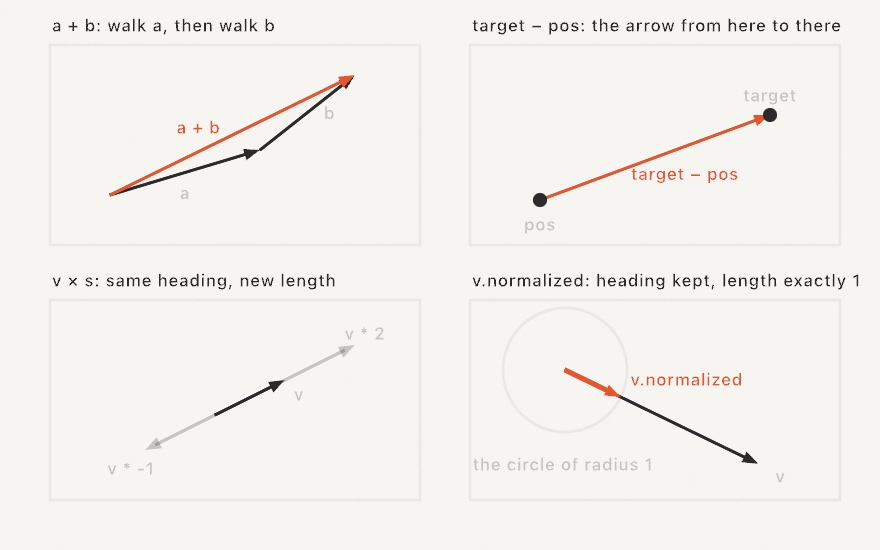
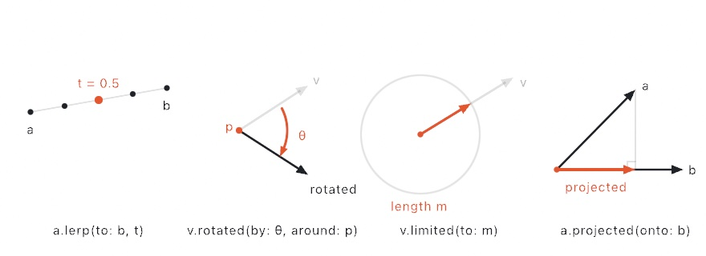
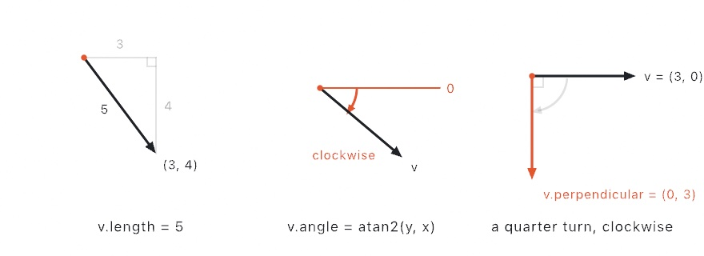
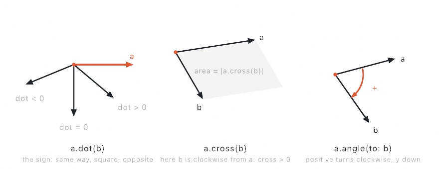
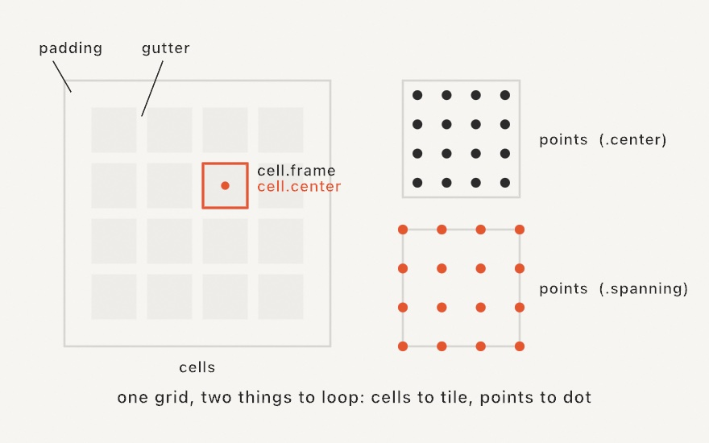
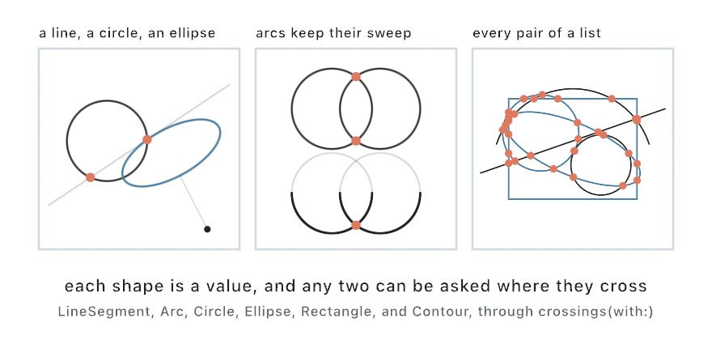
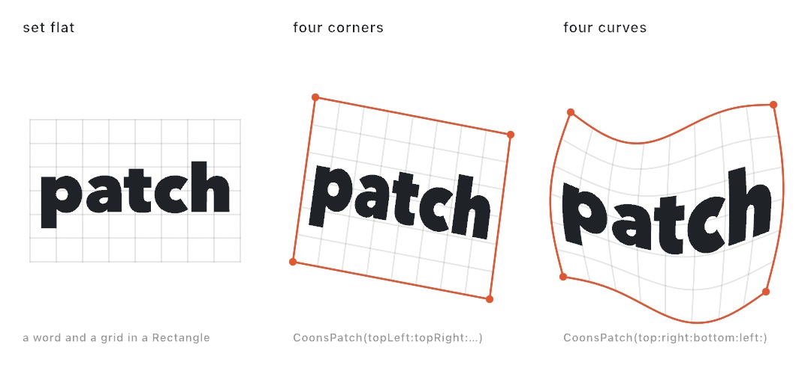
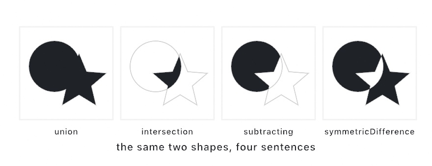
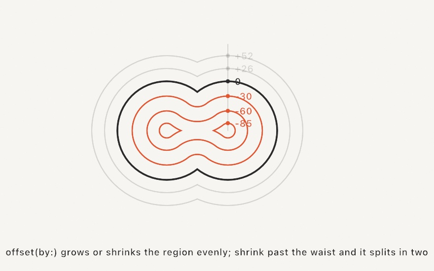
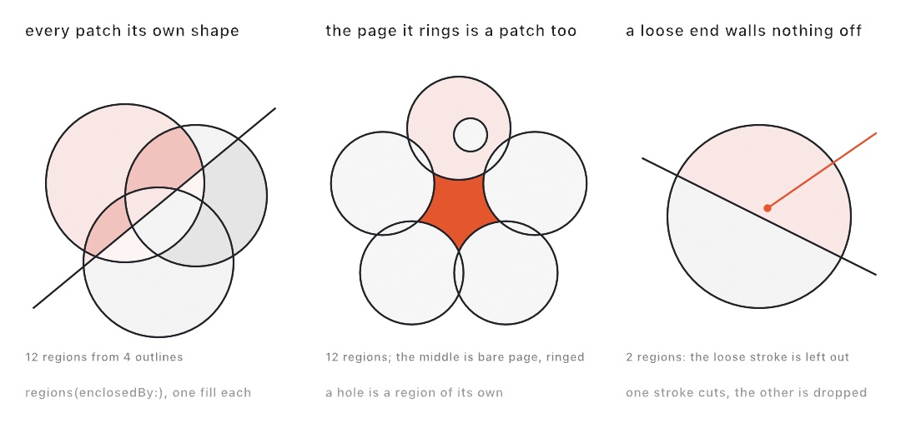

#### <sup>[Ollin](../../README.md) → [Documentation](../README.md) → [Drawing](./README.md) → `Geometry`</sup>

---

## Geometry

`Vector2`, `Vector3`, `Rotation3D`, `Ray3`, `Rectangle`, `Circle`, `LineSegment`, `Arc`, `Ellipse`, `Contour`, `Shape`, and `Path` are Ollin's geometry value types. Primitives take them as data, and you pass them around and compose them. Canvas coordinates use a top-left origin, with y increasing downward. The two vector types share most of their surface through the `Vector` protocol, so it is documented once below and each type's own section is short.

### Contents

- [Vectors](#vector)
  - [Constants](#v-constants)
  - [Length & direction](#v-length)
  - [Arithmetic](#v-arithmetic)
  - [Measuring between two vectors](#v-measuring)
  - [Producing new vectors](#v-producing)
  - [Putting it together](#v-together)
- [What `Vector2` adds](#vector2)
- [What `Vector3` adds](#vector3)
- [Rotation3D](#rotation3d)
- [Ray3](#ray3)
- [Box3](#box3)
- [Rectangle](#rectangle)
- [Grid](#grid)
- [Insets](#insets)
- [Circle](#circle)
- [LineSegment](#linesegment)
- [Arc](#arc)
- [Ellipse](#ellipse)
- [Where curves cross: PlaneCurve](#plane-curves)
- [Contour](#contour)
  - [Asking an outline questions](#contour-questions)
  - [Lighter, reversed, rounded, and cut](#contour-edits)
  - [Bent along a curve, pulled, smoothed with its corners, split, and fitted](#contour-bending)
- [CoonsPatch: an outline bent into a curved patch](#coons-patch)
- [Shape](#shape)
  - [Points inside one](#shape-points)
  - [Set operations](#shape-booleans)
  - [Offsetting](#shape-offset)
  - [Stroke as shape](#shape-stroked)
  - [Cut by a line](#shape-cut)
- [The regions a drawing encloses](#regions)
- [Convex hull](#convex-hull)
- [Path](#path)
- [HobbySpline](#hobby)

<a name="vector"></a>

### Vectors

`Vector2` is an `(x, y)` point in sketch points, and `Vector3` an `(x, y, z)` point in space. Primitives like `drawPolyline`, `drawCircle(center:)`, and `drawLine` take a `Vector2`. A value that lives in space, such as a 3D body joint in meters or a point of a depth cloud, arrives as a `Vector3`. Either one is both a **point** (a location) and a **vector** (an arrow with a direction and a length). Each method below uses whichever reading fits.

```swift
Vector2(_ x: Double, _ y: Double)
Vector2(x: Double, y: Double)
Vector3(_ x: Double, _ y: Double, _ z: Double)
Vector3(x: Double, y: Double, z: Double)
```

Nearly everything you call on one means the same thing on the other, so it is written once, on a `Vector` protocol the two share. This section is that shared surface, and a helper you write against `Vector` takes either type:

```swift
func midpoint<V: Vector>(_ a: V, _ b: V) -> V { a.lerp(to: b, 0.5) }

midpoint(Vector2(0, 0), Vector2(10, 4))         // Vector2(5, 2)
midpoint(Vector3(0, 0, 0), Vector3(10, 4, 2))   // Vector3(5, 2, 1)
```

Two short sections follow it: [what `Vector2` adds](#vector2) and [what `Vector3` adds](#vector3). The one to know is `cross`, which comes back as a different *kind* of value in each.

<a name="v-constants"></a>

**Constants:** `.zero` (every component `0`), `.one`, `.unitX`, `.unitY`, plus `.unitZ` on `Vector3`.

**A note on orientation.** Ollin's y-axis points down, because the origin sits at the top left. That is the opposite of the math-class convention, where y points up. The formulas are the same, but the direction of rotation looks flipped on screen. A positive angle turns clockwise as you watch it, and so does anything the usual math convention calls "counter-clockwise". The diagrams below are drawn in screen space, with y down, to match what you see. See [Where a point is](../Concepts/Coordinates.md) for this frame, its units, and how to convert a point that arrived in some other frame.

<picture>
  <source media="(prefers-color-scheme: dark)" srcset="../../Guide/Images/01-HelloOllin/CoordinateSystem-dark.jpg">
  
</picture>

<a name="v-length"></a>

#### Length & direction

**`length` / `lengthSquared`** measure how far the point is from the origin, which is how long the arrow is. The formula is the Pythagorean theorem, the hypotenuse of the right triangle with sides `x` and `y`, so `(3, 4)` has length `√(3² + 4²) = 5`. `lengthSquared` leaves out the square root, giving `25` here, and you use it when you only need to compare.

**In a sketch:** turn a distance or a speed into something you can see. A dot can grow as the mouse nears, or a trail can react to how fast it moves (`velocity.length`). The first panel of the figure under [what `Vector2` adds](#vector2) draws that triangle.

**`normalized`** is the same direction rescaled to length exactly 1, a "unit vector". Each component is divided by the length, so `(3, 4)` becomes `(0.6, 0.8)`. Use it when you want a direction on its own and will set the length yourself. It returns `.zero` if the vector has no length to scale.

**In a sketch:** this is how you move toward a target. `pos += (target - pos).normalized * speed` steps a fixed amount in the right direction, however far the target is.

Naming a direction as one number, and turning by one angle, need a plane to happen in, so `angle`, `perpendicular`, and `rotated(by:)` are [what `Vector2` adds](#vector2). In space a turn takes an axis as well, which is [`Rotation3D`](#rotation3d).

<a name="v-arithmetic"></a>

#### Arithmetic

<picture>
  <source media="(prefers-color-scheme: dark)" srcset="../../Guide/Images/10-Vectors/VectorArithmetic-dark.jpg">
  
</picture>

**`+`, `-`, unary `-`** add two vectors *head to tail*, and subtract to get the step between two points. `a - b` is the step from `b` to `a`. Unary `-` keeps the length and flips the direction. The in-place forms `+=` and `-=` are there too, and they are what `pos += vel` uses.

**In a sketch:** `target - pos` is the arrow pointing from one point to another, and every chase, spring, and look-at starts there. `pos += velocity` is how anything moves.

**`*` / `/` by a scalar** stretch or shrink the arrow and keep its direction. A negative scalar flips it. For `*` the scalar can sit on either side. The in-place forms `*=` and `/=` are there too.

**In a sketch:** set how big a step is. Use `direction * speed` to go faster, or `* deltaTime` so motion runs the same on any machine.

<a name="v-measuring"></a>

#### Measuring between two vectors

**`distance(to:)` / `distanceSquared(to:)`** measure the straight-line distance between two points. This is the same Pythagoras as `length`, applied to `a − b`. The squared form skips the `√`, so use it when you only need to compare.

**In a sketch:** this drives proximity effects. Connect dots closer than N, fade things by how near they are, or push neighbors apart when they crowd. Use the squared form inside big loops to skip the slow `√`.

**`dot(_:)`** is one number measuring how much two vectors point the *same way*. It is `ax·bx + ay·by` (with `+ az·bz` in space), which equals `|a|·|b|·cos θ`. The sign alone tells you the rough relationship: positive under 90° (aiming similar ways), zero at exactly 90°, and negative past it (aiming opposite ways).

**In a sketch:** this answers "same way or opposite?" and "in front of me or behind?". Simple lighting is built on it, since it measures how squarely a surface faces the light, and so are field-of-view checks.

The first panel of the second figure under [what `Vector2` adds](#vector2) draws the sign. The other classic measure, `cross(_:)`, is the one that does not generalize: it is a number in the plane and a vector in space. Both are below.

<a name="v-producing"></a>

#### Producing new vectors

**`lerp(to:_:)`** slides from `a` toward `b` by a fraction `t` (`0` = `a`, `1` = `b`). `t = 0.5` is the midpoint, and `t` past `0…1` extrapolates.

<picture>
  <source media="(prefers-color-scheme: dark)" srcset="../Images/VectorMoves-dark.jpg">
  
</picture>

**In a sketch:** this is the simplest smooth follow. `pos = pos.lerp(to: target, 0.1)` makes anything glide after the mouse with a soft lag. It also gives you midpoints and in-betweens.

**`limited(to:)`** clamps the length to a maximum and keeps the direction. Shorter vectors pass through untouched, which is what makes it a velocity cap.

**In a sketch:** keep speeds from growing without bound. `vel = vel.limited(to: maxSpeed)` is what keeps flocking and steering stable.

**`projected(onto:)`** is the part of `a` that lies along `b`, its shadow cast straight down onto `b`'s line. Drop a perpendicular from `a`'s tip, and its foot marks the projection.

**In a sketch:** snap a point onto a guide line, or find the nearest spot on a path. It also splits a bounce into "along the wall" and "into the wall".

**`with(x:)` / `with(y:)`** return a copy with one component replaced and the others kept, and `Vector3` adds `with(z:)`. `p.with(y: 0)` flattens a point onto the top edge.

**In a sketch:** pin one axis. Drop points to the top edge with `.with(y: 0)`, or let x scroll while y holds still.

**`points.centroid`** works on any collection of vectors, of either type. It gives the centroid, the arithmetic mean of the points, or `nil` when the collection is empty. It averages the points themselves, so the centroid is pulled toward wherever the vertices crowd. For a polygon outline, that means it is not the area's center of mass.

**In a sketch:** find the center of a cluster, or a flock's middle to steer toward. It also gives the center of a tracker's landmark points, such as an eye region's loop or a quad's corners.

<a name="v-together"></a>

#### Putting it together

```swift
let a = Vector2(100, 100)
let b = a + Vector2(angle: .pi / 4, length: 80)   // 80 units out at 45°
drawLine(a, b)

let dir = (b - a).normalized        // unit direction from a to b
let mid = a.lerp(to: b, 0.5)        // the midpoint
var p = a
p += dir * 10                       // step 10 units toward b
```

<a name="vector2"></a>

### What `Vector2` adds

The members that need a plane to mean anything. A direction there is a single number, there is exactly one perpendicular, a turn needs no axis to name it, and a cross product has nowhere perpendicular to point.

<picture>
  <source media="(prefers-color-scheme: dark)" srcset="../Images/VectorHeading-dark.jpg">
  
</picture>

**`angle`** gives the direction as one number, the angle of the arrow from the `+x` axis, in radians (`atan2(y, x)`). It grows clockwise on screen, because `+y` points down. `Vector2(angle:length:)` is the inverse, and builds an arrow from an angle and a length.

```swift
Vector2(angle: Double, length: Double = 1)   // polar: `length` units at `angle` radians
```

**In a sketch:** point a shape the way it's heading. Call `rotate(velocity.angle)` before you draw, so an arrow or a fish faces where it's going.

**`perpendicular`** is a quarter turn. It swaps and negates the components, so `(x, y)` becomes `(−y, x)`, and `(3, 0)` becomes `(0, 3)`. That turn is clockwise on screen, with y down. Use it to offset to the side of a line, for example to give a stroke its width.

**In a sketch:** this is the sideways direction. Step out both ways from a freehand line to give it thickness, or use it to make something strafe or orbit.

<picture>
  <source media="(prefers-color-scheme: dark)" srcset="../Images/VectorMeasures-dark.jpg">
  
</picture>

**`cross(_:)`** is the 2D "perp-dot", `ax·by − ay·bx`, and it is one number, not a vector. Its *magnitude* is the area of the parallelogram the two vectors span. Its *sign* gives the turn direction from `a` to `b`. It is positive when `b` is clockwise from `a`, as seen on screen with y down. It is negative when `b` is counter-clockwise, and zero when the two are parallel and the area collapses. This is the same quantity [`Vector3.cross`](#vector3) puts in its `z`, which is the whole of the 2D answer once there is no third axis to point along.

**In a sketch:** the sign answers "is the target on my left or my right?". A creature can then turn the short way toward it. Summed around a shape's points, it gives the area and the direction the shape winds.

**`angle(to:)`** is the *signed* angle from `a` to `b`, in `−π…π`. It is `atan2(cross, dot)`. Unlike `b.angle − a.angle`, it never wraps, and it tells you which way to turn. A positive result turns clockwise on screen, and a negative one turns the other way. There is no sign to give in space without an axis to measure against, which is why this one is 2D's.

**In a sketch:** swivel to face something smoothly. Rotate by a fraction of `heading.angle(to: toTarget)` each frame and a creature tracks the mouse.

**`rotated(by:)` / `rotated(by:around:)`** spin the arrow by an angle (positive turns clockwise, y-down), about the origin or about a given pivot point. The second panel of [Producing new vectors](#v-producing) draws the pivot form.

**In a sketch:** lay things out in a ring, orbit a moon around a planet, or swing a clock hand with `rotated(by:around:)` about its pivot.

<a name="vector3"></a>

### What `Vector3` adds

A third axis, and what comes with it.

- **`.unitZ`**, `(0, 0, 1)`, beside the shared constants.
- **`cross(_:)`** returns a `Vector3` perpendicular to both, with length the area of the parallelogram they span. In space there *is* somewhere perpendicular to point, so the answer is a direction: a surface normal, a frame's third axis, a torque. The 2D version keeps only the signed magnitude.
- **`xy`** drops the depth, which projects the value back onto the canvas plane.
- **Turning one:** `rotated(by:)` takes a [`Rotation3D`](#rotation3d), because a turn in space needs an axis as well as an angle. The single-angle helpers stay on `Vector2`.

What the axes mean, which way is up and where the origin sits, belongs to whatever produced the value. A producer like [`Body3D`](../Vision/Vision.md#body3d) documents its own spaces.

```swift
let joint = Vector3(0.2, 1.4, -0.3)          // meters, say
drawCircle(center: center + joint.xy * 200, radius: 6)        // front view: drop the z
drawCircle(center: center + Vector2(joint.z, -joint.y) * 200, radius: 6)   // side view: look along x
```

<a name="rotation3d"></a>

### `Rotation3D`

A turn in space as one value: how far, and about which axis. It is what a 3D body faces by ([`Body3D.rotation`](../Simulation/Physics3D.md#body3d)), what a wheel is posed with, and what `rotate(_:)` draws with. Underneath it is a unit quaternion, so two turns compose without the trouble three separate angles run into. You still read it as an angle and an axis.

```swift
Rotation3D(angle: Double, axis: Vector3)      // right-handed, like rotate(_:axis:)
Rotation3D(from: Vector3, to: Vector3)        // the shortest turn taking one direction to the other
Rotation3D.aboutX(_:) / .aboutY(_:) / .aboutZ(_:)
Rotation3D.euler(x:y:z:)                      // three angles, composed as rotateX, rotateY, rotateZ would be, in that order
Rotation3D.identity                           // no turn
Rotation3D(x:y:z:w:)                          // from quaternion parts, for a value that arrives that way
```

- **Reading it:** `angle` in radians, from `0...π`, and `axis` at unit length. A turn of nothing has no axis of its own, so `axis` reads `unitY` there.
- **Composing:** `a * b` turns by `b` first and then by `a`, the way matrices multiply, so a chain reads right to left. `inverse` undoes a turn. `interpolated(to:_:)` is the turn part of the way toward another one, along the shortest arc and at a steady rate.
- **Applying it:** `vector.rotated(by:)` turns a `Vector3`. `rotate(_:)` on the sketch composes it onto the [3D transform stack](../3D/3D.md#transforms). `matrix` is the same turn as the 4×4 `transform(_:)` takes.
- **One form per turn.** A quaternion and its negation are the same turn, so the value keeps `w` non-negative. Two equal turns compare equal however they were built.

```swift
let tilt = Rotation3D(angle: .pi / 6, axis: .unitZ)
crate.rotation = .aboutY(time) * tilt          // spin about y, then tilt
let up = Vector3.unitY.rotated(by: crate.rotation)
let aim = Rotation3D(from: .unitZ, to: target - eye)   // point the z-axis at something
```

<a name="ray3"></a>

### `Ray3`

A straight line in space, given as the point it starts at and the direction it runs in. It carries the tests that ask what it hits. Use it whenever something *points at* something else: a [phone held as a wand](../3D/Phone.md#the-phone-as-a-pointer), a camera's sight line, or a click carried into a scene.

```swift
Ray3(origin: Vector3, direction: Vector3)     // direction is scaled to length 1
Ray3(from: Vector3, toward: Vector3)
```

The direction is kept at length 1, so every distance a hit reports is a real distance in the same units as the origin. `point(at:)` then reads as "this far along". A hit is only counted **in front of** the origin, so a body behind you never answers.

- **Along the line:** `point(at:)` is the point that far out. `distanceAlong(_:)` is how far along a point sits, and it goes negative behind the origin. `distance(to:)` is how far off the line a point sits, measured square to the line.
- **What it hits:** `hit(sphereAt:radius:)`, `hit(boxAt:size:)` (axis-aligned, with `size` the whole width, height, and depth), and `hit(planeAt:normal:)`. Each one returns the distance to the first meeting, or `nil` for a miss.
- **The edge cases have answers, not crashes.** A ray with no direction hits nothing. A ray starting inside a ball reports the far side, so what it returns is never behind the origin. A ray running parallel to a box's faces is judged by whether it sits inside that slab.

```swift
let ray = Ray3(origin: eye, direction: target - eye)
if let distance = ray.hit(sphereAt: ball, radius: 0.2) {
    let landing = ray.point(at: distance)
    drawTube([ray.origin, landing], radius: 0.004)
}
```

Its 2D counterpart is [`Ray2`](./Envelopes.md). That type carries a family of lines rather than a pointer, and it leaves its direction as given.

<a name="box3"></a>

### `Box3`

An axis-aligned box in space, given as a `min` corner and a `max` corner. Those two hold the smallest and largest coordinate on every axis. It is what a mesh or a scene reports as its bounds, what a metaball field reaches, and the region a surface is marched over. Like `Rectangle` on the canvas, it is a value you pass around and compose.

```swift
Box3(min: Vector3, max: Vector3)
Box3(center: Vector3, size: Vector3)
Box3(containing: [Vector3])                   // nil for no points
```

- **Reading it:** `center`, `size` (width, height, and depth as one `Vector3`), `longestSide`, `isEmpty` (no volume), and `contains(_:)`, with the faces counting as inside.
- **Deriving one:** `padded(by:)` grows the box by that much on every side, and a negative amount shrinks it. `union(_:)` is the smallest box holding both, and `intersects(_:)` says whether two boxes share any point, faces that touch included.
- **Where it appears:** `Mesh.bounds`, `Scene.bounds`, and the phone room's mesh and planes each report one, and it is `.zero` when there is nothing yet. `Metaballs.bounds` is optional, because a field with no balls has no reach. `isosurface(at:in:resolution:)` and `shadowArt(in:)` march over one.

```swift
let room = scan.bounds
camera(.orbiting(target: room.center, radius: room.longestSide * 0.9))

let field = isosurface(at: 0.5, in: Box3(center: .zero, size: Vector3(4, 4, 4)), resolution: 64) { p in
    fbm(p.x, p.y, p.z, octaves: 4)
}
```

<a name="rectangle"></a>

### `Rectangle`

An axis-aligned rectangle, given as a `corner` plus `width` and `height`. This is the typed form `drawRect` takes, and the bare scalar `drawRect(x, y, width, height)` is sugar over it.

```swift
Rectangle(corner: Vector2, width: Double, height: Double)
Rectangle(x: Double, y: Double, width: Double, height: Double)
Rectangle(center: Vector2, width: Double, height: Double)
Rectangle(fitting size: Vector2, in container: Rectangle)
Rectangle(covering size: Vector2, in container: Rectangle)
```

- **Properties:** `corner`, `width`, `height`, `x`, `y`, `center`, `area`, `perimeter`.
- **Corners:** `topLeft`, `topRight`, `bottomRight`, `bottomLeft`.
- **Outline:** `contour`, the four corners as a closed `Contour`, top left first and clockwise, ready for a `Shape`, a boolean, or [`regions(enclosedBy:)`](#regions); `edges`, the four sides as `LineSegment`s in that order.
- **Crossings:** [`crossings(with:)`](#plane-curves) against any other curve.
- **Test:** `contains(_ point: Vector2)` (the boundary counts as inside).
- **Overlap:** `intersects(_ other: Rectangle)`, whether two rectangles share any point (touching along an edge or at a corner counts); `intersection(_:)`, the rectangle they share, or nil; `union(_:)`, the smallest rectangle holding both. A [`BoundsIndex`](./BoundsIndex.md) asks these of thousands of rectangles at once.
- **Inset:** `inset(by: Insets)`, the rectangle shrunk inward by a per-edge margin (see [`Grid`](#grid)).
- **Normalized coordinates:** `point(u:v:)` is the point at 0…1 fractions of the rectangle, so `point(u: 0.5, v: 0.5)` is `center`, and values outside 0…1 land proportionally outside. Its inverse is `uv(of:)`. The canvas-wide sugar is [`uv(u, v)`](../Core/Canvas.md#uv), and the curved counterpart, a four-sided region whose sides are curves, is [`CoonsPatch`](#coons-patch).

`Rectangle(fitting:in:)` is the letterbox fit, the largest rectangle of `size`'s aspect ratio centered inside `container`. Draw an image or video frame into that box and it will not stretch, which is the fit behind `drawFrame` and `fittedRectangle(in:)`. `Rectangle(covering:in:)` works the other way. It is the *smallest* rectangle of that shape that covers the container, so it runs past two edges. What falls outside is meant to be cropped. The two are what [`drawImage`'s](Images.md#fit) `.contain` and `.cover` are built on.

```swift
let box = Rectangle(center: center, width: 200, height: 120)
drawRect(box)
let p = randomVector(in: box)       // a random point inside it
```

<a name="grid"></a>

### `Grid`

A regular grid of `columns × rows` over a rectangle. It replaces the margin-then-nested-loop boilerplate so many sketches repeat. `Grid` is geometry, not a draw call. It gives you two things, and you loop over whichever you are drawing: the **points** (the dots) or the **cells** (the rectangles). Each element carries its `column` and `row`, so **one** loop covers the indexed cases too, with no nested `for`.

```swift
Grid(in: Rectangle, columns: Int, rows: Int, padding: Insets = .zero, gutter: Double = 0, distribution: Distribution = .center)
grid(columns: Int, rows: Int, padding: Insets = .zero, gutter: Double = 0, distribution: Distribution = .center)   // Sketch sugar, over the canvas
```

The `Sketch` form `grid(columns:rows:…)` lays the grid over the canvas `bounds`. The `Grid(in:…)` initializer takes any rectangle instead, so a grid can fill a render target or a single cell, because grids nest. `padding` insets the whole grid from the edges, and `gutter` is the gap *between* cells.

The labeled comparison sheet is its own call. `drawSheet(_:columns:gutter:_:)` lays a list of `(label, item)` pairs into a near-square grid over the canvas. It hands each item's cell to your closure to draw, and it sets each label on a dark plate along its cell's bottom edge. Use it for a filter gallery, a palette lineup, or a parameter sweep:

```swift
drawSheet(filters.map { ($0.name, $0) }) { filter, cell in
    drawImage(scene.filtered(filter).image, in: cell)
}
```

Leaving `columns` out picks the near-square count. `gutter` defaults to 1% of the canvas width. Labels use the current `textFont`, and the state around the call is untouched.

- **Layout:** `bounds` (the region the cells fill, after `padding`), `columns`, `rows`, `gutter`, `cellWidth`, `cellHeight`, `cellSize`.
- **Points:** `points` is every dot (`[Point]`, row-major). Each one carries a `column`, a `row`, and a `position`, laid out according to the grid's `distribution` (below). Use `point(column:row:)` for one.
- **Cells:** `cells` is every cell (`[Cell]`, row-major). Each one carries a `column`, a `row`, a true `center`, and a `frame` rectangle. Use `cell(column:row:)` for one.

A grid *is* its cells, so it is a `RandomAccessCollection` of `Cell` in that same row-major order. Looping the grid itself is the short way to say it, and it works each cell out as it is asked for, so it builds no array at all:

```swift
let g = grid(columns: 12, rows: 8, padding: 40)
for cell in g { drawRect(cell.frame) }         // the same cells, nothing allocated
let howMany = g.count                          // columns × rows
let diagonal = g.filter { $0.column == $0.row }
let one = g.randomElement(using: &randomness)  // one cell, on the sketch's seed
```

`cells` is still there for when an array is what you need. `HexGrid` and `TriangleGrid` read the same way.

Loop over whichever you are drawing, and the indices come with it, so a checkerboard or a hue-by-position is still one loop:

```swift
for dot in grid.points {                          // dots
    drawCircle(center: dot.position, radius: 6)
}
for cell in grid.cells {                          // cells, with indices
    fill((cell.column + cell.row) % 2 == 0 ? .white : .black)
    drawRect(cell.frame)
}
```

**Cells or dots: `distribution`.** A grid gives you the same `columns × rows` count either way. `distribution` only chooses where the **points** fall, since `cells` always tile the bounds:

- `.center` (default): one dot at the center of each cell, inset half a cell from the edges. This is the "a thing in every cell" layout.
- `.spanning`: the dots form a lattice spanning the bounds edge to edge. The outer ones sit on the boundary, and the four corners land on the rectangle's corners. This is the "grid of dots" layout, for when you want the dots to reach the edges rather than float inside. `gutter` does not apply here, because spanning dots span the full bounds.

<picture>
  <source media="(prefers-color-scheme: dark)" srcset="../../Guide/Images/06-GridsAndRepetition/GridAnatomy-dark.jpg">
  
</picture>

```swift
for dot in grid(columns: 24, rows: 24, padding: 60, distribution: .spanning).points {
    drawCircle(center: dot.position, radius: 6)   // dots reaching the edges
}
```

**Gaps between cells: `gutter`.** `padding` is the margin around the whole grid, and `gutter` is the gap *between* cells, where 0 means they touch. Here is a contact sheet of tiles with an even gap inside and between them:

```swift
let g = grid(columns: 3, rows: 2, padding: .all(12), gutter: 12)
for cell in g.cells {
    drawImage(thumbnails[cell.row * g.columns + cell.column], in: cell.frame)
}
```

Grids nest, because a cell's `frame` is another `Rectangle`:

```swift
for cell in grid(columns: 4, rows: 4, padding: 20).cells {
    for sub in Grid(in: cell.frame, columns: 3, rows: 3, padding: 6).cells {
        drawRect(sub.frame)
    }
}
```

<a name="insets"></a>

### `Insets`

A per-edge margin in sketch points: `top`, `right`, `bottom`, and `left`. It is what a `Grid`'s `padding` and `Rectangle.inset(by:)` take. Build it the way the layout reads:

```swift
.all(20)                                 // every edge
.symmetric(horizontal: 40, vertical: 20) // left/right vs top/bottom
.horizontal(40)                          // left and right only
.vertical(20)                            // top and bottom only
Insets(top: 10, right: 0, bottom: 30, left: 0)
```

A bare number is an even inset on every edge, so `padding: 20` reads as `.all(20)`:

```swift
let g = grid(columns: 12, rows: 8, padding: 24)   // 24pt margin all around
```

<a name="circle"></a>

### `Circle`

A circle, given as a `center` plus a `radius`. This is the typed form `drawCircle(_:)` takes, and the bare scalar `drawCircle(x, y, radius)` is sugar over it. The [`drawCircles`](../Drawing/Drawing.md#batches) batch call draws an array of them.

```swift
Circle(center: Vector2, radius: Double)
Circle(x: Double, y: Double, radius: Double)
```

- **Properties:** `center`, `radius`, `x`, `y`, `diameter`, `area`, `perimeter`, `bounds` (the bounding `Rectangle`).
- **Test:** `contains(_ point: Vector2)`.
- **On it:** `point(at angle:)`, the point at an angle in radians from the positive x-axis, clockwise as the canvas shows it; `nearestPoint(to:)` and `distance(to:)`, the nearest place on the outline and how far a point is from it.
- **Outline:** `contour(segments:)`, the circle as a closed `Contour` of straight pieces, starting at the right and running clockwise. Left to its default, the count follows the radius so no piece strays more than a tenth of a unit from the circle (8 pieces for a tiny ring, up to 256), the same limit `rounded(_:)` flattens an arc to. That is the outline a `Shape`, a boolean, or [`regions(enclosedBy:)`](#regions) takes; `contour` alone is the default count.
- **Crossings:** [`crossings(with:)`](#plane-curves) against any other curve.

```swift
let dot = Circle(center: center, radius: 60)
drawCircle(dot)
if dot.contains(Vector2(mouseX, mouseY)) { /* pointer is inside */ }
```

<a name="linesegment"></a>

### `LineSegment`

A straight piece of line between two points: the typed form `drawLine(_:)` takes, with the bare `drawLine(x1, y1, x2, y2)` and `drawLine(a, b)` as sugar over it. A segment has two ends. The line through a point in a direction, with no ends, is [`Ray2`](Envelopes.md).

```swift
LineSegment(_ start: Vector2, _ end: Vector2)
LineSegment(_ x1: Double, _ y1: Double, _ x2: Double, _ y2: Double)
```

- **Properties:** `start`, `end`, `length`, `vector` (`end - start`), `direction` (the unit vector from `start` toward `end`), `angle` (radians), `midpoint`, `bounds`.
- **Along it:** `point(at: t)`, the point a fraction `0...1` of the way from `start` to `end`, clamped to the segment; `fraction(of:)`, its inverse, which for a point beside the segment is the nearest fraction.
- **Nearest:** `nearestPoint(to:)`, `distance(to:)`.
- **Outline:** `contour`, the two points as an open `Contour`; `reversed()`, the same segment run the other way.
- **Crossings:** [`crossings(with:)`](#plane-curves) against any other curve.

```swift
let edge = LineSegment(Vector2(100, 900), Vector2(980, 160))
drawLine(edge)
for hit in edge.crossings(with: Circle(center: center, radius: 200)) {
    drawCircle(center: hit, radius: 6)
}
```

<a name="arc"></a>

### `Arc`

A piece of a circle: a `center`, a `radius`, and the two angles it runs between, `start` to `stop`. The angles are in radians from the positive x-axis, increasing clockwise as the canvas shows it, the same angles [`drawArc`](Drawing.md#arc) takes. `drawArc(_ arc:mode:)` draws one, closed the way `mode` says (the curve alone by default). A `stop` smaller than `start` runs the other way round, so the same two angles name either of the two arcs between them.

```swift
Arc(center: Vector2, radius: Double, start: Double, stop: Double)
Arc(x: Double, y: Double, radius: Double, start: Double, stop: Double)
```

- **Properties:** `center`, `radius`, `start`, `stop`, `sweep` (`stop - start`, negative when the arc runs counterclockwise), `length`, `circle` (the whole circle), `startPoint`, `endPoint`, `midpoint`, `chord` (a `LineSegment` between the ends), `bounds` (the box round the curve itself).
- **Along it:** `point(at: t)`, the point a fraction `0...1` of the way along the sweep; `contains(angle:)`, whether an angle lies on the arc (angles a whole turn apart are the same angle, and either end counts).
- **Nearest:** `nearestPoint(to:)`, `distance(to:)`.
- **Outline:** `contour`, the arc as an open polyline, flattened by the same rule as a circle; `contour(mode:segments:)`, closed by a chord or through the center the way the draw call's `ArcMode` closes it, with the number of pieces fixed if you give one.
- **Crossings:** [`crossings(with:)`](#plane-curves) against any other curve, only on the sweep.

```swift
let smile = Arc(center: center, radius: 120, start: .pi * 0.15, stop: .pi * 0.85)
drawArc(smile)
drawCircle(center: smile.midpoint, radius: 6)
```

<a name="ellipse"></a>

### `Ellipse`

An ellipse: a `center`, the half-widths `radiusX` and `radiusY` along its own two axes, and a `rotation`. The rotation is in radians and turns those axes clockwise as the canvas shows it. This is the typed form `drawEllipse(_:)` takes. At a `rotation` of 0 it is what `drawEllipse(x, y, radiusX, radiusY)` draws, and with one the draw call turns it for you.

```swift
Ellipse(center: Vector2, radiusX: Double, radiusY: Double, rotation: Double = 0)
Ellipse(x: Double, y: Double, radiusX: Double, radiusY: Double, rotation: Double = 0)
```

- **Properties:** `center`, `radiusX`, `radiusY`, `rotation`, `area`, `perimeter`, `eccentricity` (0 for a circle, toward 1 as it flattens), `bounds` (exact under the rotation).
- **Test:** `contains(_ point: Vector2)` (the outline counts as inside).
- **On it:** `point(at angle:)`, the point at a *parametric* angle (`radiusX * cos` along one axis and `radiusY * sin` along the other, turned by `rotation`), which is not the polar angle of the point from the center except on a circle; `nearestPoint(to:)` and `distance(to:)`.
- **Outline:** `contour(segments:)`, starting at the end of the x axis and running clockwise, flattened by the same rule as a circle of the larger radius; `contour` alone is the default count.
- **Crossings:** [`crossings(with:)`](#plane-curves) against any other curve.

`perimeter` is exact to double precision, not a formula's guess. It is the complete elliptic integral of the second kind, taken through Gauss's arithmetic-geometric mean, which doubles its correct digits at every step. Ramanujan's approximation, the usual shortcut, is a few parts in ten thousand off on a very flat ellipse.

```swift
let dish = Ellipse(center: center, radiusX: 260, radiusY: 110, rotation: .pi / 8)
drawEllipse(dish)
let dots = Int(dish.perimeter / 12)                 // one dot every 12 points round it
for i in 0 ..< dots { drawCircle(center: dish.point(at: Double(i) / Double(dots) * .tau), radius: 3) }
```

<a name="plane-curves"></a>

### Where curves cross: `PlaneCurve`

`LineSegment`, `Arc`, `Circle`, `Ellipse`, `Rectangle`, `Triangle`, and `Contour` share one protocol. A `PlaneCurve` has a `contour`, the outline every other geometry question takes, and it can say where it meets another:

```swift
func crossings(with other: some PlaneCurve) -> [Vector2]
```

<picture>
  <source media="(prefers-color-scheme: dark)" srcset="../../Guide/Images/15-ShapesAsMaterial/CurvesThatCross-dark.jpg">
  
</picture>

The points come back sorted along the curve you asked. A segment or an arc counts from its start, and a contour along its walk. A circle or an ellipse counts from its right going clockwise, and a rectangle or a triangle from its first corner. A touch counts as a crossing. Two curves that run along each other share no single point and report nothing for that stretch. A mixed list works the same way, since every member is a `PlaneCurve`:

```swift
let road = LineSegment(Vector2(0, 300), Vector2(1080, 420))
let pond = Circle(center: Vector2(540, 380), radius: 160)
let dish = Ellipse(x: 300, y: 500, radiusX: 220, radiusY: 90, rotation: 0.4)
let bow = Arc(center: center, radius: 400, start: .pi, stop: 2 * .pi)
let curves: [any PlaneCurve] = [road, pond, dish, bow]
for i in curves.indices {
    for j in curves.indices where j > i {
        for hit in curves[i].crossings(with: curves[j]) { drawCircle(center: hit, radius: 6) }
    }
}
```

Every pair with a closed form is answered from it, exactly. That covers anything made of straight pieces (a segment, a rectangle, a triangle, a contour) against anything else made of them. It also covers those against a circle, an arc, or an ellipse, and circles and arcs against each other. An ellipse against a circle, an arc, or another ellipse is found on the two outlines first. The points are then polished onto the true curves to machine precision. So a bare touch, or two crossings closer together than the outlines' own pieces, may come back as one or none. A contour asked about another contour keeps its own [`crossings(with:)`](#contour-questions), which also says how far along each walk the point sits.

Worked example: [`Examples/Shapes/Crossings`](../../Examples/Shapes/Crossings/Sketch.swift), six drifting shapes with a dot on every meeting and a probe dropped to the nearest place on each. The Guide teaches the family in [Chapter 15](../../Guide/15-ShapesAsMaterial.md#shapes-that-know-where-they-cross-segments-arcs-and-ellipses).

<a name="contour"></a>

### `Contour`

One connected path, an ordered run of points, either open (a stroked path) or closed (a fillable outline). It is polygonal, with straight segments between the points. A `Shape` is built out of contours. To author a *curved* outline, use [`Path`](#path), or the `curveThrough` initializer below, which fits a smooth spline through the points.

```swift
Contour(_ points: [Vector2], closed: Bool = true)
Contour(curveThrough points: [Vector2], closed: Bool = true, spline: Spline = .catmullRom)   // smooth curve through the points

var length: Double              // distance along the segments (closed: plus the return leg)
func point(at t: Double) -> Vector2   // the point a fraction t along, by walked length (wraps when closed)
var midpoint: Vector2           // point(at: 0.5)
func resampled(spacing: Double) -> Contour   // points respaced evenly along the walk
func contains(_ point: Vector2) -> Bool      // is the point inside the outline?
```

`point(at:)` walks a contour's own points by length. On an open contour it clamps `t` to `0...1`. A closed one wraps it, so `1.25` is a quarter of the way round again and `point(at: time * 0.1)` runs round the loop for good. `tangent(at:)`, `normal(at:)`, and `piece(from:to:)` read their fractions the same way. A curve you write as a function instead, such as a Lissajous figure, is walked at one speed by a `Pace`, and the same walk in space is a `Curve3D`. Both are on [Sweeps and strips](../3D/Sweeps.md).

A contour is a run of points, and it says so: it is a `RandomAccessCollection` of its `Vector2`s, so the standard library reaches it without a detour through `points`.

```swift
let contour = Contour([Vector2(60, 60), Vector2(260, 80), Vector2(200, 240)])
for point in contour { drawCircle(center: point, radius: 3) }
let howMany = contour.count            // how many points
let rightmost = contour.map(\.x).max()  // the rightmost x
let middle = contour.centroid          // where the points average out, nil when empty
let backwards = contour.reversed()     // still a Contour, walked the other way
```

`points` is still the settable side: read through the collection, write through `points`.

Two calls on a contour answer geometric questions rather than membership ones, and they match their `Shape` namesakes:

```swift
let outline = Contour([Vector2(60, 60), Vector2(260, 80), Vector2(200, 240)])
let inside = outline.contains(mouse)                      // inside the outline?
let isAVertex = outline.points.contains(Vector2(60, 60))  // one of my own points?
```

`centroid` comes from the shared `Vector` surface, so it is the mean of the *points*. That is a different question from [`Shape.centroid`](#shape), which is where a filled region balances. A run of points crowded along one edge pulls the first and not the second.

The walk helpers measure *along* the contour. That is why they land mid-stroke even when the points are spaced unevenly, as in a `textToShapes` glyph or a two-point diagonal. `midpoint` is the anchor to style each contour by. Color each strand of a [Truchet tiling](./Truchet.md) by a noise field sampled at its middle, or hang a label off a path's center.

`resampled(spacing:)` rebuilds the contour with its points an even arc-length `spacing` apart, and keeps `isClosed`. Run it before dot, dash, and jitter effects. A contour can arrive with uneven vertices, since a glyph outline is dense on curves and sparse on straights. Resampling gives it back at a steady interval, so marks placed one per point spread evenly. `Shape.resampled(spacing:)` applies it to every contour and keeps the shape's `winding`. See the `TypeAsGeometry` and `GlyphContours` examples.

<a name="contour-questions"></a>

#### Asking an outline questions

An outline can tell you where it goes, not only what it holds. Every answer is measured along the walk, in the same fraction `point(at:)` takes, so the answers fit together.

```swift
func tangent(at t: Double) -> Vector2              // the direction of travel there, a unit vector
func normal(at t: Double) -> Vector2               // the tangent turned to the right of travel
func nearestPoint(to point: Vector2) -> Vector2    // the closest place on the outline
func fraction(of point: Vector2) -> Double         // how far along that closest place sits
func distance(to point: Vector2) -> Double         // how far away the outline is
func piece(from start: Double, to end: Double) -> Contour   // the stretch between two fractions
func crossings(with other: Contour) -> [Contour.Crossing]   // where it meets another outline
func crossings() -> [Contour.Crossing]                      // where it crosses itself
```

The first five read the outline under a point. `fraction(of:)` is the inverse of `point(at:)`, so `point(at: fraction(of: p))` is `nearestPoint(to: p)`. The nearest place can fall anywhere along a segment, not only on a vertex.

```swift
let path = Contour(curveThrough: [Vector2(120, 700), Vector2(400, 300),
                                  Vector2(700, 650), Vector2(950, 250)], closed: false)
let t = path.fraction(of: mouse)
let foot = path.point(at: t)
drawPolyline(path.piece(from: 0, to: t).points)      // the part already walked
drawArrow(from: foot, to: foot + path.tangent(at: t) * 80)
drawArrow(from: foot, to: foot + path.normal(at: t) * 50)
```

A contour is straight between its points, so the tangent is the direction of the segment `point(at: t)` lands on. At a vertex it is the segment arriving there. The normal is `tangent(at: t).perpendicular`, a quarter turn clockwise as the canvas shows it, so it points to the right of the direction of travel. On an outline wound clockwise on the canvas, that is inward, and `reversed()` flips it.

`piece(from:to:)` cuts out the stretch between two fractions as an open contour. It starts at `point(at: start)`, ends at `point(at: end)`, and keeps every vertex in between, so its length is the difference of the fractions times the whole length. On a closed outline the piece always runs forward, at most once round. It wraps through the start when it has to, so `piece(from: 0.9, to: 0.1)` is the fifth of a ring around its seam, and so is `piece(from: 1.9, to: 2.1)`. Two fractions a whole number of laps apart give the whole loop. On an open one, an `end` before `start` walks backward.

`crossings(with:)` finds every place two outlines meet, sorted along the one you asked. Each `Contour.Crossing` carries its `point` and a fraction along both walks: `fraction` on this outline and `otherFraction` on the other. Either outline can then be cut at the crossing with `piece(from:to:)`.

```swift
let road = Contour([Vector2(80, 540), Vector2(1000, 520)], closed: false)
let river = Contour(curveThrough: [Vector2(300, 100), Vector2(600, 500), Vector2(400, 980)],
                    closed: false)
for crossing in road.crossings(with: river) {
    drawCircle(center: crossing.point, radius: 10)          // a bridge goes here
}
```

`crossings()` asks the same question of one outline against itself. Each crossing is reported once, and `fraction` is the first pass through it, `otherFraction` the second. Two neighboring segments meeting at their shared vertex do not count, and neither does a closed outline's return leg meeting its first segment. Outlines that run along each other in parallel share no single point, so that stretch reports nothing. A touch counts the same as a crossing.

The search sweeps the segments from left to right and tests only the pairs that overlap. A dense trace of thousands of points stays cheap. The `Examples/Shapes/OverUnder` sketch finds a tangled loop's crossings every frame. Walking once round, it sends every second pass under by cutting a gap out of the strand there. The loop then reads as a knot that weaves.

<a name="contour-edits"></a>

#### Lighter, reversed, rounded, and cut

Four edits return a new contour and keep `isClosed`:

```swift
func simplified(tolerance: Double) -> Contour   // only the points needed to stay within tolerance
func reversed() -> Contour                      // the same outline walked the other way
func rounded(_ radius: Double) -> Contour       // every corner turned into an arc
func chamfered(_ size: Double) -> Contour       // every corner cut straight across
```

`simplified(tolerance:)` thins a dense trace, like a mouse stroke, a traced edge, or an isoline, down to the points it needs. Every point of the original stays within `tolerance` of the result. Straights keep only their ends, and bends keep more. It is the Ramer-Douglas-Peucker method, measured against each kept segment rather than the whole line through it. That way a run that doubles back past its own end still keeps the point where it turned. An open contour keeps both ends, and a closed one keeps its first point.

```swift
let dense = Contour((0 ... 400).map { i in
    Vector2(Double(i) * 2.5, 540 + 160 * sin(Double(i) / 40))
}, closed: false)
let lighter = dense.simplified(tolerance: 0.5)    // 401 points in, 60 out
```

`reversed()` walks the same outline backward, so on an open contour `reversed().point(at: t)` is `point(at: 1 - t)`. It is a `Contour`, not the collection's reversed view, and iterating it reads the points in reverse all the same. On a closed outline it flips the winding, which is what makes an outline a hole under the non-zero rule.

`rounded(_:)` replaces each corner with an arc of that radius, tangent to both edges. `chamfered(_:)` cuts each corner straight across, `size` back along each edge, so a square becomes an octagon. A corner is limited by its shorter neighboring edge. Each edge lends at most half its length to a corner at either end, so neighboring arcs meet and never overlap. A radius too large for a corner rounds it as far as its edges allow. An equilateral triangle rounded past its limit becomes its own incircle. An open contour keeps its two ends sharp, and a straight run through a vertex is left alone.

```swift
let star = Contour((0 ..< 10).map { i in
    Vector2(540, 540) + Vector2(angle: Double(i) / 10 * .tau,
                                length: i.isMultiple(of: 2) ? 420 : 170)
})
drawShape(Shape(contours: [star.rounded(24)]))
```

`Shape` has `simplified(tolerance:)`, `rounded(_:)`, and `chamfered(_:)` too. Each edits every contour and keeps the shape's `winding`, so holes round the same way their outline does.

<a name="contour-bending"></a>

#### Bent along a curve, pulled, smoothed with its corners, split, and fitted

Five more edits move the outline as a whole. Four return points, and the fit returns curves.

```swift
func warped(from base: Contour, along target: Contour, spacing: Double = 4) -> Contour
func pulled(toward point: Vector2, amount: Double, radius: Double, spacing: Double = 4) -> Contour
func smoothed(neighbors: Int, weights: SmoothingWeights = .gaussian, keepingCornersOver angle: Double) -> Contour
func split(atCornersOver angle: Double, span: Double = 0) -> [Contour]
func fitted(tolerance: Double) -> Path
```

`warped(from:along:)` bends the outline so that it follows `target` the way it followed `base`: lettering set on a straight baseline bends along a wave, a row of tiles wraps round a ring. Every point is read against the base as a fraction along it and an offset to its side, then put back at the same fraction and offset along the target. The fraction is what maps, so an outline laid along the whole base stretches to the whole target. To keep the letters their size, give the base the target's length. The side offset keeps its size, so tall letters stay tall, and a base and target that are the same curve give the outline back unchanged.

```swift
let word = textToShapes("ollin", 540, 540)
let baseline = Contour([Vector2(0, 540), Vector2(1080, 540)], closed: false)
let wave = Contour(curveThrough: (0 ... 12).map { i in
    Vector2(Double(i) * 90, 540 + 70 * sin(Double(i) * 0.8 + time))
}, closed: false)
for glyph in word { drawShape(glyph.warped(from: baseline, along: wave)) }
```

`pulled(toward:amount:radius:)` draws the part of the outline near a point toward it: a tug on one side of a blob, a rope caught at one place. Each point moves by `amount` of its distance to the point, weighted by how near it is, from full weight at the point to none at `radius`, so the pull makes a bump rather than a kink. An open contour's two ends stay where they are, and the pull fades out on the way to each. An `amount` of 1 brings the nearest points all the way, and a negative amount pushes away.

Both edits add points along the outline's straight runs first, so a straight edge bends instead of staying straight between its two ends. `spacing` is the longest straight stretch left, and 0 keeps the points as they are. Every original point stays, so corners survive.

`smoothed(neighbors:keepingCornersOver:)` is the moving average above with the corners left alone. A point that turns by more than `angle` (radians) between its two neighbors is a corner, and the smoothing restarts on each side of it, the way it restarts at an open contour's ends. A square with many points along each side keeps its four corners and its straight sides. The count and the order stay.

`split(atCornersOver:span:)` cuts the outline into open pieces at those same corners. A trace from the hand turns gradually round a corner, a few degrees at each of several points, so `span` says how far back and ahead along the walk the turn is measured; points over the angle within `span` of each other count as one corner, cut at the sharpest. Neighboring pieces share the corner point. A closed outline with `k` corners gives `k` pieces and an open one `k + 1`; an outline with no corner over the angle comes back whole, as the one element.

`fitted(tolerance:)` traces a dense outline with a few smooth cubic curves and returns them as a [`Path`](#path): a mouse stroke of hundreds of points comes back as a handful of Béziers that pass within `tolerance` of every point, joined smoothly, and closed when the contour is. It is Schneider's method: the points get parameters by the distance walked, one cubic is fitted by least squares with its end directions held, the parameters are improved by Newton's method when the fit is close, and otherwise the trace is cut at its worst point and each half fitted again. A tighter tolerance gives more curves. One smooth run cannot turn sharply, so cut a trace at its corners first and fit the pieces.

```swift
let trace = Contour([Vector2(120, 600), Vector2(300, 420), Vector2(520, 640),
                     Vector2(700, 380)], closed: false)     // what the mouse left
let lighter = trace.simplified(tolerance: 0.6)             // a corner onto one point
for piece in lighter.split(atCornersOver: .pi / 3, span: 8) {
    let path = piece.fitted(tolerance: 2)
    drawShape(path.shape)
    for cubic in path.cubics {                              // the handles
        drawLine(cubic.start, cubic.control1)
        drawLine(cubic.end, cubic.control2)
    }
}
```

`Shape` has all five: `warped`, `pulled`, and the corner-keeping `smoothed` edit every contour and keep the `winding`, `split` returns the pieces of every contour in one list, and `fitted` returns one `Path` per contour. The `Shapes/WavyLettering` example bends a word along a traveling wave and tugs it with the mouse; `Shapes/TraceToCurves` turns a scribble into curves as it is drawn.

<a name="coons-patch"></a>

### `CoonsPatch`: an outline bent into a curved patch

A four-sided region whose sides are curves, read the way a `Rectangle` is read: `u` runs 0 to 1 from the left side to the right, `v` 0 to 1 from the top side to the bottom, and `point(u:v:)` is the place at those fractions. Bend an outline into it and lettering set in a box lands on a waving banner, or a tile lands on a bulging cushion.

<picture>
  <source media="(prefers-color-scheme: dark)" srcset="../../Guide/Images/15-ShapesAsMaterial/CurvedPatch-dark.jpg">
  
</picture>

```swift
CoonsPatch(top: Contour, right: Contour, bottom: Contour, left: Contour)
CoonsPatch(topLeft: Vector2, topRight: Vector2, bottomRight: Vector2, bottomLeft: Vector2)
CoonsPatch(_ rectangle: Rectangle)

func point(u: Double, v: Double) -> Vector2
var contour: Contour                     // the outline, along all four sides
let top, right, bottom, left: Contour    // the sides, turned to run as the patch reads them
let topLeft, topRight, bottomRight, bottomLeft: Vector2

// On Contour and Shape:
func warped(from rectangle: Rectangle, into patch: CoonsPatch, spacing: Double = 4) -> Contour
```

Give four curves and each side of the patch follows its curve exactly, the inside filled by blending them: two surfaces stretched between opposite sides, added, less the plane through the four corners that both of them counted. That blend is Steven Coons's patch, from his 1967 report on surfaces for computer-aided design. Give four corners instead and the sides are straight, which is the bilinear map: `point(u:v:)` is the place `u` of the way across and `v` of the way down, read between the corners. A patch made from a rectangle is that rectangle.

Each side is read by the fraction walked along it, so `point(u: 0.5, v: 0)` is the top curve's midpoint by length however its points are spaced. The top runs from the top-left corner to the top-right and sets the direction. The left and right sides run down from the top, and the bottom runs left to right like the top. A side given the other way round is turned to meet the top. The sides are meant to meet at the corners. Where two ends miss each other, the corner is halfway between them and both sides move to meet it.

`warped(from:into:)` reads every point of an outline as fractions across and down `rectangle` and puts it at the same fractions in the patch. Lettering set in a box keeps its first letter at the patch's left side and its last at the right. Like the other bends, it adds points along the outline's straight runs first, so a straight edge bends with the patch. `spacing` is the longest straight stretch left, measured before the bend, and 0 keeps the points as they are. A point outside the rectangle lands outside the patch, carried past the sides in the direction each was heading at its end.

```swift
let flat = Rectangle(x: 160, y: 380, width: 760, height: 320)
let t = time
let waves = [flat.y, flat.y + flat.height].map { y in
    Contour((0 ... 40).map { i -> Vector2 in
        let s = Double(i) / 40
        return Vector2(flat.x + s * flat.width, y + 60 * s * sin(s * .tau * 1.5 - t))
    }, closed: false)
}
let banner = CoonsPatch(top: waves[0], right: Contour([], closed: false), bottom: waves[1],
                        left: Contour([flat.topLeft, flat.bottomLeft], closed: false))
textAlign(.center, .middle)
textSize(150)
for glyph in textToShapes("ollin", flat.center.x, flat.center.y) {
    drawShape(glyph.warped(from: flat, into: banner))
}
```

An empty side runs straight between the corners of its two neighbors, which is what the banner's free edge does above. Warp every glyph of a word from the one rectangle that holds the whole word and the word bends as one piece. A grid's lines bend too: a straight line across the rectangle warped into the patch becomes the patch's own curve at that fraction. `Shape` has `warped(from:into:)` as well, keeping its `winding`, so a glyph's counter bends with its outline. The `Shapes/WavingBanner` example waves a striped banner and its word from a pole.

<a name="shape"></a>

### `Shape`

A fillable region of one or more `Contour`s. Unlike a convex `drawPolygon`, a `Shape` can be **concave** and can have **holes**. Contours nested inside the outer one cut holes out of the fill, under even-odd winding, so a contour's direction does not matter. Draw it with [`drawShape`](../Drawing/Drawing.md#shape).

```swift
Shape(_ points: [Vector2], closed: Bool = true)   // a single contour
Shape(outer: [Vector2], holes: [[Vector2]])        // an outer boundary with holes
Shape(contours: [Contour])                         // explicit contours
Shape(curveThrough: [Vector2], closed: Bool = true, spline: Spline = .catmullRom)  // a single smooth-curved contour
```

```swift
let outer = [Vector2(60, 60), Vector2(260, 60), Vector2(260, 260), Vector2(60, 260)]
let hole  = [Vector2(120, 120), Vector2(200, 120), Vector2(200, 200), Vector2(120, 200)]
fill(.black)
drawShape(Shape(outer: outer, holes: [hole]))      // a square frame
```

A shape is its contours in order, and it says so too: it is a `RandomAccessCollection` of `Contour`, so `for contour in shape`, `shape.count`, and `shape.first` work without reaching for `contours`. The elements are contours, not points, so flattening walks every point:

```swift
let frame = [Vector2(60, 60), Vector2(260, 60), Vector2(260, 260), Vector2(60, 260)]
let window = [Vector2(120, 120), Vector2(200, 120), Vector2(200, 200), Vector2(120, 200)]
let shape = Shape(outer: frame, holes: [window])
for contour in shape { drawPolyline(contour.points) }
let howManyContours = shape.count           // how many contours
let everyPoint = shape.flatMap { $0 }       // every point of every contour
let outlineLength = shape.map(\.length).reduce(0, +)
```

**Fill winding.** A `Shape` carries a `winding` rule (`FillWinding`) that decides which regions are inside the fill. The default is `.evenOdd`, where a contour's direction does not matter, which is the simple rule for hand-built shapes. The other is `.nonZero`, where direction *does* matter and a self-overlapping outline still fills. Font outlines use `.nonZero`, so glyph shapes from [`textToShapes`](../Drawing/Text.md#texttoshapes) set it. Pass the rule to `Shape(contours:winding:)`.

**Transforming a shape.** `mapPoints(_:)` returns a copy with every contour point passed through a closure, and it keeps the `winding` rule and the open/closed flags. Use it to move or warp a shape, a glyph from `textToShapes` for example, without dropping its winding:

```swift
let wobbled = shape.mapPoints { $0 + Vector2(0, signedNoise($0.x * 0.01, time) * 20) }
drawShape(wobbled)
```

**Point-in-shape test.** `contains(_:)` reports whether a point lies inside the filled region. It honors the shape's `winding` rule, and it treats every contour as closed, the way a fill treats an outline. Use it to test whether a click landed in the blob, and as the membership test scatter algorithms build on. This is a floating-point ray test, so a point exactly on an edge may land on either side. Do not rely on the boundary itself:

```swift
if shape.contains(Vector2(mouseX, mouseY)) { fill(.red) }
```

**Measuring one.** `area` is how much ground the fill covers, resolved under the shape's own `winding` rule, so a ring measures as the difference between its circles whichever way its hole was wound. `centroid` is the balance point of that region, where the shape would sit on a pin, with holes pulling it the way a bite out of a biscuit does. `bounds` is the axis-aligned box around every point, `nil` when there are none:

```swift
let middle = shape.centroid                  // where a body for this shape belongs
if let box = shape.bounds {
    let cover = shape.area / (box.width * box.height)   // how much of its box it fills
}
```

**Islands.** `separated()` splits a shape into its separate regions, one `Shape` each, with every hole kept in the island it belongs to. A boolean that cut a bar in two, or a [break](../Generators/Fracture.md) that left a piece in two places, comes back as one value holding both; this is how to treat each region as its own thing. A shape that is already one island comes back alone.

<a name="shape-points"></a>

**Points inside one.** `randomPoints(in:count:)` scatters points evenly over the filled region, holes left out and every island given its share by area. The points are drawn from the same triangles the fill is made of, a triangle picked in proportion to its area and a point inside it, rather than thrown at the box around the shape and thinned, so a thin or sparse shape costs no more than a compact one. `randomPoints(along:count:)` scatters them along the outline instead, evenly by walked length, open contours included. `poissonDisk(in:radius:)` is the [blue-noise](../Generators/BlueNoise.md#shape) form: no two points closer than the radius, none in a hole. All three run on the sketch's seeded `random`, so [`seed`](../Generators/Random.md#seed) makes a layout repeat:

```swift
let shape = Shape(outer: [Vector2(100, 100), Vector2(600, 140), Vector2(520, 620), Vector2(160, 560)],
                  holes: [[Vector2(300, 300), Vector2(420, 300), Vector2(420, 420), Vector2(300, 420)]])
seed(4)
let inside = randomPoints(in: shape, count: 600)      // even by area, none in a hole
let rim = randomPoints(along: shape, count: 120)      // even by length
let spread = poissonDisk(in: shape, radius: 14)       // blue noise, kept inside
noStroke(); fill(.black)
drawPoints(inside, size: 3)
```

Each wraps a free function that takes any random source, for geometry code outside a sketch:

```swift
let shape = Shape([Vector2(0, 0), Vector2(300, 40), Vector2(260, 320), Vector2(40, 280)])
var rng = SplitMix64(seed: 4)
let inside = randomPoints(in: shape, count: 600, using: &rng)
let rim = randomPoints(along: shape, count: 120, using: &rng)
```

<a name="shape-booleans"></a>

**Set operations.** Two shapes combine like sets, each call returning a new `Shape`:

```swift
func union(_ other: Shape) -> Shape                // covered by either
func intersection(_ other: Shape) -> Shape         // covered by both
func subtracting(_ other: Shape) -> Shape          // this one, with `other` cut away
func symmetricDifference(_ other: Shape) -> Shape  // covered by exactly one
```

The operations work on the **filled region**, so each side first resolves under its own `winding` rule. Self-overlaps and holes mean exactly what they mean when the shape draws. Closed contours take part, and open contours sit out. The result is an ordinary `Shape` you can fill, stroke, hatch, offset, or export. Its outer boundaries and holes come back wound in opposite directions, and it is marked `.nonZero`. Where regions do not touch, the result holds more than one contour. Where nothing remains, such as intersecting two shapes that do not overlap, `contours` comes back empty and drawing it does nothing.

<picture>
  <source media="(prefers-color-scheme: dark)" srcset="../../Guide/Images/15-ShapesAsMaterial/BooleanOps-dark.jpg">
  
</picture>

```swift
let bite = star.subtracting(disc)     // a star with a bite taken out
fill(.black)
drawShape(bite)
```

The `Examples/Shapes/Booleans` sketch shows all four operations side by side over the same two moving shapes.

<a name="shape-offset"></a>

**Offsetting.** Grow or shrink the filled region by a uniform distance, in points:

```swift
func offset(by delta: Double, join: StrokeJoin = .miter) -> Shape
```

A positive `delta` grows the region, and a negative one shrinks it. Holes move the opposite way, so offsetting a ring outward thickens the band on both edges. Shrinking past a region's narrowest waist pinches it apart, and one contour can split into several. Keep shrinking and nothing is left, which is what makes repeated insets read as topographic contour lines:

```swift
var ring = blob
while !ring.contours.isEmpty {        // inset until the region pinches out
    drawShape(ring)
    ring = ring.offset(by: -12, join: .round)
}
```



`join` decides the corners, using the same vocabulary as [`strokeJoin(_:)`](../Drawing/Drawing.md#strokeJoin). `.miter` keeps them sharp, and falls back to a flat bevel past the same spike limit the stroked path uses. `.bevel` always cuts them flat, and `.round` arcs around them. Open contours sit out here too, because `offset` moves a region's edge, not a stroked line.

The `Examples/Patterns/Topography` sketch is the inset loop above, drawn live.

<a name="shape-stroked"></a>

**Stroke as shape.** Turn a stroked line into a closed region, so a thick stroke stops being a rendering effect and becomes geometry:

```swift
// On Contour and on Shape (all contours, merged):
func stroked(width: Double, join: StrokeJoin = .round, cap: StrokeCap = .butt) -> Shape
```

The path is thickened by half the width on each side. An open contour takes `cap` ends, using the same vocabulary as [`strokeCap(_:)`](../Drawing/Drawing.md#strokeCap): `.butt`, `.round`, and `.square`. A closed contour's stroke runs all the way around it and comes back as a band, an outer boundary plus a hole. A path that crosses itself merges into one clean region. The result does everything a `Shape` can do. Fill it with a gradient, `offset` it, cut it with the booleans, or hatch it for a plotter. You can also export it as a true SVG region instead of a stroke attribute.

```swift
let ribbon = Contour(line, closed: false).stroked(width: 90, join: .round, cap: .round)
drawShape(ribbon.subtracting(stencil))
```

The `Examples/Shapes/InkRibbon` sketch strokes a drifting brush line and insets contour bands inside it.

<a name="shape-cut"></a>

**Cut by a line.** Three cuts take a shape against one straight line, by one pass over its outline (the Sutherland-Hodgman clip), so the shape booleans are not involved and the cost is a walk of the points. A `HalfPlane` is one side of a line, the line included: a `point` on it and an `inward` vector pointing into the side that is kept, at any length, or `HalfPlane(leftOf:)` / `HalfPlane(rightOf:)` for the two sides of a `Ray2` as the canvas shows them when you look along its direction.

```swift
// On Shape (every contour, the winding kept) and on Contour (the pieces inside):
func clipped(to half: HalfPlane) -> Shape                       // one side of a line
func split(along line: Ray2) -> (left: Shape, right: Shape)     // both sides; the areas add up
func clipped(within distance: Double, of line: Ray2) -> Shape   // the band around a line
```

```swift
let sheet = FacetField.crumpled(in: canvasRectangle, spacing: 60)
for facet in sheet.facets {
    let lit = HalfPlane(point: facet.centroid, inward: facet.tilt)   // the downhill half of the facet
    fill(Color(white: 0.85)); drawShape(facet.shape.clipped(to: lit))
}

let blob = Shape((0 ..< 24).map { i in
    center + Vector2(angle: Double(i) / 24 * 2 * .pi, length: 180 + 40 * sin(Double(i) * 1.3))
})
let (above, below) = blob.split(along: Ray2(origin: center, direction: Vector2(1, 0.2)))
fill(.red); drawShape(above)
fill(.blue); drawShape(below)
let stripe = blob.clipped(within: 12, of: Ray2(origin: center, direction: Vector2(1, 1)))
fill(.white); drawShape(stripe)
```

A convex shape stays convex, and a hole survives the cut on whichever side it falls. A closed outline that is not convex keeps its fill right but may touch itself along the cut, which is what any clip of that outline against a line does. An open contour comes back as the pieces of it that lie inside, each its own open contour. `HalfPlane.contains(_:)` and `signedDistance(to:)` ask which side a point is on, and `boundary` is the line itself as a `Ray2`. The sheet of facets these cuts were made for is [`FacetField`](Voronoi.md#facets).

<a name="regions"></a>

### The regions a drawing encloses

Overlapping lines, circles, and outlines wall a page into patches, and `regions(enclosedBy:)` hands back every patch as its own `Shape`, the way a coloring book has one region for every patch its lines close off:

```swift
func regions(enclosedBy contours: [Contour]) -> [Shape]
func regions(enclosedBy shapes: [Shape]) -> [Shape]      // every contour of every shape
```

The outlines are read as drawn. Where two of them cross, or one crosses itself, both are cut there, and the pieces form a map whose faces are the regions. Two overlapping circles give three (the lens and the two crescents), a grid of lines gives its cells, a page of scribbles gives every patch a pen could color without crossing a line. Every region's outline lies on the input lines, so the regions together cover exactly what the lines wall off and no two overlap. A patch of bare page ringed by several circles is a region as much as the circles' lenses are.

<picture>
  <source media="(prefers-color-scheme: dark)" srcset="../../Guide/Images/15-ShapesAsMaterial/EnclosedRegions-dark.jpg">
  
</picture>

```swift
let discs = (0 ..< 5).map { i in
    Circle(center: Vector2(540, 540) + Vector2(angle: Double(i) / 5 * .tau, length: 180),
           radius: 260).contour()
}
let page = regions(enclosedBy: discs + [canvasRectangle.contour])
noStroke()
for region in page {
    fill(Color(hue: noise(region.centroid.x * 0.003, region.centroid.y * 0.003), saturation: 0.5, brightness: 0.95))
    drawShape(region)
}
```

A region inside another is a region of its own and also a hole in the one around it: a small circle inside a large one gives the disc and the ring, and the ring's `Shape` carries the disc as a hole. An open line counts where it crosses something and is dropped where it leads nowhere. A stroke whose end hangs loose inside a region walls nothing off, a line that crosses a circle cuts it in two, and lines that run along each other share their stretch as one edge. A `Circle` becomes an outline with [`contour(segments:)`](#circle) and a `Rectangle` with [`contour`](#rectangle); any `Shape`'s contours go in as they are.

The regions come back in reading order, by the top of each one's bounds and then its left edge, and the same outlines give the same regions in the same order. A drawing that moves changes which regions exist from frame to frame, so key a region's color by something of its own, such as its `centroid`, rather than by its place in the list. Each region is marked `.evenOdd`, with its outer boundary and its holes wound in opposite directions.

The work is a sweep over the segments for the crossings and then one walk round every face, so a drawing of a few thousand segments is comfortable every frame and one of a few hundred thousand belongs in `setup()`. Points closer together than a billionth of the drawing's extent are read as one. The `Examples/Shapes/ColoringBook` sketch finds the regions of a drifting drawing every frame and fills each with a crayon keyed to its center.

<a name="convex-hull"></a>

### Convex hull

The smallest convex polygon containing a point set, like a rubber band snapped around it:

```swift
func convexHull(of points: [Vector2]) -> [Vector2]
```

It returns the hull's corners in order around the boundary. Collinear points along an edge are dropped, and fewer than three distinct points return what there is. The result is an ordinary point list. Pass it to `drawPolygon`, or wrap it in a `Contour` to stroke or offset it. It also works as a coarse "footprint" for a scatter of marks. The `Examples/Shapes/Hulls` sketch recomputes the hull of a scatter every frame and lights the corners doing the work.

When the rubber band bridges too much, the tighter wraps live on the [`Hulls`](../Generators/Hulls.md) page. `concaveHull` gives one simple polygon that dips into the gulfs, and `alphaShape` gives the scatter's true footprint, islands and holes included.

<a name="path"></a>

### `Path`

A builder for one curved or straight outline. Trace it with pen-style commands, and it samples the curves into a polygonal [`Contour`](#contour), plus a single-contour [`Shape`](#shape), that you can fill or stroke. Curved geometry uses the same triangulated fill and stroked path as everything else, with no special setup.

```swift
Path()                          // empty; trace it with the methods below
Path(_ build: (inout Path) -> Void)   // build inline

mutating func move(to: Vector2)                                   // start the outline
mutating func line(to: Vector2)                                   // straight segment
mutating func curve(to: Vector2)                                  // smooth (Catmull-Rom)
mutating func quadCurve(to: Vector2, control: Vector2)            // quadratic Bézier
mutating func cubicCurve(to: Vector2, control1: Vector2, control2: Vector2)  // cubic Bézier
mutating func close()                                             // close into a fillable loop

var contour: Contour            // the sampled outline
var shape: Shape                // a single-contour Shape, ready for drawShape
var cubics: [CubicBezier]       // every command as a cubic Bézier
```

The three curve verbs differ in who supplies the bend:

- **`curve(to:)`** is a smooth curve that passes *through* the points, and it derives its tangents from the neighboring points. Consecutive `curve(to:)` calls form one smooth run. Use it to draw a wiggle straight from points. The bare name `curve` is reserved for it because you give no control point.
- **`quadCurve(to:control:)`** is a quadratic Bézier, where you supply one control point.
- **`cubicCurve(to:control1:control2:)`** is a cubic Bézier, where you supply two.

A `Path` describes a *single* outline. For a filled region with holes, such as a donut or a frame, compose contours with `Shape(outer:holes:)` instead.

```swift
let blob = Path { p in
    p.move(to: Vector2(200, 300))
    p.curve(to: Vector2(400, 200))   // smooth through the points
    p.curve(to: Vector2(600, 360))
    p.close()
}
fill(.black)
drawShape(blob.shape)
```

The drawing-side sugar, `drawShape { p in … }` and `drawCurve`, is in [Drawing](../Drawing/Drawing.md#shape).

`cubics` reads the path back as cubic Bézier curves, one per command, in order: a straight segment as a cubic whose handles lie on it, a quadratic raised to a cubic, each span of a `curve(to:)` run as the cubic it samples, and `close()` as the run back to the start. The path and its cubics trace the same outline, so this is how to count the curves a fit made or draw their handles.

```swift
CubicBezier(start: Vector2, control1: Vector2, control2: Vector2, end: Vector2)
func point(at t: Double) -> Vector2       // the point a fraction t along the curve
func direction(at t: Double) -> Vector2   // the direction of travel there, unit length
```

A `CubicBezier` is one curve with its two handles. It is what a `Path` is made of, what a [`HobbySpline`](#hobby) fits one of per gap, and what `Contour.fitted(tolerance:)` traces a dense outline with.

<a name="hobby"></a>

### `HobbySpline`

The curve `drawCurve(points, spline: .hobby)` draws, as a value. Hobby's method fits one cubic Bézier per gap and solves all the control points together. The bend then flows evenly through every point instead of being set by its two neighbors alone. Four points on a circle come out as that circle.

```swift
HobbySpline(through: [Vector2], closed: Bool = false, tension: Double = 1, curl: Double = 1,
            startDirection: Vector2? = nil, endDirection: Vector2? = nil)

var segments: [CubicBezier]           // the Béziers: start, control1, control2, end
var path: Path                        // the same curve as a Path of cubic curves
var contour: Contour                  // sampled to points
var shape: Shape                      // ready for drawShape

Spline.catmullRom                     // the default: tangents from the neighbors
Spline.hobby                          // Hobby's fit at its natural tension and curl
Spline.hobby(tension: 1, curl: 1)     // tuned
```

`tension` pulls the control points toward the chords. A value of 1 is the natural fit, 2 hugs the straight lines between the points, and values run from 0.75 up. `curl` shapes the two ends of an open curve. The default of 1 gives an end the same bend as the point after it, and 0 lets it run straight out. A closed curve has no ends, so `curl` does nothing there. `startDirection` and `endDirection` pin the direction an open curve leaves and arrives in, and need not be unit length. Consecutive repeated points are dropped, and two points make a straight line. Each segment is a `CubicBezier` (`HobbySpline.Segment` names the same type) and answers `point(at:)` and `direction(at:)` along itself.

`spline:` is the same choice on [`drawCurve`](../Drawing/Drawing.md#curve), `Contour(curveThrough:)`, and `Shape(curveThrough:)`. A `Path`'s `curve(to:)` runs stay on the default spline.
