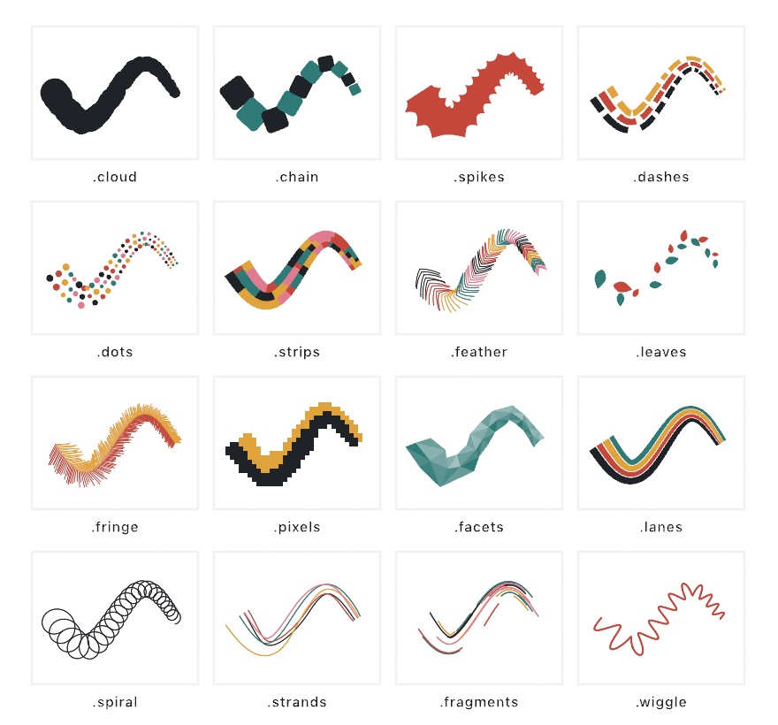

#### <sup>[Ollin](../../README.md) → [Documentation](../README.md) → [Generators](./README.md) → Gesture marks</sup>

---

## Gesture marks

A **`GestureMark`** turns one drawn path, the width at every point of it, and a seed into many small marks laid along it. There are sixteen families. The outlines are a cloud of discs, a chain of rounded squares, and a band with spikes. The rows across the width are dashes, dots, and strips. The sprouts off both sides are a feather, leaves, and a fringe. The ribbon resampled gives pixels, facets, and lanes. The lines around the path are a spiral, strands, fragments, and a wiggle. Every mark is a closed outline to fill or an open line to stroke, so the screen and a plotter draw the same geometry. Beside the families are the regions a whole gesture encloses, the figures its two ends define, and two fills that grow spikes or a wavering edge on any shape.

```swift
let palette: [Color] = [.black, .red, .orange]
let path = Contour(curveThrough: [Vector2(100, 400), Vector2(400, 250), Vector2(700, 500)], closed: false)
let gesture = GestureMark(path, width: 60)
noStroke()
fill(.black)
drawShape(gesture.cloud(seed: 3).shape)          // one silhouette
for piece in gesture.dashes(rows: 3, seed: 3) {  // pieces to color
    fill(palette[piece.row])
    drawShape(piece.shape)
}
```



### Contents

- [Building one](#building)
- [Pieces](#pieces)
- [Sizes follow the width](#sizes)
- [A growing gesture never moves what it drew](#growing)
- [Outlines: cloud, chain, spikes](#outlines)
- [Rows across the width: dashes, dots, strips](#rows)
- [Sprouts: feather, leaves, fringe](#sprouts)
- [The ribbon resampled: pixels, facets, lanes](#resampled)
- [Around the path: spiral, strands, fragments, wiggle](#around)
- [The whole gesture: hull, blob, figure](#whole)
- [Spiked and wobbled fills](#fills)

<a name="building"></a>

#### Building one

```swift
var pen = StrokeMark()
pen.record(Vector2(100, 100), deltaTime: 1.0 / 60)
pen.record(Vector2(160, 130), deltaTime: 1.0 / 60)
let drawn = GestureMark(pen, width: 40)                      // a recorded mark
let fixed = GestureMark(Circle(center: Vector2(300, 300), radius: 120).contour, width: 30)
let given = GestureMark(points: [Vector2(0, 0), Vector2(200, 50)], widths: [40, 10])
drawn.points    // the path's points, as given
drawn.widths    // the width at each one
drawn.length    // the path's length
```

`init(_:width:)` over a **`StrokeMark`** takes its positions, and each point's width is `width` times the width the mark recorded there, the way `drawMark(_:)` reads it under a `strokeWeight` of `width`. A pressure or speed response therefore carries into every family. Over a **`Contour`** every point has the one width, and a closed contour runs back to its first point. `init(points:widths:)` takes a width per point; a short list repeats its last value. A path with fewer than two distinct points makes no pieces.

<a name="pieces"></a>

#### Pieces

Every family returns an array of **`GestureMark.Piece`**. A piece's `contour` is closed for a region to fill and open for a line to stroke. Its `row` says which row or side it belongs to: rows across the width count from the left edge (the left of the direction of travel), sprouts and pixels use `0` for the left side and `1` for the right, facets number the four triangles between two stations, and strands and lanes number the copy. Everything else is row `0`. `index` is its place in its row, and `distance` is how far along the gesture it sits. `piece.shape` wraps one piece for `drawShape(_:)`.

`shape` on the array merges every closed piece into one region, overlaps joined, which is how the cloud, the chain, the spiked band, and the pixels become one silhouette to fill or plot. Open pieces are left out of it.

```swift
let gesture = GestureMark(Contour([Vector2(80, 300), Vector2(800, 260)]), width: 50)
let palette: [Color] = [.black, .red, .orange, .blue]
drawShape(gesture.chain(seed: 1).shape)            // the chain as one outline
noFill()
for piece in gesture.feather(seed: 1) {            // the two barbs at a station share an index
    stroke(palette[piece.index % palette.count])
    drawPolyline(piece.contour.points)
}
```

<a name="sizes"></a>

#### Sizes follow the width

Every size a family takes is a fraction of the gesture's width where the piece sits: a dash's length, a gap, a spike's spacing, a spiral's cycle. The rows' sizes are fractions of one row's share of it. A mark looks the same at any canvas size, and it narrows where the stroke tapers. The one exception is `pixels(cell:)`, whose grid is the canvas's, so its cell is in canvas units. `hull(padding:)` and `blob(radius:)` are in canvas units too, defaulting to half the gesture's mean width.

<a name="growing"></a>

#### A growing gesture never moves what it drew

Every piece is placed by its distance along the path from the start, and every row draws its sizes from a sequence of its own, seeded at that start. Adding a point to the end only adds pieces. The ones already there keep their exact points, except the last piece of a row, which reaches the tip and grows with it. A sketch can rebuild the marks from its pen every frame, and nothing behind the pen flickers.

The path is resampled every two canvas units before anything is placed, and the direction at any point turns from one step's direction to the next across the step. That direction never reads ahead of the step it is in, so only the last, unfinished step can change when a point arrives; a piece is placed there only when it reaches the tip. The fragments are the one family that waits: a fragment appears once it is whole, so they come in the order they end.

<a name="outlines"></a>

#### Outlines: cloud, chain, spikes

```swift
let gesture = GestureMark(Contour([Vector2(80, 300), Vector2(800, 260)]), width: 60)
drawShape(gesture.cloud(variation: 0.5, seed: 2).shape)
drawShape(gesture.chain(spacing: 0.9, roundness: 0.35, seed: 2).shape)
drawShape(gesture.spikes(spacing: 0.5, height: 0.3, sharpness: 2, seed: 2).shape)
```

`cloud(variation:seed:)` strings discs along the path. Each is centered near it and reaches up to the edge of the width. `variation`, 0 to 1, is how far the discs shrink and wander: at 0 every disc is the full width and on the path, and at 1 they go down to about half. Every disc covers the path where it sits, the next one always overlaps it, and the last sits on the tip, so the silhouette has no gap. `chain(spacing:roundness:seed:)` stands a rounded square on the path every `spacing` widths, its side the width there (a little less, from the seed), turned to the path and a little more. Below a spacing of 1 neighbors overlap. `roundness` is the corner radius as a fraction of half a side.

`spikes(spacing:height:sharpness:seed:)` is the band of the width with a spike every `spacing` widths along each edge. Each edge is pushed out by `height` widths times a triangle wave raised to `sharpness`. The peak keeps every tip a sharp point. Above 1, the power rounds every valley, which sits back on the band's edge, and steepens the flanks: at the defaults every tip is narrower than about 65 degrees, while at a `sharpness` of 1 the flanks are straight and a short spike can open past a right angle. Each spike's height (down to about two thirds) and where its tip leans are drawn from the seed. There is one piece per period.

<a name="rows"></a>

#### Rows across the width: dashes, dots, strips

```swift
let gesture = GestureMark(points: [Vector2(80, 300), Vector2(800, 260)], widths: [90, 30])
let palette: [Color] = [.black, .red, .orange, .blue]
for piece in gesture.dashes(rows: 3, length: 2, gap: 0.6, seed: 1) {
    fill(palette[piece.row])
    drawShape(piece.shape)
}
gesture.dots(rows: 3, size: 0.8, gap: 0.4, seed: 1)
gesture.strips(rows: 4, length: 2, seed: 1)    // color by index for a patchwork
```

Each splits the width into `rows` rows. Every row walks its own seeded run from the start, staggered against its neighbors. Its sizes are fractions of the row's thickness there, so a taper narrows the rows along with it. `dashes(rows:length:gap:seed:)` lays a dash about `length` thicknesses long, then a gap about `gap` long, each drawn between half and one and a half times that. A dash's sides follow the path, inset a little from its neighbors. `dots(rows:size:gap:seed:)` centers a dot in its row, `size` thicknesses across at most and six tenths of that at least, set `gap` of a thickness apart or less. `strips(rows:length:seed:)` cuts each row end to end with no gaps, into lengths from a third to over twice `length` thicknesses, so a palette indexed by `index` makes a patchwork.

<a name="sprouts"></a>

#### Sprouts: feather, leaves, fringe

```swift
let gesture = GestureMark(Contour([Vector2(80, 300), Vector2(800, 260)]), width: 70)
gesture.feather(angle: .pi / 4, spacing: 0.12, seed: 1)
gesture.leaves(angle: .pi / 4, size: 1, seed: 1)
gesture.fringe(angle: .pi / 3, spacing: 0.05, seed: 1)
```

Each sprout leaves the path leaning forward `angle` off it, toward the direction of travel, and reaches about the edge of the width. `feather(angle:spacing:seed:)` sets a barb on each side at every station, bowed a little toward the base, the stations about `spacing` widths apart. The two barbs at one station share an `index`. `leaves(angle:size:seed:)` sets pointed blades on alternate sides, each up to `size` times the reach to the edge (down to about half of it), the gaps between them drawn from the seed. `fringe(angle:spacing:seed:)` is thin, dense, straight hairs off both sides every `spacing` widths, reaching seven tenths of the way to past the edge, a palette indexed by `row` coloring each side. The angle of every sprout is jittered a little by the seed, by at most 0.1 radians for a barb, 0.15 for a leaf, and 0.08 for a hair.

<a name="resampled"></a>

#### The ribbon resampled: pixels, facets, lanes

```swift
let gesture = GestureMark(Contour([Vector2(80, 300), Vector2(800, 260)]), width: 80)
gesture.pixels(cell: 8, roughness: 0.3, seed: 1)
gesture.facets(spacing: 0.7, jitter: 0.3, seed: 1)
gesture.lanes(count: 3, gap: 0.12, wander: 0.5, seed: 1)
```

`pixels(cell:roughness:seed:)` is the canvas cells of side `cell`, in canvas units, that the width covers. Each side reaches out to its own ragged extent, the half width times one plus `roughness` of a slow noise seeded per side, so the two edges step independently. A cell is claimed once, by the side that reached it first. `facets(spacing:jitter:seed:)` places stations about `spacing` widths apart, each with a point on either edge and one on the path, every point moved by up to `jitter` of the half width. Four triangles join each two stations. `lanes(count:gap:wander:seed:)` splits the ribbon into `count` lanes side by side, `gap` of a lane's width between neighbors. The borders between them wander across by up to `wander` of a lane on a slow seeded noise. There is one piece per lane per width of length.

<a name="around"></a>

#### Around the path: spiral, strands, fragments, wiggle

```swift
let gesture = GestureMark(Contour([Vector2(80, 300), Vector2(800, 260)]), width: 60)
gesture.spiral(cycle: 1, loop: 1)
gesture.strands(count: 5, spread: 1, wavelength: 4, seed: 1)
gesture.fragments(density: 1, length: 2, spread: 1, seed: 1)
gesture.wiggle(wavelength: 1, amplitude: 0.5)
```

`spiral(cycle:loop:)` winds a coil along the path. A point circles the path once every `cycle` widths of length while its center walks it, across the full width and `loop` half widths along, so above about a third it throws loops. There is one piece per turn, so the count of pieces is the length over the cycle, rounded up. `strands(count:spread:wavelength:seed:)` is `count` copies of the path drifting across it on slow seeded waves, each up to `spread` of the half width either side, a wave about `wavelength` widths long, so they cross and recross. `fragments(density:length:spread:seed:)` scatters short copies beside the path. One starts every 0.15 to 0.65 widths (divided by `density`), runs about `length` widths, and sits up to `spread` of the half width to one side. A fragment appears once it is whole. `wiggle(wavelength:amplitude:)` is the path with one even wave, `amplitude` of the half width either side, once every `wavelength` widths.

<a name="whole"></a>

#### The whole gesture: hull, blob, figure

```swift
let gesture = GestureMark(points: [Vector2(200, 200), Vector2(500, 260), Vector2(420, 520), Vector2(180, 430)],
                          widths: [30])
drawShape(gesture.hull())                   // the rounded convex blob
drawShape(gesture.blob(radius: 20))         // the lasso and what it went round
drawShape(gesture.figure(.circle))          // centered on the start, through the end
drawShape(gesture.figure(.star(points: 5, inner: 0.45)))
```

`hull(padding:)` is the convex hull of the gesture's points grown by `padding` with round corners. `blob(radius:)` closes the gesture into a loop and takes everything within `radius` of it, the region inside included. A lasso becomes the shape it drew round, and a gesture that crosses itself keeps every lobe. Both default to half the gesture's mean width and enclose every point. `figure(_:)` is the shape the gesture's start and end define, the way a drag defines one. A **`GestureMark.Figure`** is one of five. `.circle` is centered on the start and passes through the end. `.ellipse` and `.rectangle` fill the box the two ends span. `.polygon(sides:)` is centered on the start with a corner at the end. `.star(points:inner:)` puts a tip at the end, and `inner` is its inner radius as a fraction of the outer.

<a name="fills"></a>

#### Spiked and wobbled fills

```swift
let disc = Shape(contours: [Circle(center: Vector2(400, 400), radius: 200).contour])
drawShape(disc.spiked(24, height: 40, sharpness: 2, seed: 1))
drawShape(disc.wobbled(by: 12, scale: 90, seed: 1))
```

`spiked(_:height:sharpness:seed:)` grows `count` spikes around each outline of any `Shape`, spaced evenly by its length. Each pushes the outline away from the filled region by up to `height` (in canvas units) times the same triangle wave the spiked band uses, so every valley sits back on the original outline. Each spike's height and lean are drawn from the seed by its index, and holes grow their spikes into the hole. `wobbled(by:scale:seed:)` moves every point across the outline by up to `by`, by a noise read at its position on the canvas with features about `scale` across. The noise belongs to the canvas, so the outline has no seam where it starts, and two shapes that touch wobble alike where they touch. Both start each outline halfway along its longest edge, so the seam never sits on a corner, and keep open contours as they are.

The `Patterns/GestureMarks` example plays a stroke back in every family, heavy at the start and lifting toward the end, and lets you drag to draw your own. The families were mapped from Kenichi Yoneda's notes on the drawing tool behind *Etude on Painting*, read for approach and written here from the geometry.
