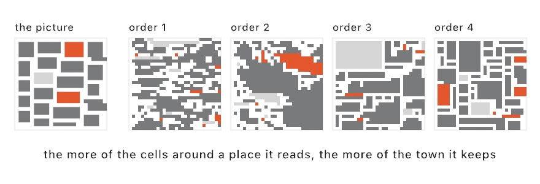

#### <sup>[Ollin](../../README.md) → [Documentation](../README.md) → [Generators](./README.md) → `MarkovGrid`</sup>

---

## MarkovGrid

A `MarkovGrid` learns one or more small pictures and writes new grids with the same local habits. A picture is rows of cells, and a cell is any `Hashable` value: a letter, a number, a color, an enum case. Use it to get more of something you drew by hand, such as a tile map, a maze, or a wall. It writes a grid of any size, or a strip without end.

It is the [`MarkovChain`](./Random.md#markovchain) taken from a line to a grid, and it lives in the core beside it. It is seeded, so the same grid and the same seed write the same rows.

<picture>
  <source media="(prefers-color-scheme: dark)" srcset="../../Guide/Images/04-Randomness/GridReach-dark.jpg">
  
</picture>

```swift
let picture = [
    "####.pp.",
    "####.pp.",
    "........",
    "##.####.",
    "##.####.",
    "........",
].map(Array.init)

var town = try MarkovGrid(learning: picture, seed: 7)
let field = town.nextRows(40, columns: 60)    // forty rows of sixty letters
```

### Contents

- [How it reads a picture](#reading-order)
- [Learning](#learning)
- [Writing rows](#writing)
- [order: how many cells it reads](#order)
- [The vocabulary and the seed](#vocabulary)
- [A table declared by hand](#declared)
- [Reading the counts back](#counts)
- [A picture that cannot be read](#errors)
- [What it keeps, and what it cannot](#envelope)

<a name="reading-order"></a>

#### How it reads a picture

A picture is read the way a page is: a row at a time from the top, and each row from its start. So when a cell is reached, four of the cells around it are already settled. The grid counts what each cell held among those four. They are always listed nearest first:

| | Cell | Where it sits |
|---|---|---|
| 1 | before | the same row, one place back |
| 2 | above | the row above, the same place |
| 3 | above and before | the row above, one place back |
| 4 | above and after | the row above, one place ahead |

A place off the picture counts as a value of its own. A first cell has the edge before it, and a top row has the edge above it. That is how the first column and the top row of what is written come to look like the picture's.

When it writes, it asks the same question of every new cell: what did the pictures hold among these four? It then rolls by the counts. If the pictures never showed that arrangement, it forgets the farthest cell and asks again, down to how often each value appeared at all. So there is always an answer.

<a name="learning"></a>

#### Learning

```swift
MarkovGrid(learning picture: [[Element]], order: Int = 4, seed: Int = 0) throws
mutating func learn(_ picture: [[Element]]) throws
mutating func learn(_ row: [Element], after previous: [Element]?) throws
```

`learn(_:)` adds a picture, given as its rows from the top. You can learn several pictures one after another, and they need not be the same size. The same picture learned twice counts twice.

```swift
let plain = ["#.#.", ".#.#", "#.#.", ".#.#"].map(Array.init)
let twill = ["##..", ".##.", "..##", "#..#"].map(Array.init)

var weave = MarkovGrid<Character>(seed: 3)
try weave.learn(plain)
try weave.learn(twill)       // the habits of both
```

`learn(_:after:)` adds one row, given the row above it. Pass `nil` for a picture's first row. Use it when a sketch shows the counts growing as a picture is scanned, or when rows arrive one at a time.

The grid reads rows. To have it read a picture by columns instead, turn the picture first:

```swift
let picture = ["##..", "##..", "...."].map(Array.init)
let columns = picture[0].indices.map { x in picture.map { $0[x] } }

var town = MarkovGrid<Character>(seed: 7)
try town.learn(columns)
```

<a name="writing"></a>

#### Writing rows

```swift
mutating func nextRow(columns: Int) -> [Element]
mutating func nextRows(_ count: Int, columns: Int) -> [[Element]]
mutating func start(after row: [Element])
mutating func reset()
```

`nextRows(_:columns:)` writes a whole grid when it is the first thing you ask for. The first row is a top row, with the edge above it. Draw the result however you like:

```swift
var town = try MarkovGrid(learning: ["##.", "##.", "..."].map(Array.init), seed: 7)
let field = town.nextRows(60, columns: 60)
noStroke()
fill(.black)
for (y, row) in field.enumerated() {
    for (x, letter) in row.enumerated() where letter == "#" {
        drawRect(Double(x) * 18, Double(y) * 18, 18, 18)
    }
}
```

`nextRow(columns:)` writes one row under the last one. Call it for as long as the sketch runs and the strip has no end. This sketch keeps the newest sixty rows and writes six more a second:

```swift
import Ollin

final class Strip: Sketch {
    var town = MarkovGrid<Character>(seed: 7)
    var rows: [[Character]] = []
    var written = 0

    override func setup() throws {
        try town.learn(["####.pp.", "####.pp.", "........", "##.####.", "##.####.", "........"].map(Array.init))
    }

    override func draw() {
        while written < 60 + Int(time * 6) {
            rows.append(town.nextRow(columns: 60))
            written += 1
            if rows.count > 60 { rows.removeFirst() }
        }
        background(.white)
        noStroke()
        fill(.black)
        for (y, row) in rows.enumerated() {
            for (x, letter) in row.enumerated() where letter == "#" {
                drawRect(Double(x) * 18, Double(y) * 18, 18, 18)
            }
        }
    }
}
```

The width may change between rows. A place the row above does not have reads as off the grid.

`start(after:)` puts the grid under a row of your own, so what it writes grows out of that row. A value in it that the grid never saw matches nothing, and the cells beside it are decided by the ones the grid does know. `reset()` goes back to the top and rewinds the randomness, so the same rows come out again.

A grid that has learned nothing writes an empty row, and so does a `columns` below 1.

<a name="order"></a>

#### order: how many cells it reads

`order` is how many of the four cells are read, from 1 to 4, and 4 is the default. The picture at the top of this page is one town at each order:

- **1** reads the cell before. A row remembers along itself only, so rows do not line up.
- **2** adds the cell above. Rows line up under one another, but shapes have ragged sides.
- **3** adds the cell above and before. A shape keeps its far side straight.
- **4** adds the cell above and after. That cell is the only one that can tell a row a shape begins just ahead, so a shape keeps its near side too.

A lower order invents more and keeps less. It can also let one value take over. These are the shares of each letter in 400 written rows of 60, from the town picture in the [`Patterns/MarkovGrid`](../../Examples/Patterns/MarkovGrid/Sketch.swift) example:

| | building | street | park | pond |
|---|---|---|---|---|
| the picture | 45% | 46% | 7% | 3% |
| order 1 | 47% | 44% | 7% | 3% |
| order 2 | 77% | 18% | 2% | 3% |
| order 3 | 56% | 36% | 5% | 3% |
| order 4 | 48% | 44% | 6% | 3% |

At order 2 nothing holds a street open, and the buildings run together. The shares are a result of the local counts. The grid does not aim for them, so check a new picture at the order you mean to use.

<a name="vocabulary"></a>

#### The vocabulary and the seed

```swift
MarkovGrid<Element>(vocabulary: [Element] = [], order: Int = 4, seed: Int = 0)
var vocabulary: [Element] { get }
```

`vocabulary` is every value the grid knows, in the order it first saw them. A roll walks the values in that order. So two grids with the same counts can still write different rows from one seed, if they met their values in a different order.

Name the values when you make the grid and the order is fixed. What a seed writes then depends on the counts alone, whichever picture was learned first:

```swift
var town = MarkovGrid<Character>(vocabulary: [".", "#", "p", "w"], seed: variation)
```

The grid keeps its own generator, seeded by `seed`. Adding one to a sketch never moves the sketch's other rolls.

<a name="declared"></a>

#### A table declared by hand

```swift
mutating func learn(_ element: Element, around cells: [Element?], times: Int = 1)
```

A grid can be declared as well as shown. Each call records that a value sat among these cells, so many times. `cells` are the four settled cells, nearest first, with `nil` for a place off the grid. Only the first `order` cells are read, and a `times` below 1 records nothing.

```swift
var bricks = MarkovGrid<String>(order: 2, seed: 3)
bricks.learn("brick", around: ["brick", "mortar"], times: 12)    // a course carries on
bricks.learn("mortar", around: ["brick", "mortar"])              // and ends in a joint
bricks.learn("brick", around: ["mortar", "mortar"], times: 4)    // a new brick begins
bricks.learn("mortar", around: [nil, "brick"])                   // a row starts under a brick
```

Each call counts as that many cells of a learned picture would. The counts land under every shorter arrangement too, which is what forgetting falls back on.

<a name="counts"></a>

#### Reading the counts back

```swift
func continuations(around cells: [Element?]) -> [(element: Element, probability: Double)]
func count(of element: Element, around cells: [Element?]) -> Int
var isEmpty: Bool { get }
let order: Int
```

`continuations(around:)` is what a cell among these cells may hold, most likely first. It forgets as writing does, so it answers for an arrangement the pictures never showed.

`count(of:around:)` is how many times a value was seen among exactly these cells. Nothing is forgotten here, so an arrangement never shown counts 0. With fewer cells than `order` it reads the counts kept under that shorter arrangement, and with none it reads how often the value appeared at all.

```swift
let town = try MarkovGrid(learning: ["....", ".##.", ".##.", "...."].map(Array.init))
let afterWall = town.continuations(around: ["#"])                // what follows a building
let corners = town.count(of: "#", around: [".", ".", ".", "."])  // blocks begun in the open
```

That is enough to draw the table a grid learned. The `Flow` sketch among the [Hiroshi Kawano recreations](../../Examples/Recreations/HiroshiKawano/) draws its sixteen arrangements this way, with a bar for each one's share of black.

<a name="errors"></a>

#### A picture that cannot be read

A picture with no cells, or with rows of different lengths, throws a `MarkovGridError`, and nothing of it is learned:

| Case | What it means |
|---|---|
| `.empty` | the picture has no rows, or its rows have no cells |
| `.ragged(row:count:expected:)` | a row is not as long as the rows before it; `row` counts from 0 |

Its `description` is a sentence you can show, such as "Row 3 of the picture has 3 cells where the rows before it have 4." A picture written in the sketch's own source cannot fail at run time once it is right, so `try!` is fair there. Use `try` or `try?` for a picture that comes from a file or from a person.

<a name="envelope"></a>

#### What it keeps, and what it cannot

The grid keeps what four neighboring cells can show: which values sit next to which, straight sides, corners, and how a shape ends. It does not keep a picture's layout.

- **It cannot count.** A brick is as long as the rolls make it. A picture of equal bricks comes back as a wall of mixed lengths.
- **It cannot plan ahead.** It never looks at a cell it has not written yet. The last column and the last row are simply where it stopped.
- **It does not aim for the picture's shares.** See the table under [order](#order).
- **It always has an answer.** At order 4 the example's three pictures meet an arrangement they never showed in 5 to 8 cells of every 100, and those are the cells that forget.

When every neighbor must be legal, use [Wave Function Collapse](./WaveFunctionCollapse.md#overlapping), which solves for it and can fail. A `MarkovGrid` never fails and makes one pass. A written cell costs about 0.4 microseconds on an M2, so a field of 60 by 60 takes about a millisecond and a half.

---

Related: [`MarkovChain`](./Random.md#markovchain) (the chain along one line), [`Wave Function Collapse`](./WaveFunctionCollapse.md) (a grid under hard rules, from tiles or from a picture), [`Cellular automata`](./CellularAutomata.md) (rows written from the row above by a fixed rule), [`Random`](./Random.md) (the seeded source a sketch rolls from). The Guide teaches it in [Chapter 4](../../Guide/04-Randomness.md#a-roll-that-remembers-the-row-above-too-markovgrid).
