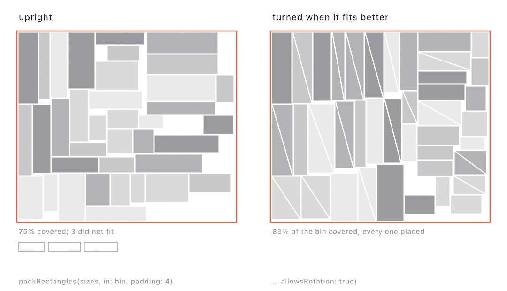

#### <sup>[Ollin](../../README.md) → [Documentation](../README.md) → [Generators](./README.md) → `Rectangle packing`</sup>

---

## Rectangle packing

Fit rectangles of given sizes into one bin, each at its own size and none overlapping. A contact sheet holds photos at their own proportions this way. A collage finds room for every card, and a texture atlas gathers sprites onto one page. `packRectangles` returns where each rectangle went and which ones did not fit. A sketch can then shrink the leftovers, start a second sheet, or leave them out.

The packing uses no randomness. The same sizes in the same bin always land the same way. A layout computed once can be held, and a layout computed every frame does not flicker.

<picture>
  <source media="(prefers-color-scheme: dark)" srcset="../../Guide/Images/15-ShapesAsMaterial/PackedRectangles-dark.jpg">
  
</picture>

### Contents

- [packRectangles](#pack)
- [What a packing holds](#result)
- [A contact sheet that fills the page](#scale)
- [How the packer chooses](#how)

<a name="pack"></a>

#### packRectangles

```swift
packRectangles(_ sizes: [Vector2], in bin: Rectangle? = nil,
               padding: Double = 0, allowsRotation: Bool = false) -> RectanglePacking
```

Each size is a width (`x`) and a height (`y`). `bin` is the region to fill. Inside a sketch it is the whole canvas by default, and the free function outside a sketch takes it without a default. `padding` is the gap left between neighboring rectangles. They may still touch the bin's edges, so inset the bin to leave a margin there too. With `allowsRotation`, a rectangle may be turned a quarter turn when that fits it better.

```swift
let sizes = (0 ..< 40).map { _ in Vector2(random(60, 260), random(60, 260)) }
let packing = packRectangles(sizes, in: Rectangle(x: 40, y: 40, width: 1000, height: 1000),
                             padding: 8)
for place in packing.placed {
    fill(Color(hue: Double(place.index) / Double(sizes.count), saturation: 0.5, brightness: 0.9))
    drawRect(place.rectangle)
}
```

A size whose width or height is not above zero, or not finite, is never placed. A bin with no area places nothing.

<a name="result"></a>

#### What a packing holds

```swift
struct RectanglePacking {
    let bin: Rectangle
    let placed: [Placement]       // in the order of the sizes given
    let unplaced: [Int]           // the places in the list of what did not fit
    var occupancy: Double         // the share of the bin covered, 0 to 1

    struct Placement {
        let index: Int            // the size's place in the list
        let rectangle: Rectangle  // where it went
        let isRotated: Bool       // turned a quarter turn to fit
    }
}
```

`placed` is sorted by `index`, the place each size had in the list, which is not the order the packer placed them in. A rotated rectangle's width is the height it was given, so a photo drawn into it is drawn turned. `occupancy` says how tight the packing is: padding counts as uncovered, so a padded packing never reaches 1.

<a name="scale"></a>

#### A contact sheet that fills the page

A packing keeps every size as given, so photos measured in thousands of pixels need a scale before they fit a page. The largest scale at which every photo still fits is a search. No scale can fit more photo than the page has room for. So the square root of the page's area over the photos' area is a scale that is too big. Halve the gap between a scale that fits and one that does not until the two meet.

```swift
let sizes = photos.map { Vector2(Double($0.width), Double($0.height)) }
let page = canvasRectangle.inset(by: .all(40))
let area = sizes.reduce(0) { $0 + $1.x * $1.y }
var fits = 0.0, tooBig = (page.area / area).squareRoot()
for _ in 0 ..< 20 {
    let scale = (fits + tooBig) / 2
    if packRectangles(sizes.map { $0 * scale }, in: page, padding: 10).unplaced.isEmpty {
        fits = scale
    } else {
        tooBig = scale
    }
}
let sheet = packRectangles(sizes.map { $0 * fits }, in: page, padding: 10)
```

Twenty halvings put the scale within a millionth of the edge, and the search runs the packer twenty-one times. For twenty photos that is quick enough to run every frame. For hundreds, run it once in `setup()` and hold the result. The `Patterns/PackedPhotos` example lays out the bundled photos this way and reflows them as the page changes shape.

<a name="how"></a>

#### How the packer chooses

The packer keeps the free part of the bin as every largest empty rectangle it holds. These maximal rectangles overlap one another, and together they cover all the free space. So any rectangle that fits anywhere fits inside one of them. Each step places a rectangle in the top-left corner of one of them. Every free rectangle the placement cuts is replaced by the largest pieces left above, below, left, and right of it. Then any free rectangle inside another is dropped.

The choice of where is the *best short side fit*: the free rectangle that leaves the smallest gap along its shorter leftover side, with the longer leftover side breaking a tie. The choice of what is global. At every step the packer weighs every rectangle still waiting against every free rectangle, and places the snuggest fit of all. It does not take the sizes in the order given. Jukka Jylänki compared rectangle packers in *A Thousand Ways to Pack the Bin* (2010), and that combination packed tightest of all the variants he measured. The order of `sizes` matters only between equal fits, where the earlier one wins.

Weighing every waiting rectangle at every step makes the cost grow faster than the count. Each rectangle remembers its best fit between steps. It is weighed again only when a placement cuts that fit's free rectangle, but in a dense packing most of them are cut. Three hundred rectangles pack in about twenty milliseconds, and a thousand in about half a second. Three thousand take over ten seconds. Pack a large set once and hold the result.

---

Related: [`Circle packing`](./Packing.md) (circles grown until they touch), [`Shape packing`](./ShapePacking.md) (any outline grown into the gaps), and [`Geometry`](../Drawing/Geometry.md#rectangle) (the `Rectangle` each placement holds, and `inset(by:)` for a margin).
