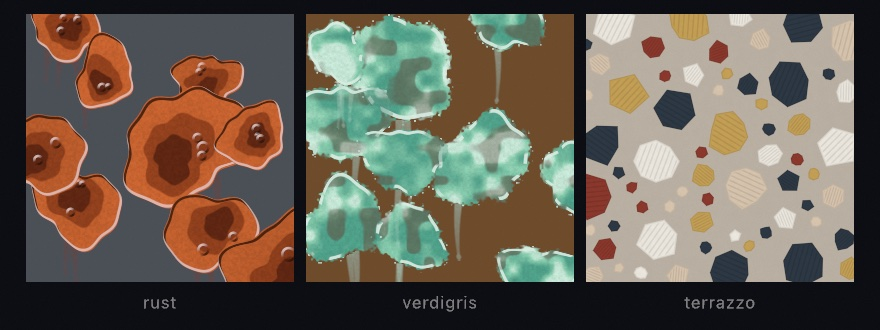
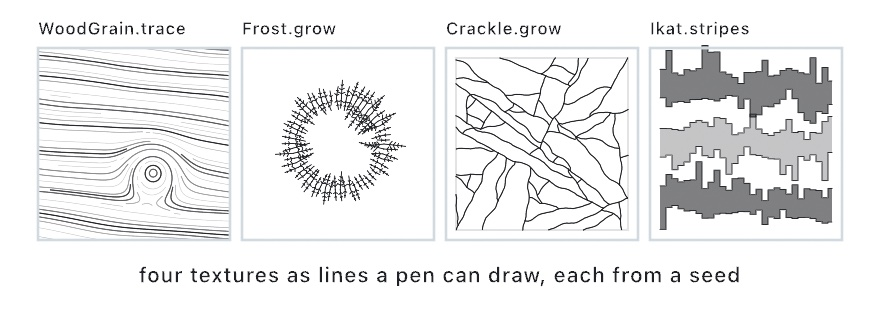

#### <sup>[Ollin](../../README.md) → [Documentation](../README.md) → [Generators](./README.md) → Textures</sup>

---

## Textures

A material texture is a surface a sketch asks for by name. They come in two kinds. The **pixel kind** is painted by the generators on the [Effects](../Drawing/Effects.md#generate) page, `.rust`, `.verdigris`, and `.terrazzo`, with the `.bubbleWrap` filter beside them. Under two of them is geometry a sketch can hold, draw, and plot. A **`Patina`** is the blooms a corrosion grows from, and a **`Terrazzo`** is the chips of a floor. The **line kind** is nothing but lines, so a pen can draw it. **`WoodGrain`**, **`Frost`**, **`Crackle`**, and **`Ikat`** are wood grain, hoarfrost, cracked wax, and the stepped edge of a resist-dyed stripe, each as strokes and shapes a sketch holds. Every one is made from a seed. The blob a plotter draws is the blob the screen shows, and the same seed draws the same texture.

```swift
let blooms = Patina.scatter(in: canvasRectangle, count: 12, seed: 3)
drawImage(generate(.rust(blobs: blooms)).image, 0, 0)
stroke(.black); noFill()
for blob in blooms.blobs { drawPolygon(blob.outline.points) }   // lands on the paint

let plank = WoodGrain.trace(in: canvasRectangle, spacing: 6, knots: 2, seed: 3)
for line in plank.strokes { drawPolyline(line.points) }         // a plotter's plank
```



### Contents

- [A patina's blooms](#patina)
- [A terrazzo's chips](#terrazzo)
- [The generators that read them](#generators)
- [A crease in a sheet](#crease)
- [Textures drawn as lines](#lines)
  - [Wood grain](#wood-grain)
  - [Frost](#frost)
  - [Crackle](#crackle)
  - [Ikat](#ikat)

<a name="patina"></a>

#### A patina's blooms

```swift
let region = Rectangle(x: 0, y: 0, width: 600, height: 400)
let blooms = Patina.scatter(in: region, count: 12, radius: 40 ... 140, seed: 1)
let blob = blooms.blobs[0]
blob.outline                     // a closed Contour of 96 points
blob.masses                      // the two nested masses, contours too
blob.blisters                    // [Circle]
blob.boundaryRadius(at: 0.5)     // the outline's radius at an angle
blob.contains(Vector2(100, 80))
blooms.outlines                  // every bloom's outline
```

A **`Patina.Blob`**, a `Blob` for short, is a circle whose radius wavers around it. The outline's radius is the mean `radius` times one plus four harmonics of the angle: two and three waves around for the big lobes, five and eight for the ragged edge (`Patina.Blob.harmonics`). Each harmonic has an amplitude in `amplitudes` and a start in `phases`. `boundaryRadius(at:)` reads the outline's radius at an angle. `swing` is how far it can wander from the mean as a fraction, so the outline always lies between `radius * (1 - swing)` and `radius * (1 + swing)`. `outline` samples it as a closed contour.

Inside the bloom sit two **`masses`**, the darker cores. They are the same waver at `Patina.Blob.massScales` of the radius, 0.62 and 0.36, with their phases turned so they are not pure copies. Their centers are moved by `massOffset`, a fraction of the radius for the first and 1.7 times it for the second. Two to four **`blisters`**, small circles inside the bloom, complete it. `tone` is a draw in 0…1 the generators use to vary each bloom's color a little.

`scatter(in:count:radius:seed:)` throws up to `count` blooms over a region, each with a mean radius drawn from `radius`. A bloom is placed only where its center is at least three quarters of the two radii away from every bloom already placed. Blooms overlap at their ragged edges and never stack, and a crowded region takes fewer than asked. The same seed makes the same patina, down to every blister. The `using:` form takes any random generator, and `Patina(blobs:)` builds one from blobs of your own when the scatter should follow your own rule, each made with `Patina.Blob(center:radius:amplitudes:phases:massOffset:blisters:tone:)`.

<a name="terrazzo"></a>

#### A terrazzo's chips

```swift
let region = Rectangle(x: 0, y: 0, width: 600, height: 400)
let floor = Terrazzo.scatter(in: region, chipRadius: 44, density: 0.55, gap: 3, tones: 5, seed: 1)
let chip = floor.chips[0]
chip.shape                       // the chip as a Shape, for drawShape or a clip
chip.points                      // its corners
chip.tier                        // 0 the largest tier, 2 the smallest
chip.tone                        // an index into a palette
floor.outlines
```

A **`Terrazzo.Chip`**, a `Chip` for short, is a polygon inside a circle. `center` and `radius` are the circle, and every corner lies within it. `rotation` is the angle of the first corner, and `corners` holds each corner's distance from the center as a fraction of the radius, in 0.72…1, going around. A chip has five to eight corners, no two chips are alike, none is regular, and one corner is always on the circle. `sides`, `points`, `outline`, `shape`, and `contains(_:)` read it.

`scatter(in:chipRadius:density:gap:tones:seed:)` lays the floor by **dart throwing** (Cook, 1986) in three size tiers, largest first. The circles are at `chipRadius` and at `Terrazzo.tierScales` of it, 0.55 and 0.3. Each tier places chips at random until together they cover about `density` of the region in the shares `Terrazzo.tierShares`, half, three tenths, and two tenths, or until its darts keep missing. A chip lands only where its circle clears every chip already placed by `gap`, so **no two chips ever touch**, and the floor reports the `gap` it was laid with. Each chip takes one of `tones` colors by index. Dart throwing jams before a floor is full, so a density past about 0.5 lays little more than 0.5. The `using:` form takes any random generator, and `Terrazzo(chips:gap:)` builds a floor from chips of your own, each made with `Terrazzo.Chip(center:radius:rotation:tier:tone:corners:)`.

<a name="generators"></a>

#### The generators that read them

`.rust(blobs:...)`, `.verdigris(blobs:...)`, and `.terrazzo(chips:...)` take the scatter and paint it (the rust reads a `Patina` as blooms with their masses and lip, the verdigris reads the same blobs as a mottled crust with a frayed edge): the GPU reads the very blobs and chips the sketch holds, so an outline stroked from one lands on the paint, and a scatter rebuilt every frame (a bloom growing, a floor laid chip by chip) is repainted every frame. With no scatter handed in, each generator scatters its own over the layer from its `seed` with the same calls, so `generate(.rust(seed: 3))` paints the blooms `Patina.scatter(in: layer, count: 14, radius: 40 ... 150, seed: 3)` builds over a rectangle the layer's size, byte for byte. Every parameter of the paint (the tones, the lip, the blisters, the tide, the hatching) is on the [Effects](../Drawing/Effects.md#generate) page, beside the catalog they belong to.

<a name="crease"></a>

#### A crease in a sheet

The fourth pixel texture is a fold rather than a scatter. `Heightfield.creased(along:width:amplitude:)` presses a crease into any heightfield along a polyline, shaped by one closed-form kernel (`Heightfield.creaseProfile(at:)`): a cusp with a rounded tip, an asymmetric step that lifts one flank, and a trough two widths out on both sides. The same kernel shapes the folds of `.paperTexture`. It lives on the [Terrain](Terrain.md#crease) page with the rest of `Heightfield`.

<a name="lines"></a>

#### Textures drawn as lines

The line kind hands back polylines and shapes and nothing else, so a plotter draws the material. `--export-svg` writes them as paths and `--export-gcode` as a route. Each is a value you trace or grow once and hold, and each repeats from its seed. The `Patterns/LineTextures` example draws all four the way a plotter would, stroke by stroke.



<a name="wood-grain"></a>

##### Wood grain

```swift
let plank = WoodGrain.trace(in: canvasRectangle, direction: 0.12, spacing: 6, knots: 2,
                            ringSpacing: 48, ringContrast: 0.6, wobble: 0.35, seed: 3)
noFill()
for line in plank.strokes {
    stroke(Color(hex: 0x4A2A14).withAlpha(0.3 + 0.7 * line.tone))
    if line.isClosed { drawPolygon(line.points) } else { drawPolyline(line.points) }
}
plank.lines                       // every stroke's points
plank.knots                       // the knots it flowed around
plank.across(Vector2(300, 200))   // the ring coordinate at a point
plank.tone(at: Vector2(300, 200)) // the ring tone there
plank.field                       // the angle field, a FlowField
```

**`WoodGrain`** is streamlines traced through an angle field. The lines run with the grain, bend around the knots, and bunch up every so often across the grain where a ring is. Under it is a *ring coordinate*, `across(_:)`, the distance across the grain lifted by a bump at every knot and wandered by two octaves of noise. A **`Knot`** has a `center`, a `radius` (the width of its bump), and a `height` in radii. Past `WoodGrain.Knot.closingHeight`, about 1.65, the rings close into loops around the knot. Every **`Stroke`** is a level curve of the ring coordinate. So strokes never cross, a stroke that circles a knot closes (`isClosed`, so draw it as a polygon), and each belongs to one ring along its whole length. The stroke carries that ring as its `tone`, 0 on the light wood between rings and 1 on the darkest ring. `tone(at:)` reads the tone anywhere. `field` is the angle field itself, a [`FlowField`](FlowField.md), for a sketch that wants to trace its own lines through it.

`trace(in:direction:spacing:knots:ringSpacing:ringContrast:wobble:seed:)` traces the grain over a region. `direction` is the grain's angle, `spacing` the distance between strokes on a ring, and `ringSpacing` the distance from ring to ring. `ringContrast` is how much sparser the strokes are between rings, 0 for even spacing and 1 for three times the spacing, which is how a plotted plank shows its rings. `wobble` is how far the grain wanders as a fraction of the ring spacing. Past about 0.5 the wander can pinch a stroke off into an island. `knots` is a count, thrown over the region from the seed by `WoodGrain.Knot.scatter(in:count:seed:)`, or a list of knots of your own, each made with `WoodGrain.Knot(center:radius:height:)`. The strokes are evenly spaced. A seed closer to a stroke than its spacing allows is skipped, a stroke stops at half its spacing from another, and every traced stroke seeds the next ones beside it, so the whole region fills. `WoodGrain(strokes:knots:direction:ringSpacing:wobble:seed:)` builds one from strokes of your own.

<a name="frost"></a>

##### Frost

```swift
let pane = Frost.grow(along: canvasRectangle.contour, spacing: 7, length: 90, clump: 0.6,
                      barbSpacing: 6, barbAngle: .pi / 3, side: .inside, seed: 2)
stroke(.white); strokeWeight(1); noFill()
for line in pane.strokes { drawPolyline(line) }
let needle = pane.needles[0]
needle.root; needle.tip           // the spine's ends
needle.angle; needle.length
needle.spine                      // the spine as a two-point stroke
needle.barbs[0].base              // where a barb leaves the spine
needle.barbs[0].tip
needle.barbs[0].station           // where along the needle, 0 the root to 1 the tip
needle.barbs[0].side              // 1 on the left of the needle, -1 on the right
pane.roots                        // where the needles stand
Frost.barbStations(length: 60, spacing: 5)   // the barb law
```

**`Frost`** is hoarfrost. Needles sprout along an outline's normals, each a straight spine with barbs leaning toward its tip, the way frost grows on a pane's edge or a twig. `grow(along:spacing:length:clump:barbSpacing:barbAngle:side:seed:)` takes a `Contour` or a whole `Shape`. It stands a **`Needle`** every `spacing` along the outline, pointing away from it on `side` (`.outside`, `.inside`, or `.both`), each tilted a little. For an open path, outside is the left of its direction of travel. A needle's length is `length` scaled by a mix of a slow noise along the outline and a draw of its own. `clump` weights the noise, so at 1 long needles come in runs and at 0 every needle draws alone. The mix is squared, so most needles are short.

The barbs follow one law, `barbStations(length:spacing:)`. They start `Frost.barbStart` of the way up the spine, a quarter, sit `barbSpacing` apart from there, and stop half a spacing short of the tip. At each station a pair of **`Barb`**s leans forward `barbAngle` off the spine, sixty degrees by default with a little jitter, one on each side. A barb reaches `Frost.barbReach` of the needle at the root's station, never past `Frost.barbCap` barb spacings, and shortens to nothing at the tip. `strokes` is every spine and barb, each a two-point stroke. `Frost(needles:)` builds a frost from needles of your own, each made with `Frost.Needle(root:angle:length:barbs:)` and `Frost.Barb(base:tip:station:side:)`.

<a name="crackle"></a>

##### Crackle

```swift
let panel = Rectangle(x: 70, y: 70, width: 940, height: 940)
let folds = [[Vector2(450, 70), Vector2(500, 1010)]]
let wax = Crackle.grow(in: panel, spacing: 34, creases: folds, forkChance: 0.5, wobble: 0.3, seed: 5)
stroke(Color(hex: 0x1F2B5B)); strokeWeight(1.4); noFill()
for line in wax.lines { drawPolyline(line) }
let vein = wax.veins[0]
vein.points
vein.order                        // 0 seeded, 1 a fork, 2 a fork of a fork
vein.parent                       // the vein it forked from, or nil
vein.length
wax.cell                          // the Shape the veins cross
```

**`Crackle`** is the veins of cracked wax. Each is a wandering walk across a cell that stops at the cell's edge or where it meets another vein, forking once near its middle, and the veins are denser along the creases where the wax was folded. `grow(in:spacing:creases:forkChance:wobble:seed:)` takes a `Shape` as the cell, or a `Rectangle`. It seeds about one **`Vein`** for every two `spacing` squares of the cell's area. A third start on the rim and walk in, and the rest start inside and walk both ways from their root. A vein's heading wanders by a slow noise (`wobble`, in radians) with a little jitter at every step, so it reads as a crack rather than a curve. It ends on the rim, bisected to the edge so a plotter reaches it, or on the first vein it meets, which it touches and never crosses. When it is done it may fork (`forkChance`, lower by two fifths for each order). A child sets out from a point between a third and two thirds along it, fifty to eighty degrees off, and may fork once more itself, up to `Crackle.maxOrder`. Every polyline in `creases` seeds an extra vein every two fifths of a spacing along itself, headed along it, so the crackle crowds where the sketch says the wax creased. Every point of every vein lies inside the cell. `Crackle(veins:cell:)` builds one from veins of your own, each made with `Crackle.Vein(points:order:parent:)`.

<a name="ikat"></a>

##### Ikat

```swift
let cloth = Ikat.stripes(in: canvasRectangle, count: 5, bundle: 13, bleed: 24,
                         spikes: 0.14, intrusions: 0.14, skew: 1.2, warp: .vertical, seed: 3)
noStroke()
for stripe in cloth.stripes {
    fill(Color(hex: 0x1F2B5B))
    drawShape(stripe.shape)
}
let stripe = cloth.stripes[0]
stripe.band                       // the stripe as designed, a Rectangle
stripe.bundles                    // how many bundles it spans
stripe.leading                    // the leading edge's offset per bundle
stripe.trailing
stripe.leadingEdge                // the stepped polyline, two points per bundle
stripe.trailingEdge
stripe.edges                      // both
cloth.shapes; cloth.edges         // every stripe's
let one = Ikat.stripe(across: Rectangle(x: 40, y: 200, width: 1000, height: 80), bundle: 12, seed: 1)
```

**`Ikat`** is the stepped, bleeding edge of a resist-dyed stripe. In ikat the threads are tied in bundles and dyed before they are woven. Every bundle lands a little out of place on the loom, so a stripe's edge is not a line but a stair, one step per bundle, each at its own height. A **`Stripe`** is a `band`, the stripe as it was designed, with an offset per bundle at each of its two edges, `leading` and `trailing`. The offsets run along the **`Warp`**, the direction the threads run. For a `.vertical` warp the leading edge is the top and the bundles step across x. `leadingEdge` and `trailingEdge` are the stairs as polylines, two points per bundle with a riser between bundles. `shape` is the stripe between them, closed, for a fill.

`stripe(across:bundle:bleed:spikes:intrusions:skew:warp:seed:)` dyes one stripe over a band. Each bundle *slips* along the warp, moving both its edges together, by a slow noise of up to a third of `bleed` plus a lean of `skew` times `bleed` from one end of the stripe to the other. Each edge then *bleeds* on its own. It flares up to half of `bleed` either way by a slow noise, spikes one to two bleeds out on a `spikes` share of the bundles (a spike runs into the next bundle a third of the time), and intrudes half to one bleed in on an `intrusions` share, never past two fifths of the band. `stripes(in:count:...)` lays `count` stripes across a region, each half as tall as its share of the region along the warp and centered in it, every one dyed from its own draw of the seed. `Ikat(stripes:)` builds a cloth from stripes of your own, each made with `Ikat.Stripe(band:bundle:warp:leading:trailing:)`.
