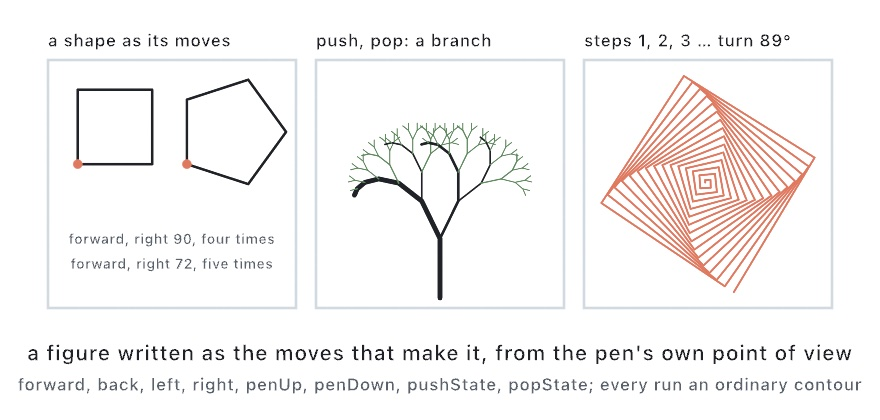

#### <sup>[Ollin](../../README.md) → [Documentation](../README.md) → [Generators](./README.md) → `Turtle`</sup>

---

## Turtle

A **turtle** is a pen you drive. It stands somewhere on the canvas facing some way. You tell it to walk forward, to turn left or right, and to lift or lower its pen. The path it draws comes back as contours. Each contour is one unbroken run with the pen down. It is the oldest way of drawing by program. A figure is written as the moves that make it from the pen's own point of view. A square is "forward, turn right, four times" and never four pairs of coordinates. The [L-system](LSystem.md) turtle reads a string. This one takes calls.

```swift
var turtle = Turtle(at: center)          // facing up the screen, pen down
for _ in 0 ..< 4 {
    turtle.forward(200)
    turtle.right(90)
}
for run in turtle.contours { drawPolyline(run.points, closed: run.isClosed) }
```

<picture>
  <source media="(prefers-color-scheme: dark)" srcset="../../Guide/Images/16-CurvesAndFigures/TurtleDrives-dark.jpg">
  
</picture>

### The moves

```swift
Turtle(at position: Vector2 = .zero, heading: Double = -90)

mutating func forward(_ distance: Double)
mutating func back(_ distance: Double)
mutating func left(_ degrees: Double)
mutating func right(_ degrees: Double)
mutating func move(to point: Vector2)
mutating func home()

var position: Vector2         // where it stands
var heading: Double           // which way it faces, in degrees; set it to face a direction
var direction: Vector2        // the same as a unit vector
```

Angles are in **degrees**, as turtle graphics has always had them. `heading` is measured from the positive x-axis and grows clockwise as the canvas shows it. So `-90` faces up the screen and `0` faces right. From straight up, `right(90)` faces right. Set `heading` outright to face a direction. `move(to:)` walks straight to a point without turning. `home()` walks back to where the turtle started and faces as it faced then. Both draw if the pen is down.

### The pen

```swift
mutating func penUp()
mutating func penDown()
mutating func close()

var isPenDown: Bool
var contours: [Contour]
```

`contours` is everything drawn so far. Each run with the pen down is one open contour, in the order they were drawn. The run in progress is included once it has two points. `penUp()` ends the run. The moves after it leave no line. `penDown()` starts a new run where the turtle stands. `close()` ends the run in progress as a *closed* outline, so it can be filled through a `Shape`. A run that ends where it began drops the repeated point.

### Remembering where it stood

```swift
mutating func pushState()
mutating func popState()
```

`pushState()` remembers the position, the heading, and whether the pen is down. `popState()` takes the turtle back there without drawing the way. The run so far is kept and a new one starts there. That is how a branch is drawn. Walk out a limb and remember the spot. Turn and grow one branch. Pop, then turn the other way and grow the other. The pair nests. A pop with nothing remembered changes nothing.

```swift
func grow(_ turtle: inout Turtle, length: Double, depth: Int) {
    guard depth > 0 else { return }
    turtle.forward(length)
    turtle.pushState()
    turtle.left(25)
    grow(&turtle, length: length * 0.7, depth: depth - 1)
    turtle.popState()
    turtle.pushState()
    turtle.right(25)
    grow(&turtle, length: length * 0.7, depth: depth - 1)
    turtle.popState()
}

var tree = Turtle(at: Vector2(width / 2, height * 0.9))
grow(&tree, length: 180, depth: 7)
for run in tree.contours { drawPolyline(run.points) }
```

### What comes back

Every run is an ordinary [`Contour`](../Drawing/Geometry.md#contour). It strokes with `drawPolyline` and fills through a `Shape` once closed. It answers the [contour questions](../Drawing/Geometry.md#contour-questions) and joins the [booleans](../Drawing/Geometry.md#shape-booleans). It plots as lines through `--export-svg`. A walk drawn at any size lands in a frame with [`fitted(_:in:)`](../Drawing/Geometry.md#rectangle), the way the [spirolateral](../Drawing/Curves.md) does.

A `Turtle` is a value. It is copied by assignment and changed by `mutating` calls. Hand it to a helper as `inout` so the helper walks the same turtle. The `grow` function above does that.

Worked example: [`Examples/Patterns/TurtleWalk`](../../Examples/Patterns/TurtleWalk/Sketch.swift). It grows a tree by that program with the wind leaning every turn, beside a polyspiral whose turn slides over the loop. The Guide teaches the turtle in [Chapter 16](../../Guide/16-CurvesAndFigures.md#a-pen-you-drive-the-turtle).
