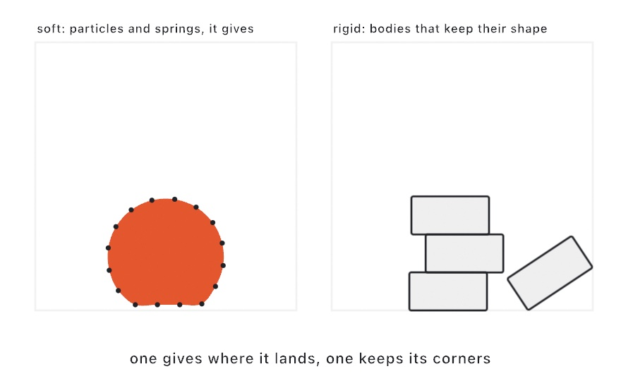
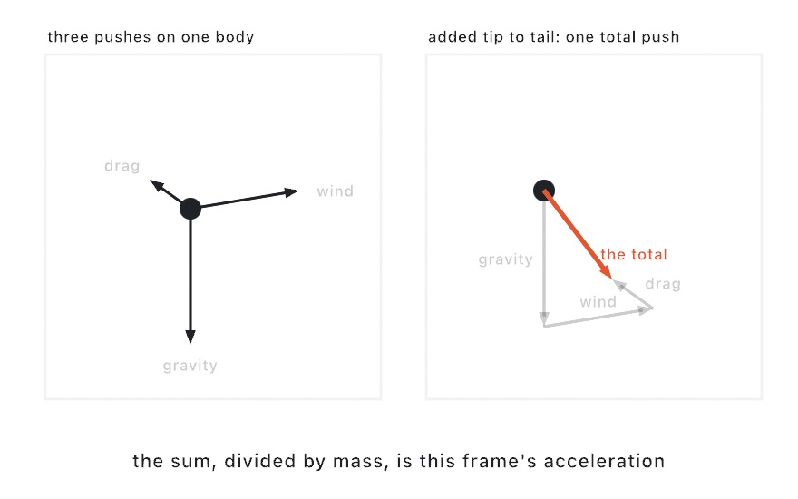
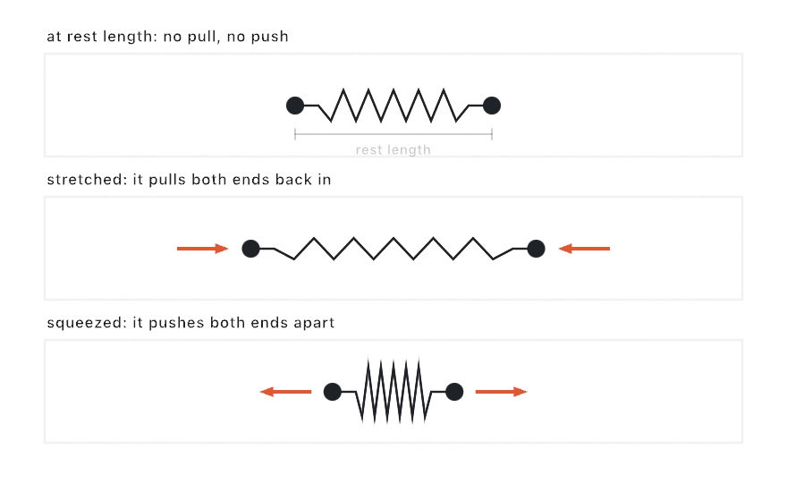
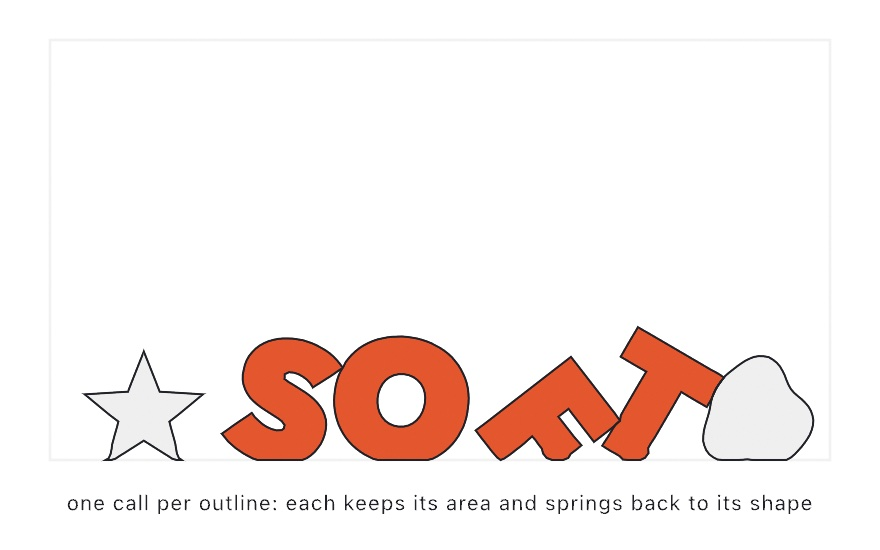

#### <sup>[Ollin](../../README.md) → [Documentation](../README.md) → [Simulation](./README.md) → `Physics`</sup>

---

## Physics

Physics lets motion come from a simulation instead of from hand-tuned numbers. The physics code lives in a separate library, so the drawing core does not carry it. To use it, add `import OllinPhysics` beside `import Ollin`.

The model is lightweight and made for creative work. It is not a game engine. A [`World`](#world) holds [`Particle`](#particle)s (point masses) and the [`Spring`](#spring)s between them. You set the global rules (gravity, an optional container, whether particles collide), and then you step the world once a frame. The model is tuned for motion that looks right rather than for exact physical accuracy. A few hundred springs and constraints is its comfortable range. Plain colliding disks go further than that, to a few thousand a frame, because the broad phase below compares each disk only with its neighbors.

The same `World` also holds a second kind of body. On the **soft** side, [`Particle`](#particle) and [`Spring`](#spring) form a Verlet solver, which is good at cloth, chains, and soft blobs. On the **rigid** side, a [`Body`](#rigid-bodies) is a rigid body. It has an orientation, it rotates, it rests in stable stacks, and it links to other bodies with joints. That covers the cases the soft model cannot handle, such as a toppling tower or a swinging pendulum. The rigid side is backed by [Box2D](https://box2d.org). Both sides share the world's gravity, walls, and per-frame `advance(by:)`, so you can use either one or both. Skip ahead to [Rigid bodies](#rigid-bodies) if that is what you need. This page covers the 2D world. Rigid bodies inside the 3D scene have their own [`World3D`](Physics3D.md).

<picture>
  <source media="(prefers-color-scheme: dark)" srcset="../../Guide/Images/11-ForcesAndPhysics/SoftVsRigid-dark.jpg">
  
</picture>

The usual pattern is to build the world once in `setup()`. Then, in `draw()`, you call `advance(by:)` and draw from its particles.

```swift
import Ollin
import OllinPhysics

final class Drops: Sketch {
    let world = World()

    override func setup() {
        world.bounds = Rectangle(x: 0, y: 0, width: width, height: height)
        world.particlesCollide = true
        for _ in 0 ..< 200 {
            world.addParticle(at: Vector2(random(width), random(height * 0.3)),
                              radius: 14 * scale)
        }
    }

    override func draw() {
        background(.black)
        world.advance(by: deltaTime)
        fill(.white)
        for p in world.particles {
            drawCircle(center: p.position, radius: p.radius)
        }
    }
}
```

Gravity pulls the discs down, the walls stop them, and `particlesCollide` keeps them from overlapping, so they pile up.

### Contents

- [World](#world) - the simulation, its bodies, rules, and the per-frame `advance(by:)`
- [Particle](#particle) - a point mass, with position, velocity, mass, and pinning
- [Spring](#spring) - a distance link between two particles (cloth, chains, soft bodies)
- [Rigid bodies](#rigid-bodies) - `Body`, colliders, surface properties, and joints (the Box2D side)
- [How the solver works](#how-the-solver-works) - Verlet integration and relaxation, in one paragraph
- [Soft bodies](#soft-bodies) - a squishy body from any outline, in one call

<a name="world"></a>

### World

```swift
let world = World()
```

A `World` is the container for everything. You add particles and springs to it, set its rules, and call `advance(by:)` each frame.

**Building it**

```swift
@discardableResult
func addParticle(at position: Vector2, radius: Double = 0, mass: Double = 1) -> Particle
@discardableResult
func connect(_ a: Particle, _ b: Particle, length: Double? = nil, stiffness: Double = 1) -> Spring
func remove(_ spring: Spring)
func remove(_ particle: Particle)
func remove(_ body: Body)
func removeAll()

var particles: [Particle] { get }
var springs: [Spring] { get }
```

A [soft body](#soft-bodies) made from an outline has its own `addSoftBody(from:)`, `remove(_:)`, and `softBodies`.

`remove(_ body:)` takes one rigid body out along with any joints holding it. The `Body` value is spent afterwards, so read anything you still need from it (its velocity, its angle) **before** the call and drop your reference to it after: a shard that inherits the motion of the thing it came from is the everyday case, and that is a read of a body about to leave. See [breaking things](../Generators/Fracture.md#bodies).

`addParticle` returns the new [`Particle`](#particle), so you can pin it, push it, or connect it to a spring. A `radius` of `0` (the default) makes a point that does not collide. A positive radius makes the particle collide as a disk. `connect` links two particles with a [`Spring`](#spring). By default the spring's rest length is the distance between the two particles at that moment.

`remove(_ particle:)` takes the particle out along with every spring attached to it. Each call reads through all of the world's springs and particles. Taking out a hundred particles a frame from thousands is a hundred of those reads. A sketch that retires disks and adds new ones all the time does better to keep the retired ones and reuse them. Set a retired disk's `radius` to `0`, which the collision pass skips. When the next disk is born, hand it the old particle with its new radius. Move it with [`place(at:)`](#particle), which carries the previous position along, so the jump adds no speed.

**The rules**

```swift
var gravity: Vector2 = Vector2(0, 980)   // points per second², y-down
var drag: Double = 0.01                  // the share of speed lost per sixtieth of a second, 0…1
var bounds: Rectangle?                   // optional container; nil lets bodies leave
var restitution: Double = 0.5            // how much speed survives a hit, 0…1
var particlesCollide: Bool = false       // push particles apart as solid disks
var iterations: Int = 8                  // relaxation passes per step
var substeps: Int = 1                    // pieces each step is cut into, for a rod or a chain
var maxTimestep: Double = 1.0 / 30       // clamp on dt, for stability
```

- **`gravity`** is a constant acceleration on every unpinned particle. Set it to `.zero` for a weightless field where everything floats freely.
- **`drag`** stands in for air friction. At `0` motion is conserved, so things drift forever. A small value removes energy, so things settle. It is the share of speed lost every sixtieth of a second, whatever the frame rate: the default of `0.01` removes 45% of a particle's speed in a second at 30, 60, or 120 frames a second alike. A rigid [`Body`](#rigid-bodies) reads the same number, on its speed and on its spin. Set it at any time, since a change reaches every body already in the world.
- **`bounds`** keeps particles inside a rectangle, and it accounts for each particle's `radius`. `restitution` then sets how much speed a particle keeps when it hits a wall. At `0` the particle sticks, and at `1` it loses nothing at the wall, though `drag` still takes its share in flight. It is also what a rigid body gets when `addBody` names none. A [soft body](#soft-bodies) bounces off a wall by its own give instead, so `restitution` does not reach it.
- **`particlesCollide`** turns on disk-against-disk separation. It is off by default for two reasons. A cloth should not have its own points collide, and the check costs a pass every frame. Turn it on for packings and piles. Points with `radius == 0` never collide, and the pass skips them. The broad phase runs through a spatial hash, so the cost grows with the number of disks rather than with its square. Each cell of the hash is as wide as the largest disk, and each disk is compared with every disk in its own cell and the eight around it. So the sizes matter as much as the count. Disks of one size meet a handful of others each, while a few large disks among many small ones make each small one meet hundreds. Measured in a release build on an M2, a settled packing of 3,650 disks steps in about 22 ms at four passes, about 1.5 µs a disk a pass. Its largest radius is 32 px and its median about 10. At 60 frames a second, a packing like it has room for two to three thousand disks at four passes, and fewer as the largest disk grows against the rest.
- **`iterations`** is how many relaxation passes the solver runs to hold springs and collisions together. More passes make stiff stacks and tight packings firmer, and the cost grows linearly with the count.
- **`substeps`** cuts each step into pieces, each integrated and relaxed on its own. A bob on a rod gives back only 70% of its height on its first swing at one piece a frame, because projecting a step onto the rod drops the share of the motion that pointed along it. The loss shrinks in proportion to the count: 98% at sixteen pieces, and at sixty-four the bob holds its height within 5% for ten seconds. The cost grows with the count, so it is for a pendulum or a chain of a few particles rather than a pile.

<picture>
  <source media="(prefers-color-scheme: dark)" srcset="../../Guide/Images/11-ForcesAndPhysics/ForceAccumulation-dark.jpg">
  
</picture>

**Stepping**

```swift
func advance(by dt: Double)
```

`advance(by:)` moves the simulation forward by `dt` seconds. Pass `deltaTime`. A `dt` of `0` (a paused frame or the first frame) does nothing. A large `dt` is clamped to `maxTimestep`, so a stutter or a window drag does not throw everything off the screen.

<a name="particle"></a>

### Particle

```swift
let p = world.addParticle(at: Vector2(540, 200), radius: 24)
```

A `Particle` is a point mass. It is the body the world moves. You usually make one with `World.addParticle`, and then you read its `position` to draw it.

```swift
var position: Vector2          // where it is now
var velocity: Vector2 { get }  // implicit, as a per-step displacement
var radius: Double             // collision radius (0 = a non-colliding point)
var mass: Double               // heavier resists being pushed
var inverseMass: Double        // 1 / mass, the weight a constraint shares a correction by
var acceleration: Vector2      // force gathered for the next step (applyForce is the way in)
var pinned: Bool               // held in place (an anchor)
var userData: Any?             // hang your own data off it

func applyForce(_ force: Vector2)   // accumulate a force for the next step
func push(_ amount: Vector2)        // add to velocity (a per-step displacement)
func place(at point: Vector2)       // teleport without imparting velocity
@discardableResult func pin() -> Particle
@discardableResult func unpin() -> Particle
```

Motion is **Verlet**. A particle does not store a velocity. Instead it keeps its previous position, and the velocity is the difference between the two positions. That is why there are two ways to move a particle. `place(at:)` teleports the particle and moves the previous position with it, so it adds no velocity. `push(_:)` *adds* velocity by moving the previous position. To throw a particle, place it and then push it.

```swift
p.place(at: Vector2(100, 100))   // set it down, still
p.push(Vector2(8, 0))            // now flick it to the right
```

`pin()` anchors a particle, so gravity and springs no longer move it. It still acts on whatever it is connected to. This is how you hang a cloth from its top edge or hold a pivot in place. `userData` lets you attach a color, an index, or any other per-body state to the particle, so you do not need a parallel array.

<a name="spring"></a>

### Spring

```swift
let s = world.connect(a, b)        // holds their current distance
s.stiffness = 0.4                  // gives a little, over a few steps
```

A `Spring` is a link that tries to hold two particles at a fixed distance from each other. It can stand for a cloth thread, a chain segment, or a soft-body strut.

<picture>
  <source media="(prefers-color-scheme: dark)" srcset="../../Guide/Images/11-ForcesAndPhysics/SpringRestLength-dark.jpg">
  
</picture>

```swift
let a: Particle
let b: Particle
var length: Double         // the rest distance it pulls back to
var stiffness: Double      // 0…1; 1 is a rigid stick, less gives
var strain: Double { get } // signed: 0 at rest, + stretched, − compressed
```

With `stiffness` at `1` the link behaves like a rigid stick. A lower value lets the link give and spring back over a few frames. `strain` reports how far the link is stretched right now, as a signed fraction of its rest length. It is 0 at rest, positive when stretched, and negative when compressed. You can use it to color a cloth by stress.

<a name="rigid-bodies"></a>

### Rigid bodies

A [`Particle`](#particle) is a soft point with no orientation. A [`Body`](#body) is a rigid body. It has an `angle`, it spins, it rests in stable stacks, and it bounces off other bodies with a contact response. Use it when the soft model cannot do the job. Examples include a tower of blocks that topples, a hinged chain, and a pile of tumbling shapes. The rigid side is backed by [Box2D](https://box2d.org). Box2D is wrapped behind Ollin's own types, and the rigid side is measured in sketch points.

```swift
import Ollin
import OllinPhysics

final class Tower: Sketch {
    let world = World()

    override func setup() {
        world.gravity = Vector2(0, 2600)
        world.bounds = bounds                       // the floor and walls
        for row in 0 ..< 7 {
            world.addBody(.box(width: 100, height: 44),
                          at: Vector2(width / 2, height - 60 - Double(row) * 46))
        }
    }

    override func draw() {
        background(.black)
        world.advance(by: deltaTime)
        fill(.white)
        for body in world.bodies {
            withState {
                translate(body.position)
                rotate(body.angle)                  // real rotation, not a fake spin
                drawRect(center: .zero, width: 100, height: 44)
            }
        }
    }
}
```

The pattern is the same as for particles. You build the world in `setup()`, and then in `draw()` you call `advance(by:)` and draw from `world.bodies`. You can keep each body's look, its color and its drawn size, in `userData`, and then draw it from its `position` and `angle`.

**A number the solver cannot hold is refused at the bridge.** A value that is not a number, an infinity, or a magnitude past a billion units never reaches the solver. A rigid body's position, angle, velocity, or spin set to one keeps what it had. A force or an impulse made of one does nothing. The world's `gravity`, `bounds`, and `unitsPerMeter` keep theirs, and `addBody(at:)` given such a position places the body at the origin. Each prints one note naming the call, once per world. The [3D world](Physics3D.md) does the same.

**Adding bodies**

```swift
@discardableResult
func addBody(_ collider: Collider, at position: Vector2,
            kind: Body.Kind = .dynamic, density: Double = 1,
            friction: Double = 0.3, restitution: Double? = nil) -> Body

var bodies: [Body] { get }
```

- **`collider`** is the body's shape (described below). **`kind`** is how the body moves. `.dynamic` (the default) is moved by forces. `.static` never moves, so use it for walls, the ground, or a hinge anchor. `.kinematic` moves only by a velocity you set.
- **`density`** sets the mass, so heavier bodies push lighter ones. **`friction`** is surface grip, from `0` (slippery) to `1` (grippy). **`restitution`** is bounciness, `0…1`. It defaults to the world's `restitution` and follows it until the body is given one of its own, here or through `body.restitution`. The walls carry no bounce of their own, so a body bounces off them with its own value, and two bodies meet with the larger of theirs.

<a name="collider"></a>

**Colliders**

```swift
enum Collider {
    case circle(radius: Double)
    case box(width: Double, height: Double)
    case capsule(from: Vector2, to: Vector2, radius: Double)   // a rounded stadium
    case polygon([Vector2])                                    // convex, ≤ 8 points
}
```

Geometry is given in body-local points, centered on the body's origin. The body's `position` and `angle` then place it in the world. A `.polygon` is made convex for you by taking its convex hull, so a concave outline is expanded to that hull rather than rejected. It is brought within the eight-corner limit for you too, by dropping the corner whose own triangle is smallest until eight are left, so an outline with more corners is simulated as a slightly plainer version of itself rather than refused.

<a name="body"></a>

**The Body**

```swift
var position: Vector2          // center, in points
var angle: Double              // orientation, radians (clockwise, y-down)
var velocity: Vector2          // points per second (a real velocity)
var angularVelocity: Double    // radians per second
var mass: Double { get }
var restitution: Double        // bounciness; the world's until the body is given one
var kind: Body.Kind            // .dynamic / .static / .kinematic
var userData: Any?

func applyForce(_ force: Vector2)     // steady push (thrust, wind)
func applyImpulse(_ impulse: Vector2) // instant kick (a hit, a launch)
func applyTorque(_ torque: Double)    // spin it, a force in points times an arm in points
```

A spin fast enough to turn a shape more than a quarter turn between frames can carry a thin shape through another, since contacts are found once a step. The `Forces` example shows all three calls in one windy yard. It also has a `.kinematic` sweeper that other bodies cannot stop, and a pinned cloth colored by `Spring.strain`.

**Shared rules and units**

The rigid side reads the settings you already made on the world. It takes `gravity` unchanged and uses `bounds` as walls. `restitution` is what a body gets when `addBody` names none, and `drag` slows every body's speed and spin by the share a particle loses. A change to either reaches the bodies already in the world, and a change to `gravity` wakes any that had settled, so a tilt reaches a box resting on the floor. A `.kinematic` body is never dragged, since it moves only by the velocity it is given. The rigid side also runs on the same `advance(by:)`. One parameter belongs to it alone:

```swift
var unitsPerMeter: Double = 100
```

Box2D works in meters and behaves best for objects roughly 0.1 to 10 m. `unitsPerMeter` converts between meters and sketch points. The default of 100 puts a 100-point shape at 1 m, which is well inside that range, so you can keep thinking in points. The Verlet particle side works in points directly and ignores this value.

<a name="joint"></a>

**Joints**

You can link two bodies with a constraint, or grab one body with the cursor:

```swift
@discardableResult
func connect(_ a: Body, _ b: Body, _ kind: JointKind) -> Joint
@discardableResult
func grab(_ body: Body, at point: Vector2) -> Joint

enum JointKind {
    case revolute(at: Vector2)                        // a free hinge at a world point
    case distance(from: Vector2, to: Vector2,
                  length: Double? = nil, stiffness: Double = 1)   // a rod (soft < 1)
    case weld                                          // lock together rigidly
    case prismatic(at: Vector2, axis: Vector2)         // a slider along an axis
}
```

`revolute` is the most common joint. Repeat it down a line of links for a rope or a pendulum, and anchor the first link to a `.static` body to hang it. `distance` holds two anchors at a fixed distance from each other. Below `stiffness: 1` it softens into a spring. `grab` returns a [`Joint`](#joint). You steer the joint by setting its `target` each frame (for example to the cursor), and you call `remove()` to let go:

```swift
let held = world.grab(body, at: Vector2(mouseX, mouseY))
// each frame while dragging:
held.target = Vector2(mouseX, mouseY)
// to release:
held.remove()
```

See the `RigidBodies` and `Chain` examples for complete sketches. The first is a toppling pyramid knocked into a pile of mixed shapes, and the second is a set of swinging chains you can grab. The `Joints` example shows the four joint kinds side by side, with one small rig for each. Every rig hangs from a `.static` anchor, and you can grab each one with the cursor.

<a name="how-the-solver-works"></a>

### How the solver works

Each step first integrates every particle forward. The integration is time-corrected Verlet, so an uneven frame rate does not change how fast things move. `drag` is scaled by the step for the same reason. The step then runs a few **relaxation** passes. Each pass pulls springs back toward their length, pushes overlapping disks apart, and keeps everything inside `bounds`. Every constraint is solved by moving *positions*, so the velocity follows on its own. A bounce, a spring's recoil, and a collision all only move points, and the implicit Verlet velocity carries the result into the next frame. Many cloth and soft-body demos on the web use the same approach. `Particle` is the one place where Ollin uses reference semantics instead of value types. That lets a spring or a collision move the same shared point in place.

<a name="soft-bodies"></a>

### Soft bodies

A soft body is a squishy thing made from an outline. Hand `addSoftBody(from:)` any closed `Shape`, such as a lumpy circle, a star, or a letter, and it puts a ring of particles round the outline. The ring keeps the area it was made with, its corners keep their angle, and it springs back toward its own shape. Other soft bodies cannot get inside it, so a pile of them squashes together instead of overlapping. A rigid `Body` and a soft one push each other, so a ball lands on a jelly and a jelly rests on a tilted plank, and everything a soft body touches rubs by its `friction`.

```swift
let disc = Circle(center: Vector2(540, 300), radius: 120)
let blob = try world.addSoftBody(from: Shape(contours: [disc.contour]))

// each frame:
world.advance(by: deltaTime)
fill(.orange)
drawShape(blob.shape)
```

The particles go where the shape's points are, so build the shape where the body should start. They are ordinary particles in `world.particles`, so gravity, `drag`, `bounds`, and a sketch's own `push(_:)` reach them as they reach any other.

<picture>
  <source media="(prefers-color-scheme: dark)" srcset="../../Guide/Images/11-ForcesAndPhysics/SoftShapes-dark.jpg">
  
</picture>

**Building one**

```swift
@discardableResult
func addSoftBody(from shape: Shape, mass: Double = 1, spacing: Double = 8,
                 stiffness: Double = 0.8, bend: Double = 0.2,
                 pressure: Double = .infinity, shapeMemory: Double = 0.3,
                 friction: Double = 0.3, collidesWithItself: Bool = false,
                 thickness: Double? = nil) throws -> SoftBody
func remove(_ body: SoftBody)
var softBodies: [SoftBody] { get }
```

- **`spacing`** is the distance between neighboring particles along the outline, in points. Every corner sharper than 30 degrees gets a particle of its own, and each side between two corners is cut evenly, so a star keeps its points and a square its corners. A finer spacing follows a detailed outline more closely. The cost grows with the count.
- **`stiffness`** is how hard the outline resists stretching. At `1` it cannot stretch at all. At `0.5` it stretches by about a tenth of its length when it holds its own weight.
- **`bend`** is how hard each corner resists folding. Each particle is linked to the particles two and three places along the ring, so a corner keeps its angle. A long straight side can still bow, and `shapeMemory` is what holds it.
- **`pressure`** is how firmly the body holds its area, in gravities. The default, `.infinity`, holds the area whatever presses on it. A finite value lets the body's own weight press out about `1 / pressure` of its area when nothing else holds the shape: on a slack outline (`stiffness: 0.5`, `shapeMemory: 0`), `50` gives up 2%, `20` about 5%, and `5` about a seventh. A stiff outline with shape memory keeps its area by keeping its shape, so there `pressure` changes little. At `0` nothing holds the area, and a slack outline crumples like a loose loop of string.
- **`shapeMemory`** is how strongly the body springs back toward its own shape, turned and moved to where the body is now (shape matching). Dropped from its own height onto the floor, a disc squashes by a third of its height at `0`, by a tenth at the default `0.3`, and by under 4% at `0.9`. At `1` the body is rigid.
- **`friction`** is how much the outline grips what it touches, `0` slick to `1` grippy, read as a rigid body's `friction` is and with the same default. It reaches every contact the body makes: the walls, other soft bodies, rigid bodies, loose particles, and its own far side. See *What touches it* below for the rule.
- **`collidesWithItself`** keeps the outline out of itself, for a rope or any long thin outline that can fold back on its own side. Off by default: a blob or a letter never folds onto itself, and the pass costs about as much as the body has particles on every iteration.
- **`thickness`** is how far the outline keeps from its own far side when it `collidesWithItself`, in points: half the `spacing` unless given. A corner sharper than that is held open by it.

Each setting is a compliance, an amount of give for a given load, rather than a share of the error fixed on each pass. That is why a setting means the same body at any frame rate and any `iterations`: a soft disc sagging under its own weight settles to the same height within 2% at 30, 60, 120, and 240 frames a second. More `iterations` or `substeps` still bring a stiff body closer to what its settings ask for.

`addSoftBody` throws `PhysicsError.unbuildable` for a shape it cannot build from: one with no closed outline that encloses any area, a point that is not a number, or a mass or spacing of zero or less.

**Holes and pieces**

The shape's fill decides what the body is, read under the shape's own winding rule, so a contour inside another is a hole. A letter "O" makes one body with an open counter. Each ring keeps its own area, so the counter stays open rather than collapsing while the outline shrinks to match, and the rings never cross each other.

A shape with several separate pieces, such as the dot and the stem of an "i" or a whole word, makes one body whose pieces hold together through `shapeMemory`. To let each piece go its own way, give each its own body:

```swift
for letter in textToShapes("soft", 540, 300) {
    try world.addSoftBody(from: letter)
}
```

**Reading and moving it**

```swift
var shape: Shape { get }              // the outline now, one contour per ring
var area: Double { get }              // the area now, holes taken out
var restArea: Double                  // the area it holds; set it to inflate
var center: Vector2 { get }           // the average of its particles
var velocity: Vector2 { get }         // their average velocity, per step
let particles: [Particle]             // every particle, ring after ring
let mass: Double
var stiffness: Double                 // the settings, which can change while it runs
var bend: Double
var pressure: Double
var shapeMemory: Double
var friction: Double
var collidesWithItself: Bool
var thickness: Double
var userData: Any?

func contains(_ point: Vector2) -> Bool
func push(_ amount: Vector2)
func applyForce(_ force: Vector2)
func move(by offset: Vector2)
```

`shape` has straight edges between particles, which keeps a star's points sharp. For a rounder look, draw each ring as a smooth curve, as `drawCurve(blob.shape.contours[0].points, closed: true)` does. Set `restArea` above what the body was made with to inflate it, or below to let the air out; one driven by `sin(time)` makes a blob that breathes.

`push(_:)` adds the same velocity to every particle, and `applyForce(_:)` spreads a force over them so the body as a whole accelerates by force over mass. `move(by:)` shifts the body without changing its motion. To grab or poke one spot, move its particles, which are in `particles`.

**What touches it**

- Other soft bodies, and the separate pieces of one body, never get inside each other. Three bodies piled up sit within a pixel of each other's outlines through the whole fall.
- Rigid `Body`s and soft bodies push each other. A particle that enters a rigid shape is moved out, and the body is handed the matching impulse where they met, the two sharing the correction by their masses at that point; a crate's corner is tested the other way round, against the soft outline, so it cannot sink between two of the outline's particles. A ball dropped on a slab of jelly dents it, bounces once, and settles in the dent; a jelly rests on a tilted plank; a kinematic belt carries a jelly along. Momentum crosses the contact whole: a soft disc hitting a free ball keeps the pair's total within 2%. The soft passes see the rigid body where it will be at the end of the step, and the impulse lands before the rigid side steps, so the answer is in the same frame.
- Everything a soft body touches rubs by `friction`: the walls, other soft bodies, rigid bodies, loose particles, and its own far side. Two surfaces meet with the geometric mean of their frictions, the rigid side's rule; the walls and a loose particle meet a soft body with its own. The rule is Coulomb's. On a slope a body holds still while its friction is above the slope's tangent and slides once it is under, and a square jelly pushed across the floor at friction `1` stops in about its speed squared over twice gravity. A round body on a rough floor rolls rather than sliding, as a ball does, so a blob is slowed less than a cube. The friction is position-based (Macklin, Müller, Chentanez and Kim 2014): after a contact pushes a particle out, the part of its motion over the step that ran along the surface is taken back out, all of it while it is under the friction times the push, and that much of it past that.
- With `particlesCollide` on, every loose particle with a positive radius is pushed out of every soft body by its radius. A soft body's own particles have no radius and never collide as disks.
- The walls of `bounds` hold a soft body's particles by position, and the body bounces by its own give. A weightless blob gliding into a wall comes off at about half its speed at the defaults, whatever `restitution` says.
- A soft body is kept out of itself only when `collidesWithItself` is on: every particle stays at least `thickness` from every edge of its own ring but the few beside it, so a rope stood on its end buckles into folds that lie on each other instead of passing through. A body that cannot fold, a disc or a letter, steps exactly as it does with the pass off. A fold that closes faster than the thickness in one step can still pass through; `substeps` is the answer for a rope thrown hard.

Contacts are the costly part. Each pair of bodies whose boxes overlap checks every particle of one against the other's outline, and friction adds a few operations to each contact. Rigid contacts cost a particle of a soft body whose box overlaps a rigid body's one shape test a pass, and the pass that keeps a body out of itself costs about as much as the body has particles, through a grid over its ring. Nine blobs of about sixty particles each, piled together, step in about 4 ms a frame in a release build.

**By hand**

`addSoftBody` is built from particles and position constraints, the same parts as the rest of the world. For a structure no outline describes, link the particles yourself with `connect`. A ring of particles with springs round the rim and slack spokes to a hub is a blob, and giving the rim particles a radius with `particlesCollide` on keeps two such blobs apart.

See the `Blobs` example for a complete sketch, with nine lumpy blobs sloshing under a gravity that swings from side to side, and `SoftBodiesMeet` for a jelly cube on a plank whose friction is a parameter, rigid balls dropped onto a slab, and a rope that folds onto itself.
