#### <sup>[Ollin](../README.md) → [Guide](README.md) → Chapter 21</sup>

---

# 21. Glass, chrome, and tape

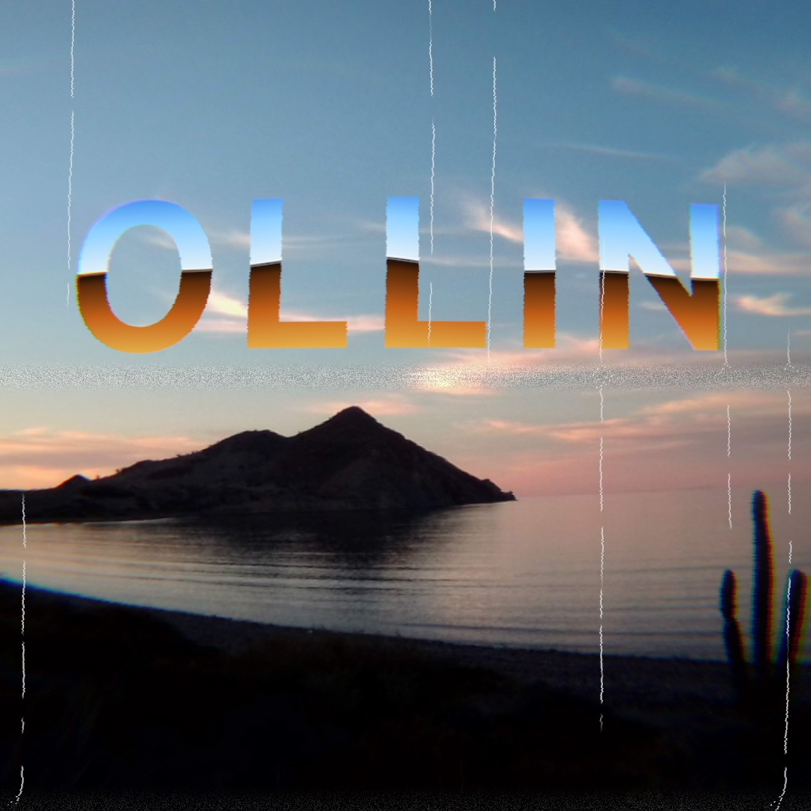

Some filters stand in for a physical thing rather than a style: a sheet of chrome, a cheap lens, a worn videotape. You learn the ones that build a material from a silhouette, the ones that bend and split a picture as glass does, and the ones that carry it as old media did. Five of them, stacked, make the title card above. Two more materials follow it, then the filters that read a layer as something else: a height, a tone, a center, a ring, a pour, a stereo pair, a gas, or hot air.

## A material from a silhouette: liquidMetal, heatmap, and gemSmoke

The design filters are built to look like the finished graphics on a product page. They split into two rows that work in opposite directions:

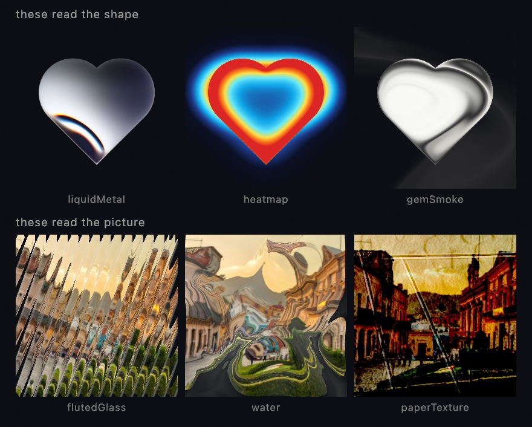

The bottom row takes a picture and hands it back changed, and [Chapter 20](20-PicturesRestyled.md#the-sheet-it-is-printed-on-paper-glass-and-water) printed its photograph onto the paper that row ends on. The top row works the other way. `.liquidMetal`, `.heatmap`, and `.gemSmoke` mostly ignore your layer's colors and read its **alpha**, the silhouette. All three tiles above started as one white heart on a transparent layer, and each filter built a whole material out of that outline. So the working method for these is to draw a shape into a layer, then filter the layer:

```swift
let shape = makeRenderTarget()
withTarget(shape) {
    noStroke(); fill(.white)
    drawHeart(width / 2, height / 2, width * 0.5)
}
drawImage(shape.filtered(.liquidMetal(phase: time)).image, 0, 0)
```

`drawHeart` is one of the analytic shapes beside `drawCircle`, and it takes a center and a size the same way. Any silhouette works. It can be text from [Chapter 8](08-Words.md), a shape you built in [Chapter 15](15-ShapesAsMaterial.md), or a tracked hand from [Chapter 35](35-Seeing.md). The filter never knows where the outline came from.

[`Examples/Effects/FilterCatalog`](../Examples/Effects/FilterCatalog/Sketch.swift) tours the design filters in full, and [`Examples/Effects/GeneratorCatalog`](../Examples/Effects/GeneratorCatalog/Sketch.swift) does the same for [Chapter 18](18-YourFirstShader.md)'s design generators. The title card letters its word with one more filter of the top row, the next step.

## Airbrushed chrome: chrome

One more filter reads a silhouette, and it paints it as the chrome of a logo. This is the airbrush convention, not a reflection. A sky sits above a horizon and a floor below it. At the join are a dark band, a razor-thin black break, and a bright wire. The horizon bends, by a sine of x and a cosine at a second frequency, so the bend never repeats. `.chrome` draws all of that over whatever shape the layer holds, and the layer's own color tints it.

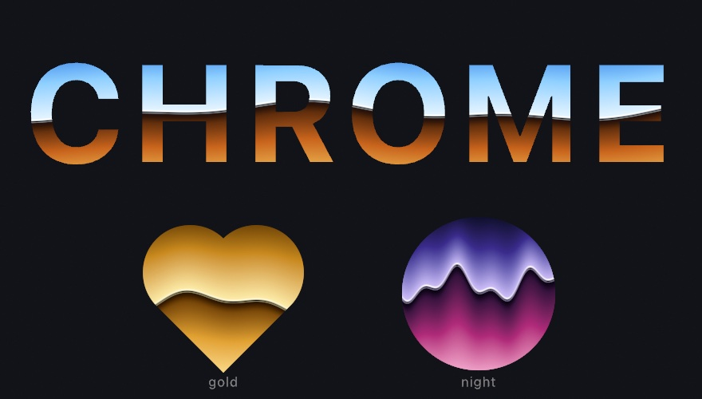

```swift
let word = makeRenderTarget()
withTarget(word) {
    noStroke(); fill(.white)
    textFont(.systemBold); textSize(220); textAlign(.center, .middle)
    drawText("CHROME", width / 2, height / 2)
}
drawImage(word.filtered(.chrome(phase: time * 0.6)).image, 0, 0)
```

Every stop is a parameter. `sky` and `floor` are ramps, read from the top of the layer down to the horizon and from the horizon down to the bottom. `core` and `wire` are colors. So the gold and the night palettes under the word are the same filter with other ramps. `horizon` sets where the join sits, `warp` how far it bends, `waves` how often, and `phase` drifts the bend: feed it `time`. It differs from `.liquidMetal` in the last step, whose bands wrap an inflated shape. This one reads as lettering because its horizon is a line. The parameters are on the [Effects](../Docs/Drawing/Effects.md#design) page. [`Examples/Effects/ChromeLettering`](../Examples/Effects/ChromeLettering/Sketch.swift) letters a word in three palettes picked from the inspector.

## One filter, five pictures: chromatic aberration

A word lettered in chrome over a photograph is still a clean picture. The next filters take it through glass. Chromatic aberration pulls the color channels apart a little, so a white edge grows a colored rim. It is for the look of glass: a cheap lens, or a fast lens wide open. The name is the lens fault it imitates, where glass bends each wavelength by a slightly different amount and the colors land apart. Most filters have a strength argument. This one has a strength argument and a **mode**. Each mode is a different picture, because what the mode decides is *where* the channels get pulled.

<picture>
  <source media="(prefers-color-scheme: dark)" srcset="Images/21-GlassChromeAndTape/Dispersion-dark.jpg">
  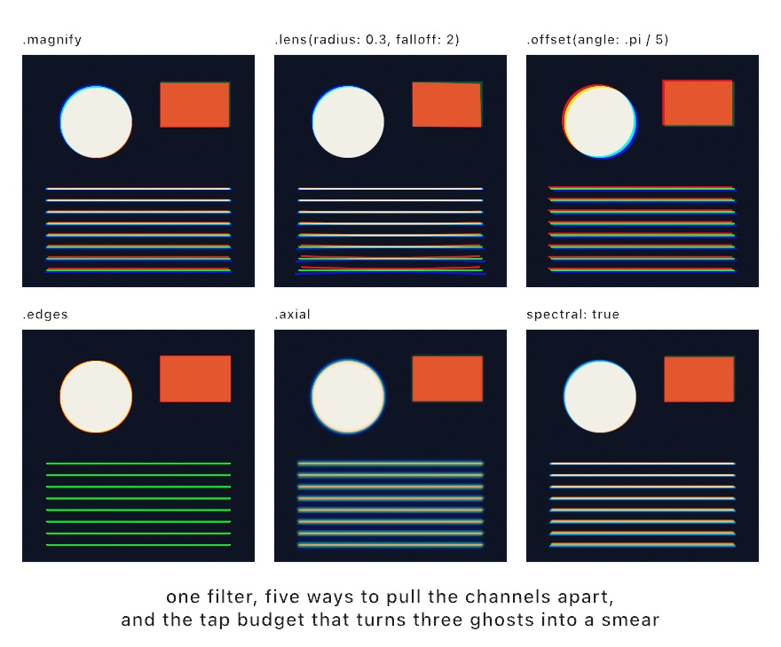
</picture>

```swift
layer.filtered(.chromaticAberration(amount: 0.018))                        // the default
layer.filtered(.chromaticAberration(amount: 0.05, mode: .lens(radius: 0.3, falloff: 2)))
layer.filtered(.chromaticAberration(amount: 0.012, mode: .offset(angle: .pi / 5)))
layer.filtered(.chromaticAberration(amount: 0.03, mode: .edges))
layer.filtered(.chromaticAberration(amount: 0.022, mode: .axial))
layer.filtered(.chromaticAberration(amount: 0.018, spectral: true))
```

**`.magnify` is the default, and it scales each channel about the middle of the frame.** The middle does not split at all, and the split grows the further out you go. Straight lines stay straight. This is the form a lens produces, and it is the one to reach for first.

**`.lens(radius:falloff:)` shapes that growth.** `radius` says how far out the fringe starts to show, and `falloff` says how fast it grows past there. About 2 reads like glass. In the second panel nothing happens near the middle at all, and the bottom of the frame comes apart.

**`.offset(angle:)` moves every pixel by the same vector.** The middle splits as much as the corner, which no lens does. That is the point. This is a plate printed a hair off, an anaglyph, a scan that slipped.

**`.edges` puts the fringe only where there is an edge.** It slides along the direction in which the brightness changes fastest, which is called the brightness gradient. The slide scales with how steep that change is, so flat areas keep their exact color. Fringing on a lens is only visible at high-contrast edges. Putting it there and nowhere else is what stops it reading as a filter laid over the picture. The thin lines go green because a three-pixel line is all edge. Red slides off one side, blue off the other, and green is what stays.

**`.axial` changes focus instead of position.** One end of the spectrum stays sharp while the other softens, which is most of the look of a fast lens wide open. A positive amount keeps red sharp, and a negative one keeps blue sharp. That sign is the difference between a highlight going green and going magenta, so try both.

Two more things to know. Every mode hands the layer straight back at `amount: 0`, so an A/B costs nothing. And `spectral: true` takes the split over a whole set of wavelengths instead of three. That is the difference between the last panel and the first: three hard ghosts become one continuous smear. It costs more taps, and `quality:` sets how many.

There is a two-layer version too. `.dispersed(by:)` in a `compose` block, or `Combine.disperse` on its own, scales the amount by a second layer's brightness. A `Combine` is an effect that reads two layers, and the [effects reference](../Docs/Drawing/Effects.md#combined) lists them. [Chapter 22](22-PicturesYouSolve.md#a-field-you-measure-the-distance-field) applies one with `combined(with:_:)`. Draw white where you want the color to come apart and black everywhere else, and the fringe lands only there.

## Through a lens, onto a wall, and through a mixer: lensDistortion, cornerPin, and channelMixer

Three more filters take one poster somewhere else. Two of them are warps with a physical model behind them. The third is the glass filter a black-and-white photographer screws onto a lens, done as arithmetic.

<picture>
  <source media="(prefers-color-scheme: dark)" srcset="Images/21-GlassChromeAndTape/LensPinMixer-dark.jpg">
  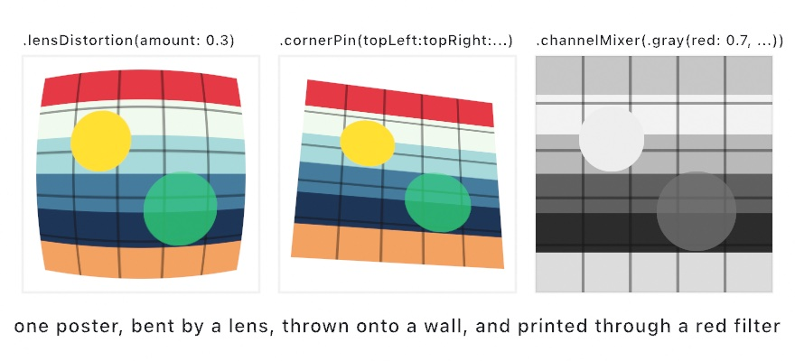
</picture>

```swift
layer.filtered(.lensDistortion(amount: 0.3, quartic: 0.1))
layer.filtered(.cornerPin(topRight: Vector2(0.9, 0.2), bottomRight: Vector2(0.95, 0.9)))
layer.filtered(.channelMixer(.gray(red: 0.7, green: 0.2, blue: 0.1)))
```

**`.lensDistortion` bends the picture the way a real lens does.** A point some distance from the center reads the layer a little further out than itself. The factor grows with the square of that distance. That one rule is the radial part of the lens model that photogrammetry, the measuring of real things from photographs, fits to real glass. It makes straight lines bow. A positive `amount` is a barrel, in the first panel. The lines bow outward, and the corners read past the layer's edge, so they come back empty. A negative amount is a pincushion. The lines bow inward and the corners pull in from the edge. `quartic` adds a second term that grows with the fourth power of the distance. It bends the corners and leaves the middle alone. The empty corners are honest, and sometimes what you want. When they are not, `fillsFrame: true` scales the read so the frame stays full, at the cost of the outermost strip of the picture.

**`.cornerPin` lays the picture onto four points.** Give it where the four corners should land, in `0...1` layer coordinates, and every point between follows. Straight lines stay straight, and parallel edges may meet, the way a picture thrown onto a wall from an angle does. Each corner defaults to its own place, so moving one is one argument. In the second panel the right edge leans away and the top and bottom edges converge toward it. Outside the four points the layer is not there at all. [Installation mode](../Docs/Output/Installation.md) runs the same map over the whole output to fit a projector to a wall. Here it runs over one layer at a time. That is how you put a picture into a picture in perspective: a poster on a drawn wall, a screen inside a drawn room.

**`.channelMixer` weighs every channel from all of them.** A `ColorMatrix` has a row for each output channel. The row says how much of the input's red, green, blue, and alpha goes into it, plus a number added at the end. `ColorMatrix.gray` is the gray a display makes, and `.gray(red:green:blue:)` is a gray mixed to your own recipe. The third panel is a red filter's monochrome, with red weighted heavily and blue hardly at all. The red bars come out light and the blue ones dark. That is what a black-and-white photographer's red filter does to a sky. `.swapping(.red, .blue)` trades two channels. A matrix built by hand does the rest, one row per channel. `ColorMatrix(red: [1, 0, 0, 0, 0.1])` lifts red by a tenth and leaves the other channels as they were. The arithmetic runs in linear light. An offset of a tenth is a tenth of the light, not a tenth of the code value.

## Looks from tape, a codec, a lens, and paper

The last step carries the picture the way old media did. A videotape smears its color and tears its bottom lines. A JPEG breaks a picture into blocks, and a tilt-shift lens turns a town into a model. Film fogs where light leaked in, and paper curls. People now want each of those on purpose, for a music video, a poster, or a title card. Ollin has them as six filters, a generator, and a simulation:

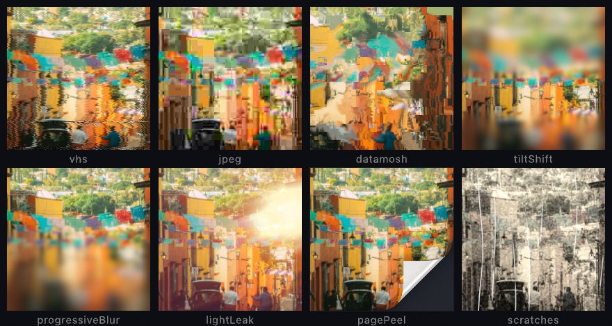

The tape and the JPEG rebuild the mechanism rather than paint its symptoms. `.vhs` keeps its luma sharp and smears only the chroma, the split a video signal makes. `.jpeg` runs the format's own 8 by 8 cosine transform with the standard's quantization tables. A quality reads as it does in an export dialog. `.datamosh` is a simulation, because a held block needs the picture it held. `.scratches` is a generator you lay over a picture. Each is one call:

```swift
let street = makeRenderTarget()
withTarget(street) { background(.white); fill(.orange); drawCircle(width / 2, height / 2, 300) }
drawImage(street.filtered(.vhs(phase: time)).image, 0, 0)
drawImage(street.filtered(.jpeg(quality: 8)).image, 0, 0)
drawImage(street.filtered(.tiltShift(focus: 0.6, radius: 14)).image, 0, 0)
drawImage(street.filtered(.pagePeel(amount: 0.3)).image, 0, 0)
```

The scratches are a separate layer because a scratch lives on the film, not in the picture. So the title card draws them over everything else, after the tape has played the frame. The [`Effects/TapeAndLens`](../Examples/Effects/TapeAndLens/Sketch.swift) example runs all eight, one picker across them. [Layered effects](../Docs/Drawing/Effects.md#tape-and-lens) has every argument, the light leak's and the page peel's among them.

## Putting it together: the title card

The title card is the opening of a film nobody shot. A word is lettered in chrome over a shore at dusk, seen through a cheap lens, and played off a worn tape. It stacks four of this chapter's steps. `chrome` letters the word, `lensDistortion` and `chromaticAberration` take the card through glass, and `vhs` with `scratches` plays it off a tape. Make `MySketches/TitleCard.swift`:

```swift
import Ollin
import OllinSamplePhotos

final class TitleCard: Sketch {
    var photo = Image(width: 1, height: 1)

    override func setup() {
        photo = SamplePhoto.headland.load()
    }

    override func draw() {
        // The word as a silhouette in a band of its own, lettered in chrome by
        // the filter, which reads the band's height as its sky and its floor.
        let band = Int(height * 0.3)
        let word = makeRenderTarget(width: Int(width), height: band)
        withTarget(word) {
            noStroke()
            fill(.white)
            textFont(.systemBold)
            textSize(Double(band) * 0.78)
            textAlign(.center, .middle)
            drawText("OLLIN", width / 2, Double(band) / 2)
        }

        // The card: the shore at dusk, with the chrome word over its sky.
        let card = makeRenderTarget()
        withTarget(card) {
            drawImage(photo, in: canvasRectangle, fit: .cover)
            drawImage(word.filtered(.chrome(phase: time * 0.5)).image, 0, height * 0.2)
        }

        // Through a cheap lens: a barrel, and color pulled apart toward the edges.
        let lens = card
            .filtered(.lensDistortion(amount: 0.16, fillsFrame: true))
            .filtered(.chromaticAberration(amount: 0.02, mode: .lens(radius: 0.3, falloff: 2)))
        drawImage(lens.image, 0, 0)

        // Off a worn tape, with a print's scratches over it.
        postProcess(.vhs(phase: time))
        drawImage(generate(.scratches(phase: time, seed: 3)).image, 0, 0)
    }
}
```

The photograph is one of the bundled sample photographs from [Chapter 9](09-Pictures.md). It is a headland at dusk with its sky mostly empty, which leaves room for a word.

The word gets a layer the height of a band across the canvas rather than one the size of the whole frame. The chrome reads its sky from the top of the layer down to the horizon and its floor from there to the bottom. In a band only a little taller than the letters, the whole sky and the whole floor land on the word. In a full-height layer, the letters would catch only the few rows of each ramp nearest the horizon. The band is then drawn over the photograph a fifth of the way down, into the sky.

The card holds the finished picture, so the lens works on all of it at once. `lensDistortion` bows it into a barrel, and `fillsFrame: true` scales the read so the corners stay full. `chromaticAberration` in `.lens` mode leaves the middle alone and splits the color more toward the edges, which is where a cheap lens shows it. So the word stays sharp and the cactus at the frame's edge grows its fringes.

The tape plays last, through `postProcess`, so it works on the whole frame. The scratches come after it, because they are on the film rather than in the scene, and the tape should never smear them. The card moves because `chrome` and `vhs` both take `time` as their phase: the horizon in the letters drifts, and the tape wobbles and tears.

> **Swift note.** `makeRenderTarget(width:height:)` is the sized form of [Chapter 19](19-LayersAndEffects.md)'s layer, and `Int(...)` turns a canvas size into the whole number of pixels it asks for. A chain of `.filtered` calls reads left to right, each filter working on what the one before it handed back.

Then make it yours:

- Try a different glass. `.chromaticAberration(amount: 0.012, mode: .offset(angle: .pi / 5))` shifts every color by one vector, a plate printed a hair off, and `.edges` puts the fringe only where the picture has an edge.
- Trade the tape for a codec. `postProcess(.jpeg(quality: 12))` in place of `.vhs` breaks the card into blocks, the way a title ripped from an old file looks.
- Letter it in another palette. `.chrome(sky:floor:)` takes two ramps, so the gold and the night palettes of the chrome step are a change of arguments.

A title card is a few seconds of moving picture, so keep it as one. `swift run OllinLive MySketches/TitleCard.swift --export-video title.mp4 --seconds 6` writes six seconds of it.

## More materials: holographic foil and bubble wrap

The title card lettered its word in chrome, one of the materials a filter builds from a silhouette. Two more belong to the same shelf. One builds a material from a shape, and the other lays a material over a whole picture.

### A sheet of holographic foil: holographicFoil

Holographic foil is one more material from a silhouette. The filter fills the shape with crumpled foil, the sticker-sheet kind whose rainbow jumps at every crease. It is a material built from geometry rather than from a field. The sheet is a `FacetField`, a triangulation lifted by a height function so each triangle knows which way it leans, and the filter builds one for itself or takes the one you hand it. A stepped rainbow, a `Ramp.stepped` with hard edges and no blending, runs across the sheet in stripes, and every facet moves the stripes by its tilt. That one move is the whole look: two facets that meet at a crease lean differently, so the stripe on one side is not the stripe on the other. A light shades the facets, lights the creases it crosses and darkens the ones it runs along, and puts a cross glint on the corners of the facets that face it hardest. The right panel below is the sheet the left panel read, drawn in geometry by the same light.

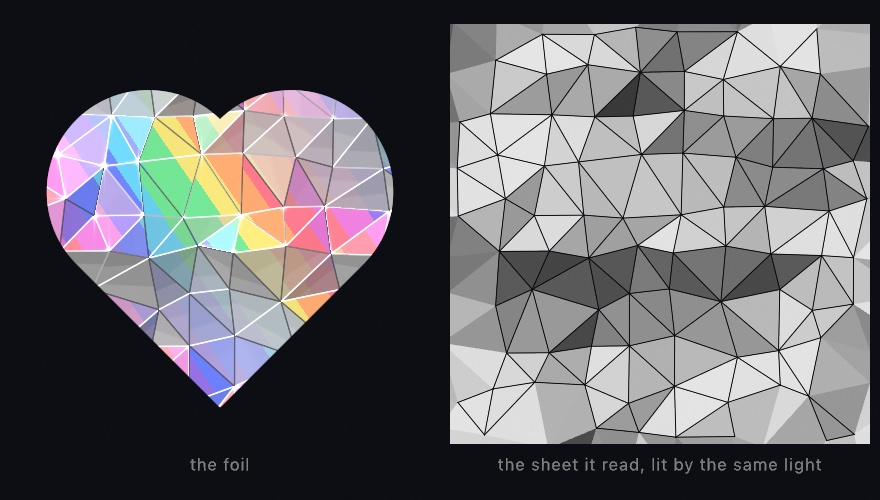

```swift
let sheet = FacetField.crumpled(in: canvasRectangle, spacing: 56, crinkle: 0.6, seed: 1)
drawImage(art.filtered(.holographicFoil(facets: sheet, lightAngle: time * 0.3, phase: time)).image, 0, 0)
stroke(Color(white: 0.1, alpha: 0.6))
for crease in sheet.edges { drawLine(crease) }       // the filter's creases, in ink
```

`phase` sweeps the bands and `lightAngle` turns the light, which is all the animation needs; `relief` reads the layer's own brightness as height, so a gray mark drawn into the layer presses into the foil as creases. The creases you stroke from the sheet land on the filter's own, because the GPU reads the facets you hold, which is also what makes the sheet a plotter can draw. The filter's parameters are on the [Effects](../Docs/Drawing/Effects.md#design) page, the sheet is on the [Voronoi](../Docs/Drawing/Voronoi.md#facets) page beside the triangulation it stands on, and [`Examples/Effects/CrumpledFoil`](../Examples/Effects/CrumpledFoil/Sketch.swift) fills the whole canvas with a sheet that breathes.

### A sheet over the picture: bubbleWrap

Bubble wrap works the other way, like the bottom row of the design filters. It transforms the picture rather than reading a shape, and it is the one that goes over everything. `.bubbleWrap` lays a sheet of bubble wrap on the layer. The bubbles sit on a hex lattice, and each one is a lens that magnifies what is under it, bending the picture more toward its rim as a dome does. Each has a shadow ring, a bright arc on the side toward the light, a dark arc on the side away, and a highlight on the dome. The film between the bubbles leaves the layer as it is. Applied with `postProcess`, it wraps the whole frame, drawing and all.

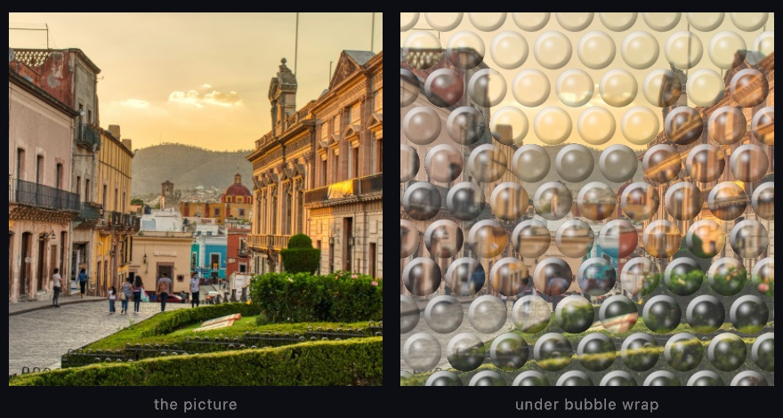

```swift
drawCircle(width / 2, height / 2, 300)        // whatever the frame holds
postProcess(.bubbleWrap(radius: 26, gap: 6, lightAngle: -2.2))
```

`radius` and `gap` are in layer pixels, and `magnification` is how much each lens enlarges. `lightAngle` turns the arcs and the highlight around the bubbles, and `highlight` scales the spot. A radius of 0 changes nothing, which is the filter's resting state. It sits among the material textures that [Chapter 18](18-YourFirstShader.md#surfaces-by-name-rust-verdigris-and-terrazzo) paints from nothing. The [`Effects/Textures`](../Examples/Effects/Textures/Sketch.swift) example has it on the same picker as the rust and the terrazzo. The parameters are on the [Effects](../Docs/Drawing/Effects.md#design) page.

## Filters that read the layer as something else: height, tone, a center, a ring, and a pour

Every filter in the title card read the layer as a picture or a silhouette and handed back a changed picture. A few filters read the same pixels as *information about something else*. They read a height, a tone, a point to warp around, a ring to repeat, a brightness to pour by, a stereo pair, a gas, or a hot road. What you feed them then matters more than their arguments, so each is met on its own here.

### Height, tone, and a center: relight, the two-tone dither, and the warps

`.relight` reads the layer's brightness as height and lights it as a surface. The two-tone `.dither` reads the brightness as tone and screens it into two colors. The warps read a center you give and distort around it. They are for a bumpy material from a noise field, a newsprint look in any two inks, and a distortion placed where you want it. Relight lights the slope it reads with Jim Blinn's highlight model. The dither is Bryce Bayer's ordered matrix, and the radial warps follow the lens warps Inigo Quilez published. Each starts from the same noise layer in the figure:

<picture>
  <source media="(prefers-color-scheme: dark)" srcset="Images/21-GlassChromeAndTape/SpecialFilters-dark.jpg">
  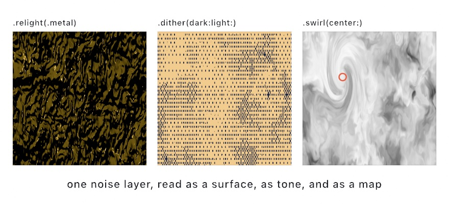
</picture>

```swift
layer.filtered(.relight(.metal, angle: -.pi * 0.7, elevation: 0.55))
layer.filtered(.dither(dark: navy, light: sand, pixelSize: 3))
layer.filtered(.swirl(angle: 4.2, radius: 0.42, center: Vector2(0.3, 0.34)))
```

**`.relight` reads brightness as height.** It treats a bright pixel as a high point and a dark one as a low point. It then works out which way the resulting surface faces, and lights it from an angle you choose. Hand it a photograph and you get an odd embossed thing. Hand it a noise field, as the first panel does, and you get hammered metal, because noise makes a plausible bumpy surface. Five finishes change how the material responds, from `.matte` through `.metal` and `.glass` to `.sand` and `.liquid`. [Chapter 24](24-GridSimulations.md)'s ripple pool uses it to turn a height field into water.

**`.dither(dark:light:)` reads brightness as tone.** It screens the layer into exactly two colors of your choosing. Each pixel comes from a repeating pattern, the ordered dither [Chapter 9](09-Pictures.md) met when it cut a photograph down to a few colors. Gradients survive as texture rather than collapsing into two flat regions. `pixelSize` makes the grain coarser, which is how you get the look of cheap newsprint or an early screen in any two colors you like.

**The warp filters read a center.** `.swirl`, `.bulge`, and `.ripple` all distort around the middle of the layer by default. Each takes a `center` given in `0...1` layer coordinates. That one argument is what turns a symmetric effect into a composition. Feed it `bounds.uv(of: mouse)`, the mouse as a fraction of the canvas, and the distortion sits under the pointer. The marked circle in the third panel is the center that swirl was given.

The [effects reference](../Docs/Drawing/Effects.md#filter) has every argument, and [`Examples/Effects/Relight`](../Examples/Effects/Relight/Sketch.swift) shows all five finishes side by side.

### A picture inside itself: droste

One warp does something none of the others do. `.droste` makes the picture contain itself. It is for the picture that goes on forever, a frame with a smaller copy of itself in its middle. It takes its name from a Dutch cocoa tin whose label showed a nurse carrying a tray with the same tin on it. The construction it runs is the one Escher used in *Print Gallery*, which Hendrik Lenstra and Bart de Smit analyzed and completed in 2003.

<picture>
  <source media="(prefers-color-scheme: dark)" srcset="Images/21-GlassChromeAndTape/PictureInsideItself-dark.jpg">
  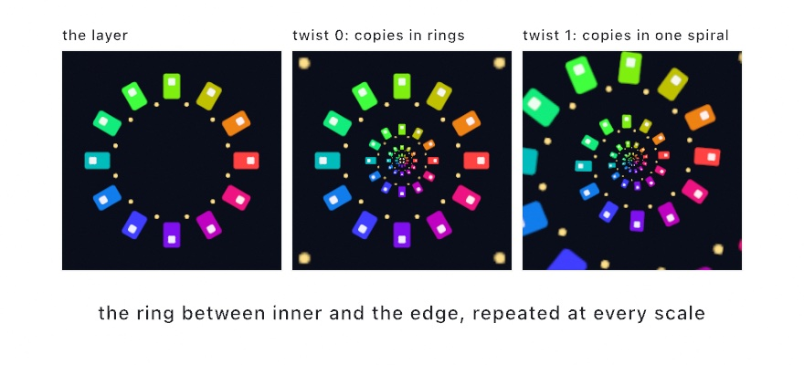
</picture>

```swift
layer.filtered(.droste(inner: 0.42, twist: 1, zoom: time * 0.2))
```

Take the ring between `inner` and the edge of the layer. Imagine straightening it into a strip, the way you would cut a rubber band and pull it flat. A strip can be repeated end to end forever. Curl the repeated strip back into a ring and each copy comes out smaller than the last. That is a picture with a smaller copy of itself in the middle, and a smaller copy in the middle of that one.

`inner` is the radius of the hole, and it is also how much smaller each copy is than the one around it. `twist` is the part Escher used. At 0 the copies sit in plain concentric rings. At 1, going once around the middle also steps you one copy down in size. The rings wind into a single spiral, and there is no longer any place where one copy ends and the next starts.

`zoom` slides the picture into itself, counted in copies. Add exactly 1 and you are back where you began, which makes this the rare animation that loops with nothing to hide. `zoom: time * 0.2` falls forever and repeats every five seconds.

One thing to design for. The filter reads a ring, and the outer edge of that ring has to meet the inner edge of the next copy along. If your content runs to both edges, the join shows up as a hard circle. Keep the content clear of both, or let the ring end on flat color at each end. The layer in the figure does the second thing: plain dark ground inside and outside, windows only in between.

### The picture poured: melt

`.melt` liquifies a layer by its own brightness. It is a design filter, for a picture poured into marbling that still reads as the picture. It is built on Inigo Quilez's domain warping, noise that bends the coordinates other noise is read at.

<picture>
  <source media="(prefers-color-scheme: dark)" srcset="Images/21-GlassChromeAndTape/Melt-dark.jpg">
  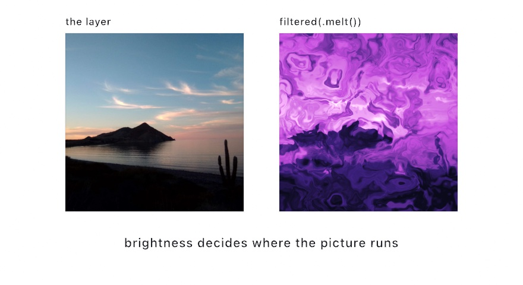
</picture>

```swift
drawImage(scene.filtered(.melt(phase: time)).image, 0, 0)
```

Underneath, the filter builds a swirling noise field and uses one displacement vector for two jobs at once. That vector warps the field's own coordinates, and it also shifts where the filter reads your layer. Because the same vector does both, the picture and the swirl move together instead of one sliding over the other. The result reads as the image having been *dyed* rather than smeared. The layer's brightness mixes back into the field before it goes through a color ramp, so bright regions stay bright and structural. The lit sky in the figure comes through the pour as the pale half of the picture, with the dark shore still holding the bottom.

It is a strong effect at its defaults, and `liquify`, `warp`, and `blend` dial back how far it takes the picture. The sway that animates it uses frequencies that do not divide evenly into each other, so it never repeats. It drifts forever, and it will not give you a seamless loop.

### Depth, density, and hot air: anaglyph, schlieren, and mirage

Three more filters read the layer as something else. `.anaglyph` reads it as a stereo pair, `.schlieren` as the density of a gas, and `.mirage` as a scene with hot air over its ground. They are for a print seen through red-and-cyan glasses, the look of a schlieren photograph of heat, and the shimmer over a summer road. The anaglyph is the red-and-cyan method Wilhelm Rollmann described in 1853. Schlieren is August Toepler's knife-edge method of 1864. The mirage is a drawing convention rather than a model of the refraction:

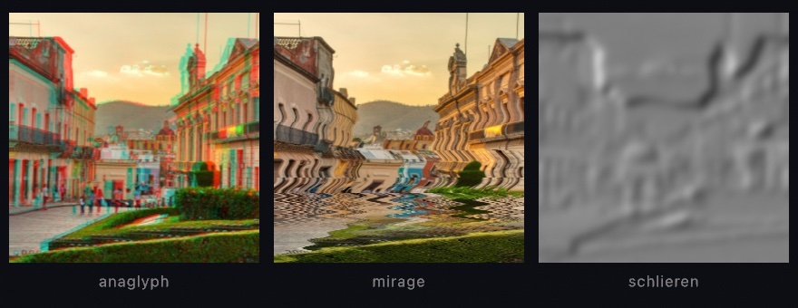

The anaglyph reads the red channel from a copy of the layer shifted one way, and the green and blue from a copy shifted the other. A dark mark on a light ground then comes out as a cyan copy and a red copy that meet in a fused dark, which reads as solid through the glasses. Schlieren takes the brightness as density and the slope of that density along a knife as the picture. One side of every spine is lit and the other shaded, with a razor flip between them. The mirage shifts every row above a horizon sideways by a wavering amount that grows toward the horizon, and mirrors the picture below it. Each is one call:

```swift
let picture = makeRenderTarget()
withTarget(picture) { background(.white); fill(.black); drawCircle(width / 2, height / 2, 200) }
drawImage(picture.filtered(.anaglyph(separation: 9)).image, 0, 0)
drawImage(picture.filtered(.gaussianBlur(radius: 6)).filtered(.schlieren(angle: 0.5)).image, 0, 0)
drawImage(picture.filtered(.mirage(horizon: 0.58, amount: 12, phase: time)).image, 0, 0)
```

The filter shifts every pixel by one parallax. A 3D scene has a depth of its own, and `scene.combined(with: scene.depth, .anaglyph())` shifts each pixel by that depth instead, so a near orb stands off the page and a far one sinks into it. The [`Effects/Phenomena`](../Examples/Effects/Phenomena/Sketch.swift) example runs all three, with the orbs orbiting, the air shimmering, and a plume rising under the knife. [Layered effects](../Docs/Drawing/Effects.md#filter) has every argument.

## Where this comes from

The design filters were cross-read against Paper Shaders, the design-shader library from paper.design with shaders by Ksenia Kondrashova. The liquid metal follows its published parameterization closely, re-expressed in Ollin's own Metal. The chrome is the airbrush convention of logo lettering, a sky over a horizon over a floor. The foil's sheet is a triangulation lifted by a height function.

Chromatic aberration and the lens's barrel are faults of real lenses. The barrel and its quartic term are the radial part of the distortion model photogrammetry fits to real glass. The channel mixer is the color matrix of a darkroom printer's filters.

The entries after the title card name their own sources. The picture inside itself is named after a Dutch cocoa tin from 1904. Its label showed a nurse holding a tray with a cup of cocoa and the same tin on it. Escher took the idea somewhere stranger in *Print Gallery* (1956), where a man in a gallery looks at a picture that contains the gallery. He left a hole in the middle, which he signed rather than finished. Hendrik Lenstra and Bart de Smit worked out in 2003 what belonged in it. The straighten-repeat-curl construction the filter runs is Escher's, completed by them. The melt is Inigo Quilez's domain warping, with the picture read through the same warp as the swirl. Its shared displacement and its sway follow *fluid*, an open-source generative-background studio credited in the attribution notes.

The tape and lens looks were read as a map from Shaders, a component library of two hundred web effects. Each was written from its technique. The JPEG is the baseline transform of the ITU's T.81 standard from 1992. Its Annex K tables are scaled by the Independent JPEG Group's quality curve. The tape splits its color into the luma and chroma of the NTSC signal, whose chroma carried far less detail than its luma. The page curl wraps the sheet around a cylinder and lays what passes half a turn flat on top of it. Full credits are in the project's [attribution notes](../ATTRIBUTION.md).

## Go deeper

- [Layered effects](../Docs/Drawing/Effects.md#design): the design filters with every argument, the chrome, the foil, and the bubble wrap among them, and the [tape and lens](../Docs/Drawing/Effects.md#tape-and-lens) looks.
- [Layered effects](../Docs/Drawing/Effects.md#filter): the rest of the filter catalog, chromatic aberration, the lens's barrel, the corner pin, the channel mixer, and the filters that read a layer as something else.
- [Sample photographs](../Docs/Drawing/SamplePhotos.md): the bundled pictures the chapter's figures and its title card start from.
- Worked examples: [`Examples/Effects/ChromeLettering`](../Examples/Effects/ChromeLettering/Sketch.swift) (a word in airbrushed chrome in three palettes), [`Examples/Effects/Dispersion`](../Examples/Effects/Dispersion/Sketch.swift) (chromatic aberration in every mode), [`Examples/Effects/TapeAndLens`](../Examples/Effects/TapeAndLens/Sketch.swift) (one street eight ways), [`Examples/Effects/CrumpledFoil`](../Examples/Effects/CrumpledFoil/Sketch.swift), [`Examples/Effects/Textures`](../Examples/Effects/Textures/Sketch.swift) (bubble wrap beside the rust, the verdigris, and the terrazzo), [`Examples/Effects/Relight`](../Examples/Effects/Relight/Sketch.swift), [`Examples/Effects/Droste`](../Examples/Effects/Droste/Sketch.swift), [`Examples/Effects/Phenomena`](../Examples/Effects/Phenomena/Sketch.swift) (the anaglyph, the mirage, and the schlieren knife), and [`Examples/Effects/FilterCatalog`](../Examples/Effects/FilterCatalog/Sketch.swift).

---

[Contents](README.md#contents) · Previous: [Chapter 20, Pictures restyled](20-PicturesRestyled.md) · Next: [Chapter 22, Pictures you solve](22-PicturesYouSolve.md)
