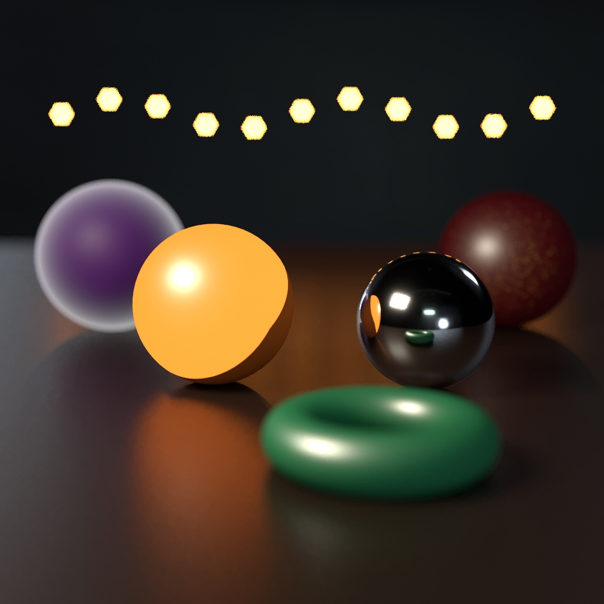
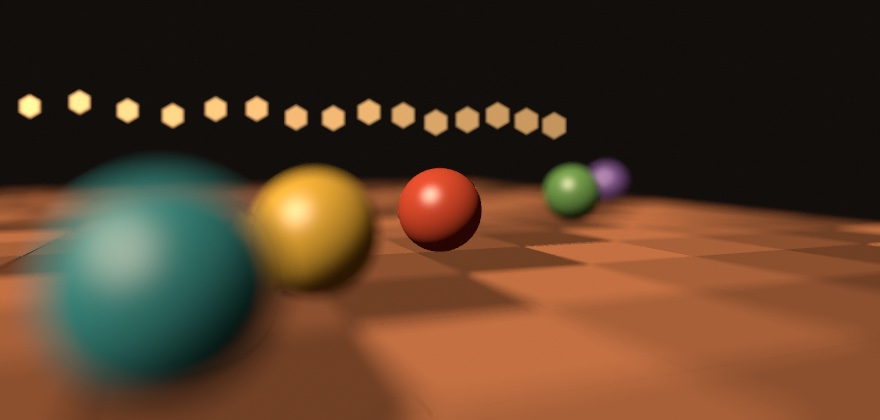
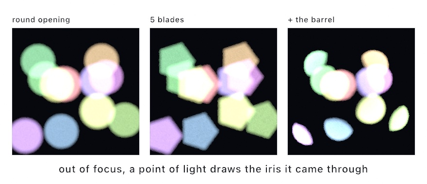
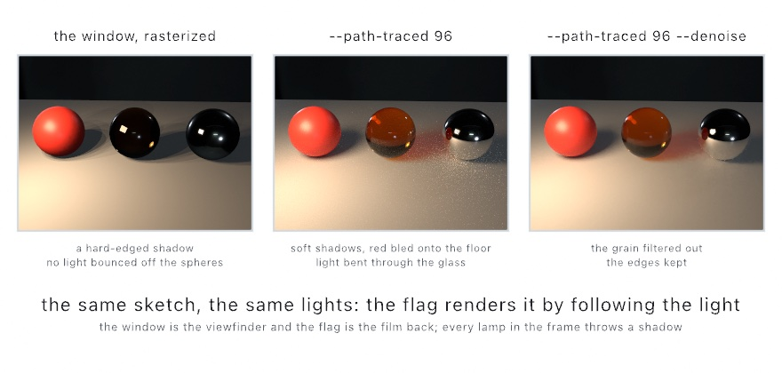
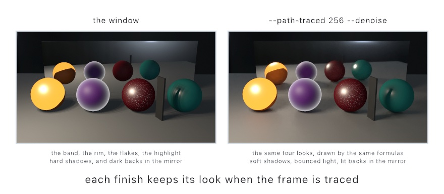
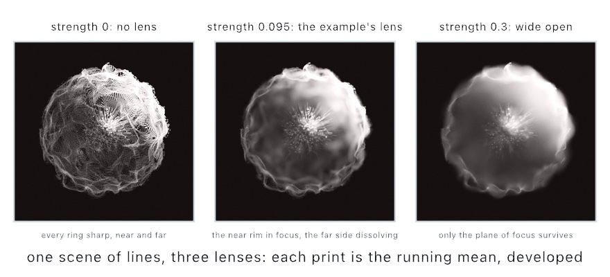

#### <sup>[Ollin](../README.md) → [Guide](README.md) → Chapter 35</sup>

---

# 35. The lens and the slow render



A photograph keeps one distance sharp and lets the rest go soft. Its light has also bounced around the room on the way to the film. This chapter gives a 3D sketch both. The camera gets a lens, whose opening sets how much of the frame blurs and whose blades shape the blur. Then an export follows the light path by path, slowly, until the shadows, the color, and the mirrors agree. The still life above uses both. After it come the flags that steer a long render, and a blur built from samples of light.

## The frame through the camera's lens: depthOfField()

A 3D frame comes out sharp from the nearest thing to the farthest. That is because a `Camera3D` starts as a pinhole, a camera with no lens at all. A real lens has an opening, and the opening is where blur comes from. Light from one distance comes together at a point on the sensor. Light from any other distance arrives spread into a small disc, and a wider opening makes a bigger disc.

So the lens belongs to the camera. Give a `Camera3D` an `aperture`, and call `depthOfField()` in `draw()`:

```swift
var lens = Camera3D.perspective(eye: Vector3(-1.6, 0.75, 4.6), target: Vector3(0.2, 0.35, 0))
lens.aperture = 0.14          // 0 is a pinhole, sharp everywhere
lens.apertureBlades = 6       // the next step is about this line
camera(lens)
depthOfField()
```



`aperture` is the radius of the opening, in world units. The lens focuses on the camera's target, which here is the red ball in the middle. Set `focusDistance` to focus at another distance from the eye. Everything else spreads by how far it sits from the focus. The yellow ball is a little soft, and the teal one nearest the camera has turned into a veil over the floor. Behind the focus, the green and violet balls soften, and the small lamps along the back open into discs.

Two published results are behind that picture. How far each point spreads is the circle of confusion that Michael Potmesil and Indranil Chakravarty worked out for a camera lens in 1981. The blur then gathers each pixel's neighbors as if every one had scattered its light into a disc, which Jorge Jimenez described in 2014. Written that way, a small lamp keeps all of its light as it opens. A lamp only a few pixels across would slip between the gather's samples. So each one is drawn as a disc of its own, which comes out even at any quality.

`depthOfField()` blurs the finished frame by the frame's own depth, so it runs in the live window and an export carries it. What a blurred foreground hides is read from a second drawing of the scene behind it. The teal ball's soft edge then shows the floor the ball hides, not the dark above the horizon. `focusRange` holds a band sharp on either side of the focus, for when a whole subject should stay crisp. The blur runs after the edge average of [Chapter 34](34-TracedLight.md#edges-that-settle-temporal-anti-aliasing) and before its motion blur, so a sketch can carry all three.

[Chapter 27](27-3DGently.md#what-the-depth-buffer-is-for-ambient-occlusion-and-defocus)'s `.defocus` does a similar job for a layer, with a depth layer you hand it. `depthOfField()` is the one for the main canvas, and it takes everything it needs from the camera.

A caption drawn over the scene would blur with whatever is under it, since the pass reads only depth. `withOverlay` holds its block back and draws it after the lens, the edge average, the motion blur, and the frame filters. So a readout stays sharp over all of them:

```swift
withOverlay {
    fill(.white)
    drawText("f/1.4", 24, height - 24)
}
```

The block lands over everything else in the frame, whatever order it was called in. A blend mode inside it reads the finished picture. Over a canvas that piles up (`noClear()`), it is drawn each frame without joining the pile.

## The shape of a blur: bokeh

The lamps in that figure opened into six-sided discs, and `lens.apertureBlades = 6` is why. A camera's iris is the ring of thin metal blades that sets the size of the opening. It is the same iris that shaped the ghosts of [Chapter 34's lens flare](34-TracedLight.md#light-in-the-camera-lens-flare). Six blades make a six-sided opening. Out of focus, a point of light becomes a copy of the opening its light came through, so every blurred lamp is a hexagon. Photographers call the look of out-of-focus light **bokeh**, from a Japanese word for blur.

<picture>
  <source media="(prefers-color-scheme: dark)" srcset="Images/35-TheLensAndTheSlowRender/TheOpening-dark.jpg">
  
</picture>

The figure throws the same handful of lights out of focus three ways. A round opening gives round discs, and five blades give pentagons. The third panel adds the barrel of the lens. Toward the corners of the frame, the barrel clips the opening from one side, and a highlight narrows into a lemon shape. That shape is called a cat's eye, and the barrel's clip is called optical vignetting. Lawrence McIntosh, Bernhard Riecke, and Steve DiPaola showed in 2012 how a blur worked out from a finished frame can carry a polygon opening. Craig Kolb, Don Mitchell, and Pat Hanrahan reproduced the vignetting in 1995 by tracing rays through a whole lens.

On the camera, the blade count is the one thing to set, and 0 is a round iris. The layer blur takes the shape as arguments of its own. Hand `.defocus` a `blades` count and every highlight becomes a polygon of that many sides. Its `catsEye` argument adds the barrel:

```swift
let focused = scene.combined(with: scene.depth,
                             .defocus(focus: 0.46, range: 0.13, maxBlur: 16, blades: 5, catsEye: 1))
```

At full strength the barrel's round opening trims even the middle highlights, as the third panel shows. Leave `blades` out, and a scene defocused by its own depth takes the count from the camera that drew it. So one line on the camera shapes the canvas blur, the layer blur, the flare's ghosts, and the traced lens later in this chapter. Name `blades` at the call only for a blur no camera knows about, such as one over a depth ramp you drew by hand.

The layer blur gathers a fixed number of samples. A light smaller than the space between them shows the pattern of the gather instead of a clean edge. So keep a light a few pixels across, or raise `quality`.

## Light followed path by path: the path-traced export

The lens so far is a blur laid over a finished frame, and the frame under it is drawn the usual way. Ollin fills in each triangle pixel by pixel, which is called **rasterizing**. It adds shadows, mirrors, and bounce on top, each worked out on its own. That is fast enough for a live window. A still does not have to be fast, so it can be rendered another way.

A **path tracer** renders a frame by following light. For each pixel it sends many paths into the scene. Each path bounces from surface to surface until it reaches a light, and the pixel is the average of what the paths bring back. It is for the finished still, where shadows, bounces, glass, and mirrors all have to agree. The method goes back to James Kajiya's 1986 paper *The Rendering Equation*. The paper wrote all the light in a scene as one equation and introduced path tracing to estimate it.

<picture>
  <source media="(prefers-color-scheme: dark)" srcset="Images/35-TheLensAndTheSlowRender/TracedLight-dark.jpg">
  
</picture>

The figure is one small set rendered three ways. Rasterized, the softbox throws a hard-edged shadow, and the floor is lit by the softbox alone. The glass sphere is a tinted shell, and the chrome one is a dark ball with a highlight. Traced at 96 paths a pixel, the shadows soften as they fall away from each sphere. The red sphere warms the floor beside it. The light goes through the amber glass and lands as a tinted pool where the first panel had a black shadow. The chrome shows the set. What is left at 96 is grain, and the third panel is the same trace through the grain filter that a later step adds.

Nothing in the sketch changes. Add `--path-traced` to an image or video export, here for [Chapter 34's lamplit room](34-TracedLight.md#putting-it-together-the-lamplit-room):

```sh
swift run OllinLive MySketches/LamplitRoom.swift --export room.png --path-traced 512
```

The number is light paths per pixel. Each path is one sample of that pixel, so the number is also called the sample count. More paths give a smoother picture, and the time grows in step with the count. So you frame and tune in the live window, then let the export take its time. Any 3D sketch made of solid meshes can take the flag, so use one of your own if you skipped the room.

The traced frame adds what the live one leaves out. Shadows from an area light are sharp at the contact and soften with distance. Color bleeds between neighboring surfaces. Every polished surface mirrors the scene, the other mirrors included. A `.glass` material bends the view through a solid body, and a colored one tints the light that crosses it, so even its shadow glows. A mesh with an emissive material becomes a lamp with a shape, and it lights its neighbors the way a softbox does. Textures, normal maps, surface maps, and emissive maps all reach the traced light. So do the copies of [Chapter 30](30-Landscapes.md#ten-thousand-of-the-same-thing-instancing), so a field of ten thousand pebbles shadows and mirrors like ten thousand placed by hand.

Your light rig comes over as you left it. The tracer follows the light itself, so it needs no `castShadows()`, and every lamp in the frame throws a shadow. A light you told not to cast one still casts none. That matters because the fill light in a preset rig is such a light.

The tracer covers solid meshes. 2D drawing, point clouds, and the fields of [Chapter 33](33-SculptingWithFields.md) keep their usual drawing and take their place in the traced frame by depth. One part of the room does not carry over. Its bright spot under the glass comes from the live `caustics()`, so in the traced frame the glass throws a plain, paler shadow. The export needs an Apple silicon Mac, and [the reference](../Docs/Output/PathTraced.md) lists what the traced frame adds and what stays with the usual drawing.

## Finishes that keep their look: stylized materials, traced

A path tracer works out each surface from physical numbers, such as how rough it is and how much it reflects. Some of [Chapter 27's finishes](27-3DGently.md#materials) are not made of such numbers. `.toon` snaps its shading into bands, `.velvet` glows at its rim, and `.glitter` flashes from its flakes, each by a formula of its own. A finish like that is a picture of the light, not a path the light takes.

So the traced frame draws each of them by the same formula the window uses. A sketch you tuned in the window keeps its picture:

<picture>
  <source media="(prefers-color-scheme: dark)" srcset="Images/35-TheLensAndTheSlowRender/KeptLooks-dark.jpg">
  
</picture>

The figure is four balls in front of a mirror, in toon, velvet, glitter, and `.polished`, under one softbox. The band, the rim, the flakes, and the highlight are the same in both panels. Around them the traced frame has done its usual work. The shadows are soft, the shaded sides are filled by light off the floor, and the backs of the balls in the mirror are lit.

A look is drawn wherever the camera sees the surface: head on, in a mirror, through glass, and through the blur of a lens. What the surface sends on to its neighbors is its plain color. A toon ball tints the floor beside it orange, with none of its bands. That rule keeps a room of stylized surfaces from lighting itself with highlights that were only ever drawn.

Each look also answers the lights the way it does in the window, with a traced ray where the window reads a shadow map. On the right of the figure, a card stands between the softbox and the polished ball. Its shadow crosses the ball where the highlight would be, and the highlight is gone in both panels.

None of this needed new formulas. The tracer runs the window's own, such as the toon bands and the warm-to-cool shading that [Chapter 27](27-3DGently.md#where-this-comes-from) credits. Four layered finishes have no traced form yet. They are the clearcoat of `.carPaint` and `.lacquer`, the sheen of `.satin` and `.felt`, the streak of `.brushedMetal`, and the scattering under `.skin` and `.marble`. Each traces as the plain surface under it, and the [reference](../Docs/Output/PathTraced.md#where-a-look-is-drawn) has the rule in full.

## The same lens, traced: aperture and focusDistance

The traced camera has a lens too, and it is the one you already set. Every path starts from a point on the opening, so the blur is no longer a pass over a finished picture. A mirror blurs by the distance of what it shows, and a foreground cannot hide what the lens would see around it. `aperture`, `focusDistance`, and `apertureBlades` mean what they meant for `depthOfField()`. For the lamplit room, add two lines after `lens.apertureBlades = 6` and before `camera(lens)`:

```swift
lens.aperture = 0.05
lens.focusDistance = 3.7      // from the eye, along the view
```

The traced room then has true depth of field, focused on the glass ball. Its out-of-focus highlights are hexagons, for the same six blades that shaped its flare.

`depthOfField()` does nothing in a traced export, since that frame came through the lens already. So you can leave the call in a sketch. It shows you the lens in the window while you frame, and the export replaces it with the traced one. Without the call the window stays pinhole sharp, and only the traced export has the blur.

## Grain filtered out: denoising

What is left of the error in a traced render is grain. Taking it away by adding paths costs the square: four times the paths for half the grain. `--denoise` filters it out instead, for a clean still at a fraction of the time. Its filter is the edge-avoiding wavelet of Holger Dammertz and colleagues, from 2010. The variance-guided weights of Christoph Schied and colleagues, from 2017, steer it.

The tracer wrote down what it hit, not only what it saw. It kept the first surface's own color, the way it faces, and how far off it is. It also kept how much each pixel's samples disagreed. The filter divides the light by that color, smooths the light alone, and multiplies the color back. A texture keeps its edges and a silhouette keeps its line, because neither was ever in the part being smoothed. The strength comes from the disagreement, so a thin render is smoothed hard and a nearly finished one only a little. On the scene of the [`PathTraced` example](../Examples/3D/Effects/PathTraced/Sketch.swift), 64 filtered samples land about where 240 raw ones would.

It is off unless you ask. A raw render shows only what was traced, and a real sparkle reads softer once the filter has been over it. With the lens set as in the last step, the room's finished still is one command:

```sh
swift run OllinLive MySketches/LamplitRoom.swift --export lamplit-room.png --path-traced 512 --denoise
```

## Putting it together: the still life

The still life is five objects on a dark table under one softbox, with a string of small lamps far behind them. Each object has a finish from [Chapter 27](27-3DGently.md#materials) or [Chapter 29](29-MaterialsAndSurroundings.md#two-numbers-for-most-real-surfaces-pbr), and each sits at its own distance from the lens. Make `MySketches/StillLife.swift`:

```swift
import Ollin

final class StillLife: Sketch {
    override func draw() {
        background(Color(hex: 0x0B0A0D))

        // The camera and its lens: an opening, a focus, and six blades.
        var lens = Camera3D(eye: Vector3(0, 1.3, 5.6), target: Vector3(0, 0.5, 0),
                            projection: .perspective(fieldOfView: .pi / 4.8))
        lens.aperture = 0.11
        lens.focusDistance = 5.5
        lens.apertureBlades = 6
        camera(lens)
        depthOfField()      // the lens in the window; a traced export has its own

        // One softbox from the upper left, and a dim studio for the chrome.
        environment(.studio.intensified(to: 0.18))
        rectangleLight(Color(hex: 0xFFF1DC), at: Vector3(-3.0, 3.4, 2.6),
                       direction: Vector3(0.6, -0.68, -0.42),
                       width: 2.4, height: 1.6, intensity: 11)
        castShadows()

        // The table.
        withState {
            material(.dielectric(roughness: 0.35))
            fill(Color(hex: 0x3A2A22))
            translate(0, -0.25, -3)
            drawBox(width: 14, height: 0.5, depth: 16)
        }

        // In focus: a toon ball, and a chrome ball that mirrors it.
        withState {
            material(.toon)
            fill(Color(hex: 0xE8762C))
            translate(-0.55, 0.5, 0.1)
            drawSphere(radius: 0.5, segments: 64, rings: 32)
        }
        withState {
            material(.metal(roughness: 0.03))
            fill(Color(white: 0.95))
            translate(0.75, 0.42, 0.25)
            drawSphere(radius: 0.42, segments: 64, rings: 32)
        }

        // Nearer than the focus: a jade ring lying on the table.
        withState {
            material(.jade)
            fill(Color(hex: 0x3FA06A))
            translate(0.35, 0.13, 1.7)
            drawTorus(radius: 0.4, tube: 0.13, segments: 96, sides: 32)
        }

        // Past the focus: velvet on the left, glitter on the right.
        withState {
            material(.velvet)
            fill(Color(hex: 0x6A2C8C))
            translate(-1.6, 0.62, -1.9)
            drawSphere(radius: 0.62, segments: 64, rings: 32)
        }
        withState {
            var flakes = Material.glitter
            flakes.sparkleColor = Color(hue: 0.12, saturation: 0.75, brightness: 1)
            material(flakes)
            fill(Color(hue: 0.98, saturation: 0.8, brightness: 0.45))
            translate(1.75, 0.58, -2.0)
            drawSphere(radius: 0.58, segments: 64, rings: 32)
        }

        // A string of small lamps, far behind and far out of focus. Each is a
        // mesh that gives off light, so the traced frame counts it as a lamp.
        var lamp = Mesh.sphere(radius: 0.045)
        lamp.material = MeshMaterial(emissiveColor: Color(red: 10, green: 6, blue: 2.6))
        for i in 0 ..< 11 {
            withState {
                translate(-4.0 + Double(i) * 0.8, 2.3 + 0.25 * sin(Double(i) * 1.3), -9.5)
                drawMesh(lamp)
            }
        }
    }
}
```

The still life uses the camera's lens with `depthOfField()` and the six blades that shape a blur. It also uses the path-traced export, the finishes that keep their look, the traced lens, and the grain filter. The sketch itself is short, because the export does most of the work.

Start with the camera. `aperture` opens the lens, and `focusDistance` puts the focus 5.5 units from the eye, where the toon ball and the chrome ball stand. `depthOfField()` shows that lens in the window. Run the sketch live first and frame it there. Move a ball, and you can watch it go soft or sharp.

The objects are placed by their distance from the focus. The toon ball and the chrome ball are in focus. The jade ring lies nearer than the focus, so it is soft in front of them. The velvet ball and the glitter ball stand past the focus and soften behind. The glitter ball borrows the gold flakes of Chapter 27's car paint.

The lamps are the farthest thing in the frame, about fifteen units from the eye. Each is a small sphere with a `MeshMaterial` whose `emissiveColor` is far brighter than white, the glow [Chapter 28](28-Meshes.md#what-the-surface-is-per-texel-surface-maps) put on a surface. Out of focus, each lamp opens into a hexagon, for the six blades. In the traced frame a glowing mesh is also a light. So the lamps lay a warm light along the far edge of the table and on the back of each ball.

In the window the shadows are hard, and the chrome ball is nearly black, since it has only the dim studio to reflect. The traced frame is the finished picture.

Then make it yours:

- Pull the focus. `lens.focusDistance = 7.6` moves it back to the velvet and the glitter, and the toon ball goes soft in front of them.
- Change the opening. An `aperture` of 0.04 brings most of the table into focus, and 0.2 leaves only a thin slice sharp. Set `apertureBlades` to 5 and the lamps are pentagons, or to 0 and they are round.
- Trade the chrome for glass. Give that ball `material(.glass(thickness: 0.84))`, which is its own width, and a white `fill`. The traced frame bends the scene through it, and the string of lamps shows upside down inside the ball.

This one holds still, so keep it as a traced still:

```sh
swift run OllinLive MySketches/StillLife.swift --export still-life.png --path-traced 512 --denoise
```

That is the picture this chapter opened on. The toon ball keeps the hard band it had in the window. Now it also has a soft shadow, and it leaves its orange on the table. The chrome ball mirrors the toon ball, band and all, and the ring in front of it. The lamps are the hexagons the window showed, and here each one is made of paths that crossed the opening.

## More control over a long render: the noise stop, the bounce bound, reuse, and a time budget

The still life traced every pixel 512 times, and on an M2 a scene that small is done in about a minute. A heavier scene, a polished one, or a sequence asks for more control over where the time goes. Four flags give it, and each one goes on the same export command.

Each one writes what it did into the file's **recipe**, the settings every export keeps in its metadata. [Chapter 43](43-FinishingASketch.md#the-recipe-in-the-file) shows how to read one.

### Stopping where the picture has settled: --pt-noise

Not every pixel needs the whole count. The black around a subject settles in a few samples, and an evenly lit face in a few more. Only a blurred or glossy region needs them all. `--pt-noise` lets each pixel stop once the grain it has left falls under the number you give. The count becomes the most a pixel may trace. The idea goes back to Don Mitchell's 1987 paper on sampling where the contrast is. Its measure of grain comes from Holger Dammertz and colleagues, from 2010.

```sh
swift run OllinLive MySketches/StillLife.swift --export still-life.png --path-traced 512 --pt-noise 0.04
```

The number is the grain a settled pixel may keep. At 0.04 that is about four levels in 255, which suits everyday renders. At 0.01 it is one level, for a final still. The tracer reads the spread of each pixel's own samples, the same measurement the grain filter uses. It checks every eight samples past a minimum, and a pixel that is still sampling keeps its neighbors sampling.

The samples then go where the grain is. On the scene of the `PathTraced` example, the stop reached the same picture as a fixed count at half the samples. A frame still depends only on which frame it is, so a sequence cannot flicker from the stop. The recipe records the mean count the pixels reached.

### Bright dots that no count removes: --pt-clamp

A polished scene has grain the stop cannot read. Every few hundred samples, a path catches a lamp off one polished surface onto another. It carries hundreds of times the light of the rest. That one sample is a bright dot, called a firefly, and no count smooths it. `--pt-clamp 4` sets a bound on light that has bounced twice or more. Such light may add at most four times white to a sample. The dots go, the stop can settle, and a lamp seen in a mirror keeps its value. Production renderers call this control an indirect clamp.

A bound like that takes real light out of the picture, so the frame says how much. The recipe records the share of the frame's light that the bound took. A percent or two is a clean picture. Several percent beside grain that did not move means the grain was one-bounce light, which the bound leaves alone. That scene wants a higher count instead.

One kind of polished grain needs no flag. A bead a dozen pixels wide mirrors a whole lit room, so each of its pixels covers a wide cone of directions. The tracer reads the surroundings and the lights over that whole footprint, not along one direction of it. A field of such beads then comes out clean at a count that would otherwise leave it grainy. A flat mirror reads as sharp as ever. The footprint travels with each path as a ray cone, after Tomas Akenine-Möller and colleagues.

### Frames that share their samples: --pt-reuse

A sequence has one more saving, because most of a frame's light is the last frame's. `--pt-reuse 8` carries up to eight frames' worth of samples into each frame of a video or a sequence. It is the half of the Schied filter that works across time, written here for an offline sequence. The lamplit room moves, so it makes a good subject:

```sh
swift run OllinLive MySketches/LamplitRoom.swift --export-video lamplit-room.mp4 --seconds 4 --path-traced 32 --pt-reuse 8
```

Each frame follows every pixel back to where it was in the frame before. A mover declared with `withMotion` is followed by its own motion, and everything else by the camera's, through the depth. The frame takes only the samples that belonged to the same surface, and it trusts them only as far as its own grain allows. So a reflection that slides over a ball is followed and not smeared. A sequence at 32 samples a frame then shows the grain of 256, and that grain holds still from frame to frame.

### A render by the clock: --pt-seconds

Sometimes the hours are what is fixed. `--pt-seconds 10` gives each frame ten seconds in place of a count, and the count follows the scene. Production renderers offer the same choice, a time limit beside a sample count.

```sh
swift run OllinLive MySketches/StillLife.swift --export still-life.png --path-traced --pt-seconds 10
```

The frame the clock leaves is a fixed render of the count it reached, byte for byte. The recipe records that count, so a frame you liked renders again exactly from it.

## A lens made of samples: depth of field from light

Both lenses in this chapter blur a scene of solid surfaces. One works over the finished frame, and the other works inside the tracer. A third lens is made of light itself. [Chapter 26](26-ParticleSimulations.md#a-million-grains-gpu-particles) drew a million grains with `style: .light` into [Chapter 19](19-LayersAndEffects.md#converging-instead-of-brightening-the-running-mean)'s `Accumulator`, and the picture converged instead of brightening. Send each sample through a lens on its way in, and the running mean converges to a photograph with depth of field. It is for scenes made of many thin lines or points, where each sample can carry its own blur. It follows Anders Hoff's depth-of-field essays at inconvergent.net, and Domenico Bruzzese's Blurry library was read for its shape.

The lens is a `Bokeh`, with a `focalDistance`, where things are sharp, and a `strength`, how fast the blur grows with distance from that plane. Here is a sphere of rings through three of them:

<picture>
  <source media="(prefers-color-scheme: dark)" srcset="Images/35-TheLensAndTheSlowRender/ThroughALens-dark.jpg">
  
</picture>

With the strength at zero every ring is sharp, near and far, and the sphere reads as a wire model. At the example's own setting, the near rim stays crisp while the far side dissolves, as it would in a photograph. Opened wide, only the plane of focus stays sharp. Each sample lands in a disc sized by its own distance from the plane of focus. The running mean adds those discs up until the bokeh appears. So a print takes a few hundred passes to settle, and an exported frame wants `--settle`, which [Chapter 43](43-FinishingASketch.md#settled-then-written-a-running-mean-in-a-video) explains.

For a scene made of lines, `LineSpray` is that pipeline in one call. `makeLineSpray` takes the lines once in `setup()`, with a `Bokeh` as the lens, and `drawLineSpray` adds a few passes each frame:

```swift
spray = makeLineSpray(lines, sampling: .perLine(10), passesPerFrame: 5,
                      bokeh: Bokeh(focalDistance: 49.19, strength: 0.095, minSize: 0.015))
// …each frame, with a camera set:
drawLineSpray(spray)
```

`sampling: .perLine(10)` gives every line ten points a pass. The bokeh's `minSize` is the smallest disc a point is drawn as, so a line in focus keeps a little width. A line's `weight` asks for a share of the ten, so a faint line can take fewer, and a line with no light takes none. The `Rendering/LineSpray` example is the sphere of a hundred and fifty rings. The rings are bent by `curlNoise`, the three-coordinate relative of [Chapter 14](14-FieldsAndFlow.md)'s `curlField`. A curl never gathers or drains, so the rings wave as if a current had passed through the sphere, without tearing. The `Rendering/DepthOfField` example does the same from a kernel of its own, with millions of samples a frame over any geometry. The [depth of field page](../Docs/Drawing/DepthOfField.md) has the lens and the rules.

## Where this comes from

The lens and the tracer both rebuild published methods, and the steps name most of them where they are used. The canvas depth of field takes the size of its blur from Potmesil and Chakravarty's lens model. Its gather comes from Jorge Jimenez's 2014 course. What a blurred foreground hides is read from a second layer, after Sungkil Lee, Gerard Jounghyun Kim, and Seungmoon Choi, from 2008. A small bright light is drawn as a disc of its own, as Martin Mittring and Bryan Dudash described in 2011. The word *bokeh* comes from the Japanese *boke*, blur or haziness, and was first recorded in English in 1997.

The path tracer follows Kajiya's formulation, with its estimators built after *Physically Based Rendering*, by Matt Pharr, Wenzel Jakob, and Greg Humphreys. It samples polished surfaces with Eric Heitz's visible normals, from 2018. It combines its strategies with the power heuristic of Eric Veach and Leonidas Guibas, from 1995. The grain filter, the noise stop, the bounce bound, and the reuse across frames name their sources in their own sections. Full credits are in the project's [attribution notes](../ATTRIBUTION.md).

## Go deeper

- [Depth of field on the canvas](../Docs/3D/3D.md#depth-of-field): the camera's three lens settings, `focusRange`, what the blur keeps, what it cannot see, and what it costs.
- [Depth effects](../Docs/Drawing/Effects.md#combined): `.defocus` on a layer, with the `blades` and `catsEye` arguments that shape its highlights.
- [The overlay](../Docs/Drawing/Effects.md#withoverlay): `withOverlay`, for a caption drawn after the lens and every other pass.
- [Path-traced export](../Docs/Output/PathTraced.md): what the traced frame adds and what stays raster, where a look is drawn, the sample count and its timings, the real lens, the grain filter, and the four flags that steer a long render.
- [Depth of field from light](../Docs/Drawing/DepthOfField.md): `LineSpray` and the `Bokeh` lens, sampling lines by length or per line, the running mean underneath, and the same pipeline from a kernel over any geometry.
- Worked examples: [`Examples/3D/Effects/SceneDefocus`](../Examples/3D/Effects/SceneDefocus/Sketch.swift), [`PathTraced`](../Examples/3D/Effects/PathTraced/Sketch.swift), and the lens made of samples in [`Examples/Rendering/DepthOfField`](../Examples/Rendering/DepthOfField/Sketch.swift) and [`LineSpray`](../Examples/Rendering/LineSpray/Sketch.swift).

---

[Contents](README.md#contents) · Previous: [Chapter 34, Traced light](34-TracedLight.md) · Next: [Chapter 36, Seeing](36-Seeing.md)
