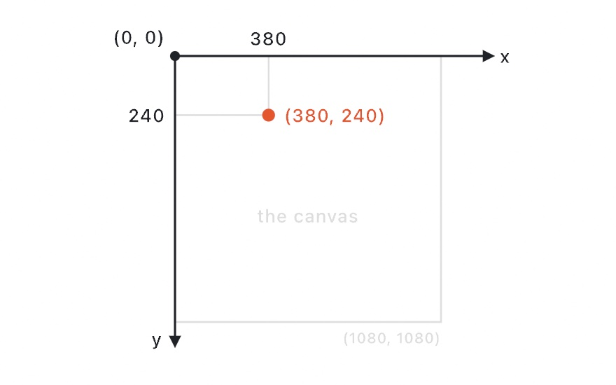

#### [Ollin](../README.md) → Guide

---

# The Ollin Guide

*A practical introduction to creative coding.*

This guide teaches creative coding from zero, using [Ollin](../README.md). You write small programs called sketches that draw, move, and react. Along the way you learn the techniques the field is built on: randomness, noise, forces, flocks, shaders, simulation, and 3D. Each chapter teaches a few ideas through short runnable steps, and the steps build a finished sketch you made yourself.

**Who it's for.** Anyone who can program a little, in any language. You don't need to know Swift, because the guide teaches what you need as it comes up, and [Appendix A](A-JustEnoughSwift.md) is a primer. You don't need a background in math, graphics, or shaders either. If you can write a loop and a function, you can start.

**What you need.** A Mac running macOS 26 or newer, and this repository. That's it.

**Where this sits.** The guide is the narrative layer, written to be read from start to finish. The [API reference](../Docs/README.md) answers the question "what does this call do", and [`Examples/`](../Examples/) is working code to browse. Chapters link into both as you go.

## How the guide is made

Four rules shape every chapter:

1. **Concepts come before they're used.** A concept appears in the guide, with a picture, before any listing or figure leans on it. When math shows up, it comes with a visual and a plain-words intuition first, and the code after. If you still get lost on a page, [Appendix B](B-JustEnoughMath.md) explains every math idea in the guide again, with a picture for each.
2. **Every listing compiles.** Each full listing is a real file under [`Figures/`](Figures/), compiled and rendered by a tool in this repository. The shorter fragments are checked against the framework too. When a framework change breaks a listing, the build of the figures fails and names it.
3. **Every image is rendered by the code beside it.** Ollin renders every figure and diagram from committed source. You can open any of them, run it, and change it.
4. **Something reaches the canvas on the first page.** Each chapter puts something on your canvas within its first page. Its steps then build a finished sketch, and the techniques that sketch does not use follow it in family sections.

Both kinds of image are already on this page. The grid above is thirty-two of the sketches the chapters build, each a committed figure, one per cell, and the first of them is [`Figures/01-HelloOllin/HelloMotion.swift`](Figures/01-HelloOllin/HelloMotion.swift). The [Chapter 1](01-HelloOllin.md) diagram below is a sketch too, [`CoordinateSystem.swift`](Figures/01-HelloOllin/CoordinateSystem.swift):

<picture>
  <source media="(prefers-color-scheme: dark)" srcset="Images/01-HelloOllin/CoordinateSystem-dark.jpg">
  
</picture>

## How to read it

Read the chapters in order the first time, because each one builds only on the ones before it. It also helps to know roughly what each part is going to ask of you. The page counts reckon three hundred words of prose to a page, listings aside.

- **Part I, chapters 1 to 9.** Around 135 pages. It is the base everything else stands on, so it is the one part you cannot skip.
- **Part II, chapters 10 to 14.** Around 60 pages. The rest of the guide depends on chapter 10 more than on any other chapter, so do not skim it.
- **Part III, chapters 15 to 17.** Around 45 pages, the shortest part. Read chapter 15 first, because the curves and marks after it come back as the shapes it teaches you to hold.
- **Part IV, chapters 18 to 25.** Around 125 pages. Chapter 18 is its gate, because chapters 21 to 23 and 25 write shader code of their own. Chapters 20 and 21 filter the layers chapter 19 makes.
- **Part V, chapters 26 to 33.** Around 150 pages, the longest part. Chapter 27 is its gate, and chapter 30 also wants the physics from chapter 11.
- **Part VI, chapters 34 to 38.** Around 85 pages. Chapter 37 builds on chapter 35's depth frames, so read those two in order. The others barely depend on each other, so read the ones you need in any order.
- **Part VII, chapters 39 to 45.** Around 135 pages. Chapter 41 plays the instruments chapter 39 builds, and chapter 43 replays a performance through chapter 41's exports.

A few chapters are better with hardware beyond the Mac. For [Chapter 35](35-Seeing.md) you want a webcam, and for [Chapter 37](37-ThePhoneAsASensor.md) an iPhone, with a LiDAR sensor for its depth streams. [Chapter 38](38-Listening.md) wants a microphone, [Chapter 39](39-ControlsAndSignals.md) a MIDI controller, and [Chapter 46](46-Installations.md) a lighting node or a projector. Each of them except Chapter 37 starts with what you can do on the Mac alone, and for depth that path is [Chapter 36](36-Depth.md). You can skip any of that hardware, and nothing later in the guide breaks.

Work along in the live-reload host, `swift run OllinLive path/to/YourSketch.swift`. It recompiles your sketch on save, so the window never closes while you experiment. [Chapter 1](01-HelloOllin.md) sets this up.

If you're coming from p5.js or Processing, [Appendix C](C-ComingFromP5.md) maps what you already know onto Ollin. [Appendix E](E-ComingFromOpenFrameworksAndOPENRNDR.md) does the same for openFrameworks and OPENRNDR. If you're new to Swift, [Appendix A](A-JustEnoughSwift.md) and the [Swift quick reference](../Docs/Swift.md) cover just enough of the language to be productive.

## Contents

### Part I: Seeing something move

1. **[Hello, Ollin](01-HelloOllin.md).** Your first sketch, what creative coding is, the draw loop, coordinates, shapes and draw order, and motion by default. It also sets up the workflow the rest of the guide uses: live reload, tunable parameters, dragging a shape into place, and the `ollin` command. Then a sketch that waits: one frame on request, the pointer's shape, a file from the open panel, and the frame on the clipboard.
2. **[Color that works](02-Color.md).** Naming colors, thinking in hue, mixing that matches what your eye expects, hues kept at one weight, harmonies grown from one color, palettes and ramps, and gradients used as paint. Then mixing the way paint does, color worked out from wavelengths of light (a soap film's among them), palettes built around one hue, how far apart two colors look, and shades whose hue drifts the way a painter's does.
3. **[Motion and time](03-MotionAndTime.md).** Time and the frame, sine and cosine explained simply, phase, the clock wrapped into laps, shaping functions drawn as curves (map, lerp, smoothstep, easing), and a loop exported as a GIF. Then the motion Ollin runs for you: a sway in one call, values that chase, timelines, timers, reduced motion, and knowing an export.
4. **[Randomness](04-Randomness.md).** Random values, seeds and why a run repeats, chance as a yes-or-no and a which-one, the uniform and Gaussian shapes, and finding a variation to keep. Then random walks and a Markov chain over a palette, scatters that are random but even (blue noise and the Halton and Sobol sequences), and breeding variations by eye.
5. **[Noise](05-Noise.md).** What Perlin noise is, a drift that swings both ways, the zoom multiplier, a field in two dimensions, time as the third, a drift that comes home to loop, and layers that add detail. Then the other fields: simplex, cellular, folded, and warped.
6. **[Grids and repetition](06-GridsAndRepetition.md).** The grid helper, transforms that move the paper, symmetry by hand and the kaleidoscope fold, and clipping. Then a cell that is a whole canvas, the grid's hex and triangle cousins, recursive panels, and a spiral of numbers.
7. **[Tiles that cover the plane](07-Tiles.md).** Tiles that agree at their edges: Truchet's two tiles and the doorway rule, the ten-print maze of diagonals, and the strands taken back as values you stroke yourself. Then the relatives: hitomezashi, perfect mazes, kolam and sona, and Celtic knotwork; polyominoes and Wave Function Collapse from tiles or from a picture; and past the repeating grid, aperiodic tilings (Penrose, Wang, girih, and the single-shape spectre), a ring where every window appears once, hyperbolic tiling on the Poincaré disk, and parquet deformations.
8. **[Words](08-Words.md).** Drawing text, the three kinds of font, letters as geometry you can warp and respace, and a passage set with both edges flush. Then letters drawn one at a time, text in every script, and writing down the page.
9. **[Pictures and data](09-Pictures.md).** Reading a picture as data: loading it, keeping a working copy, and asking it for the color under a point. Then a picture dropped on the window, fitted to a box or carved narrower, and the other ways to answer a pixel: a palette taken out of a photograph and dithered back into it, glyphs, halftone dots, and mosaics made of pictures, stipple and one unbroken line, toured or sorted along a space-filling curve, thread between pins, sorted pixels, and a shape hidden in an autostereogram. Then numbers from CSV and JSON, and how a column becomes marks.

### Part II: Systems that come alive

10. **[Vectors, gently](10-Vectors.md).** Vectors as arrows you add, subtract, scale, and divide, a point part of the way between two, length and direction taken apart, then position, velocity, and acceleration on one body, steering toward a target, and a swarm of a few hundred chasing a lure.
11. **[Forces and physics](11-ForcesAndPhysics.md).** Forces by hand and why mass matters, then a physics world: particles that pile, springs and pins, rigid bodies that tumble, hinges, grabbing with the mouse, and shapes that break. Then the assembled systems: a limb that reaches, gravity at scale, a graph that lays itself out, and a soft body from any outline.
12. **[Flocks and swarms](12-FlocksAndSwarms.md).** One creature that steers (seek, arrive, wander) and trails from a canvas that is never cleared, then flocking from three local rules, the assembled flock and the grid that keeps it cheap. Then the other crowds by rule: chases that trace curves of pursuit, a crowd that makes room, and fireflies falling into step.
13. **[Growing things](13-GrowingThings.md).** A recursive tree, L-system grammars, veins that claim space toward scattered points, and frost from frozen walkers. Then the other growers: grammars whose symbols carry numbers, rules over shapes instead of letters, the spark that grows by voltage, a line that folds as it crowds itself, cracks that make cities, and a river that wanders.
14. **[Fields and flow](14-FieldsAndFlow.md).** The two kinds of field, a number or a direction at every point, then the direction field, streamlines, and evenly spaced flow. Then contours where a number field equals something, the still lines of a ringing plate, particles carried along, a whole layer combed at once, and a field you pin down through scattered values.

### Part III: Shapes, lines, and marks

15. **[Shapes as material](15-ShapesAsMaterial.md).** Geometry you keep and edit as data: contours and shapes with holes, booleans, and offsets, then Voronoi territories, hulls and the medial axis, and hatching for pen plotters, composed into a plate, with how a plot runs. Then the questions an outline answers, the ways it bends (along a curve, toward a point, into a patch with curved sides, and into a few curves), the regions a drawing encloses, and the segment, arc, and ellipse as values that know where they cross, packing by growth and by rule (the Apollonian gasket and Ford circles) and rectangles packed by fit, fitting and the straight skeleton, SVG import, and crease patterns that fold and cut the paper itself.
16. **[Curves and figures](16-CurvesAndFigures.md).** Figures that come from a rule: Hobby's spline through your points, the curves you can write down (Lissajous figures, roses, spirographs, superellipses, guilloche, harmonographs), spirolaterals and when they close, and corners eased along clothoids. Then envelopes and caustics, Fourier epicycles, morphs, mirror anamorphosis, and a turtle you drive from code.
17. **[Marks and media](17-MarksAndMedia.md).** Strokes with a hand in them: width profiles, stroke dynamics, brushes that stamp a tip, and dashes, then a marbled sheet poured from bent outlines and initials written into its heart. Then watercolor, pigment from one polygon deformed and stacked, strokes and fills made in a material, from pencil and oil to glass and stone, a pen whose ink soaks the paper where the hand slowed, and many small marks built from one gesture.

### Part IV: Pixels and light

18. **[Your first shader](18-YourFirstShader.md).** Per-pixel thinking, uv space, writing a `shade` function, distance shaped by smoothstep, time and parameters, and the shader library, composed into an aurora. Then the shaders Ollin ships, the design generators, the pattern fields, and the material textures (rust, verdigris, terrazzo) with the filter that smooths their edges, and the other ways to a shader: chains patched in Swift, a GLSL shader brought over, a helper shared by an include line, a file checked on its own, and a shader as the paint a shape is filled or stroked with.
19. **[Layers and effects](19-LayersAndEffects.md).** Off-screen layers, the filter catalog, and blend modes, then what a canvas keeps across frames: every mark, or its own warped past. The tone map rolls off light brighter than the screen, and it all composes into comets. Then a stack declared in one block, a running mean that settles instead of brightening, and what to do when a frame gets slow: the cost row and batches. Last, wipes that take a layer in an order and copies that lay it out again.
20. **[Pictures restyled](20-PicturesRestyled.md).** Filters that make a photograph into another kind of picture: brushwork and hatching along the picture's flow, a colorist's look, the film look, and the paper it is printed on, stacked into a hand-colored print. Then ink lines and flat regions.
21. **[Glass, chrome, and tape](21-GlassChromeAndTape.md).** Filters that stand in for a physical thing: materials built from a silhouette, airbrushed lettering chrome, chromatic aberration, a lens's barrel, a corner pin, a channel mixer, and the looks of tape, a codec, a lens, and paper, stacked into a title card. Then holographic foil and bubble wrap, and the filters that read a layer as height, tone, a center, a ring, a pour, a depth, a density, or hot air.
22. **[Pictures you solve](22-PicturesYouSolve.md).** Layers treated as problems to solve: a sky diffused from a few marks, a distance field measured from every silhouette, and light worked out from a scene and its lamps, composed into a lighthouse at dusk. Then a seamless paste, the frequency domain, local averages at a flat price, and an edge a layer was not drawn with, glowing too.
23. **[Iterated forms](23-IteratedForms.md).** Pictures made by applying one rule over and over: the chaos game, a chaotic map laid down as a density plate, circles used as mirrors, and a Kleinian curve, composed into a plate of four orbits. Then fractal flames and Schottky circles, order turning into chaos in the bifurcation diagram, a ball in a room, and the double pendulum, and iteration at every pixel: escape-time fractals and the Buddhabrot, Newton's basins, domain coloring, and complex arithmetic in a shader of your own.
24. **[Simulations on a grid](24-GridSimulations.md).** Fields that carry their own state on the GPU and change it by a local rule: the Game of Life on a field you seed by drawing, a field read as data and given a look, and reaction-diffusion, grown into an organism. Then predator and prey and multi-scale Turing, fluid, ripples, and self-warp, falling sand and watercolor, and a rule of your own as a kernel.
25. **[Automata](25-Automata.md).** Rules that run on a grid of cells, each cell reading only its neighbors: percolation, a grid of coin flips that joins into one cluster past a threshold, and the forest fire, composed into a wildfire that burns the forest percolation planted. Then more automata from Wolfram's rows and turmites to Lenia, SmoothLife, excitable media, and the circuits of Wireworld; the sandpile, whose avalanches come in every size; and crowds that cross a threshold together in Schelling's board, the Ising model, and oscillators on a lattice.
26. **[Simulations made of particles](26-ParticleSimulations.md).** A buffer of individuals updated by one small program on the GPU: a million grains, the step's own names, a parameter that reaches it, and grains drawn as light, composed into a drift of a quarter of a million particles. Then a million following a strange attractor, particles that steer by a picture the sketch draws, the systems that give particles neighbors (Particle Life, the Primordial Particle System, slime mold, and the flock at scale), particles as matter (Particle Lenia, SPH fluid, and jellies), three searches (an ant colony, evolution, and swarm chemistry), and the same step run over a grid of cells (`Simulation`).

### Part V: The third dimension

27. **[3D, gently](27-3DGently.md).** A camera and how to find it again, the world's axes and units, depth, the solids and the triangles and normals inside them, transforms that build structures, light and the shadows it throws, and materials. The steps end in a sculpture court. Then a light with a body and the seam under a resting thing, air you can see, the inked cartoon look, hidden-line solids, and matcaps, flat drawing placed at a depth and the depth buffer's own effects, and a word made solid.
28. **[Meshes and maps](28-Meshes.md).** A mesh loaded from a file and wrapped in a picture, a crude cage rounded by the computer, depth carved from a picture, a picture projected from three sides, detail for a close look, and a stamp across the scene, composed into a raked garden. Then maps for relief, wear, and glow; a whole scene loaded with its camera, lights, and motion, and taken apart into code; and meshes cut, joined, carved from shadows, grown until they fold, and swept along a path, and the Hopf fibration.
29. **[Materials and surroundings](29-MaterialsAndSurroundings.md).** Finishes you set with numbers, starting from environments as the light: metal and non-metal, the brushed streak, glass, coated paint and cloth, and skin, composed into a bench of five specimens. Then clouds, the haze over distant ground, smoke placed in the scene as a volume, the thin film, and the hologram's grating.
30. **[Landscapes and multitudes](30-Landscapes.md).** Ground grown from noise and weathered by rain, then ways to draw more copies of something than you could place by hand: instanced meshes, copies scattered over a surface by area, a world cut down to what the camera sees, and grass that is drawn without ever being built, composed into a valley. Then the water on the land, rivers read off the ground and a sea made from its own waves, and a courtyard of lamps that each light only their own corner.
31. **[Worlds with weight](31-WorldsWithWeight.md).** Rigid bodies in the 3D scene, a machine of hinges driven by one motor through a gear, and collision groups that let its parts touch without jamming, composed into a contraption that one motor runs. Then contacts, sensors, and queries; degrees of freedom and path checks; tracks, pulleys, and structures that stand on their own cables; water that bodies float in and ground from a landscape or a file; and snapshots of a settled world.
32. **[Characters, vehicles, and cloth](32-CharactersAndCloth.md).** The three things a rigid body models badly, each handled its own way: a figure you walk with the keys, a vehicle on sprung wheels you drive, with a machine on tracks beside it, and cloth pinned to hang, composed into a yard you walk and drive through. Then ragdolls that fall and stand, a cape a skeleton carries, ropes that know how they are turned, and cloth among the contacts and on the water, and all three kinds in a snapshot.
33. **[Sculpting with fields](33-SculptingWithFields.md).** Shapes stored as distance: fields that melt together through the smooth minimum, flat and in space, drawn by sphere tracing, bent whole by distortions, and lit like meshes, composed into a molten sculpture of four lobes. Then the other verbs, joinery, the block form, the sculpt block, and a field rebuilt from cubes; space folded into copies and the fractal leaves; and fields turned into meshes, from metaballs to corners kept sharp.
34. **[Traced light](34-TracedLight.md).** Light followed past the first surface, with mirrors that see off screen, a glossy floor, bounce light, and caustics, then what the camera does with each frame: edges that settle, the streak a shutter leaves, and lens flare, composed into a lamplit room. After it come the path-traced still and its grain filter, mirror tunnels and highlights that hold still, the shape of a blur, the frame through the camera's lens, and depth of field built from samples of light, and a changing mesh, fewer pixels, and fewer frames.

### Part VI: The world coming in

35. **[Seeing](35-Seeing.md).** The webcam as a picture, with a still or a film standing in, and trackers that read it as typed values, down to the picture's motion as a field, composed into a brush that paints with motion. Then hands, faces, and bodies to steer by, the person lifted out as pixels, outlines and print, one thing followed, labels and saliency, models of your own, the camera frame as the light and the surface of a 3D scene, the screen as a source, and slit scan.
36. **[Depth](36-Depth.md).** What a depth frame is, one frame stood up into a point cloud, and many frames fused by their poses into one room, all on any Mac with a pretend depth camera, composed into a ghost room that scans itself. Then drawing inside a depth frame, keeping a long scan straight, and turning the cloud into a surface.
37. **[The iPhone as a sensor](37-ThePhoneAsASensor.md).** The real sensors, which are recorded clips, a live stream, and the capture app. The body the phone sends as a skeleton in meters, read from a film when no phone is there, composed into the dancer in solids. Then the phone's other streams: the room it builds, its surfaces and light, hands and gaze, text, attention, motion, and printed markers, and the phone itself as a wand, ears, a touch pad, and a barometer.
38. **[Listening](38-Listening.md).** Where sound comes from, what an analyzer hears in it (loudness, the spectrum as bands, and beats), and how to map what it hears onto a picture, composed into the Resonator, which throbs on every beat under a crown of spectrum spokes. Then the note being sung, and words and named sounds.
39. **[Controls and signals](39-ControlsAndSignals.md).** Everything that steers a sketch from outside the inspector. MIDI and OSC bound straight to your parameters, musical time from MIDI clock and Link, game controllers, the weather outside, and a knock sent back to the trackpad, composed into a weather rose. Then the trackpad's pinch and turn, typed text, TUIO tables, serial and Bluetooth sensors, parameters published over OSCQuery, a curve and a row of bars drawn in the inspector, `@Smoothed` for values that are not parameters, and feeds that poll a server or hold a stream open.

### Part VII: Out into the world

40. **[Making sound](40-MakingSound.md).** A sketch that plays sound: synths and the voices inside them, physical models of a string, a struck shape, a bow and a tube, and a chain of effects that ends in a room you can draw, composed into a workbench you play with the mouse. Then instruments built by patching or from recordings, wavetables and grains, more effects including one of your own, and expression under the finger.
41. **[Music by rule](41-MusicByRule.md).** Which notes, and when: beats and steps, rhythms spread evenly and swung, a short primer on pitch, scales, chords and arpeggios, a chain that learned a phrase, and a progression, composed into a music box that draws its own score, writes a MIDI file, and keeps its sound in an export. Then a sequencer and an arpeggiator, other tunings, a beat followed in the room, numbers played as notes, reading MIDI files, and sound placed in a 3D scene.
42. **[Finishing a sketch](42-FinishingASketch.md).** The finishing practice: exports that run without a window, a keeper picked from a contact sheet with its seed and parameters fixed, sizes for the output, video, GIF and a loop, SVG and PDF for a pen, a description, and the recipe the file carries, composed into a contour chart. Then stills from code, finer, in linear light, or brighter than white; transparent video, broadcast rates, slow motion, settled frames, and motion blur drawn from subframes; and a page that plays in a browser.
43. **[Making it physical](43-MakingItPhysical.md).** A sketch taken off the screen: G-code for a plotter, laser, or router, a 3D scene as lines, separations for printing one ink at a time, and a 3D print, composed into a printed knot that leaves as a plot, two plates, and a file to print. Then stitches for an embroidery machine, DXF for a shop, wood grain, frost, crackle, and ikat as lines a pen draws, and the rings a drop of ink leaves, a proof of the press on screen, the four process plates, and the plates slipped out of register, and USDZ models and spatial video.
44. **[Performing](44-Performing.md).** Live coding on stage, with each change evaluated over the running picture, the set recorded as a take, and looks saved as cues to call back, composed into a set in five evaluations. Then completion, a controller, and the drag on stage; replay; keyframes, the timeline, and a show's timecode; parameters written as rules; and live feeds into other apps.
45. **[Handing it over](45-HandingItOver.md).** A sketch handed to the Mac as a screen saver, a wallpaper, a menu-bar strip, or a widget that shows the day in pictures, and to a friend as a signed app, composed into a sky clock that follows the hour. Then the sketch on a phone, installed or shown from the Mac, and behavior and packages for other programmers.
46. **[Installations](46-Installations.md).** A sketch left running in one place for days: the one-line declaration, a clock that lasts a week, checkpoints, restarts, and opening hours, then light sent to lamps over DMX, composed into a wall of bars that lights a strip of lamps. Then a lighting console and a show laser, projectors fitted and one sketch across many screens and machines, and ways to keep watch from the floor. The guide closes with where to go next.

### Appendices

- **[A. Just enough Swift](A-JustEnoughSwift.md).** The core of the language, for people coming from other languages, then most of the rest of the Swift you'll see in listings.
- **[B. Just enough math, visually](B-JustEnoughMath.md).** Every math idea in the guide, each with a picture.
- **[C. Coming from p5.js and Processing](C-ComingFromP5.md).** A side-by-side translation.
- **[D. The complete toolbox](D-CompleteToolbox.md).** Everything Ollin can do, one row each, grouped by part and chapter, with the section that teaches it and its page in the reference.
- **[E. Coming from openFrameworks and OPENRNDR](E-ComingFromOpenFrameworksAndOPENRNDR.md).** The big moves from either one, each shown beside Ollin's.

---

If something is confusing, or you get stuck anywhere, that is a bug in the guide, not in you. Please [open an issue](https://github.com/eaviles/Ollin/issues).
